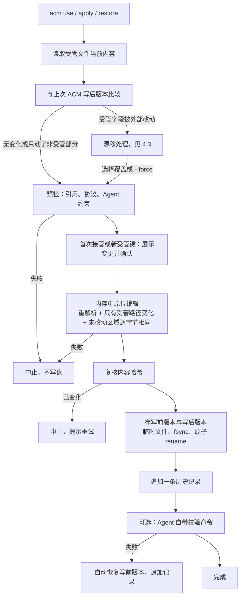

<!-- // Ver 2026-10-19 23:30, by Claude Opus 5.5 -->

# ACM 写入安全与版本历史：设计方案（rev.2）

> **意图复述**：围绕两个目标设计 ACM 的配置变更机制——① 改的时候不改坏现有配置；② 能查看历史并恢复到历史版本（包括"用 ACM 之前的原始状态"）。对比 Magpie 与旧版 ACM，以最简单且足够的方式定案。
>
> **rev.2（2026-10-19）**：回应"只像 Magpie 那样保留首次原始状态是否更简单有效""中间状态要不要记、下次启动发现文件又变了怎么办"两个问题，把 rev.1 的"每次运行都记录观察到的版本"收窄为"**只在 ACM 写入时记录写前、写后两个版本**"，删去 `snapshot`、独立 `diff` 命令与 `observed` 事件类型；新增 §4.3"再次运行时发现文件已变化"的完整处理规则。
>
> **配套文档**：`docs/ACM_Rebuild_Action_Plan_opus-5.5.md`；`docs/ACM_Ephemeral_Run_Design_opus-5.5.md`（临时启动，与本文互补：临时启动根本不写文件）。

---

## 0. 结论摘要

**只记首次原始状态（Magpie 的做法）够不够？** 对"彻底退出"够；对"上次改坏了，回到上一个能用的状态"不够——而后者是最常见的恢复需求。好消息是，二者的实现成本几乎相同：把"首次写入前存一份副本"改成"每次写入前都存一份（相同内容只存一次）"，是同一段代码少写一个 `if`。因此结论是**以 Magpie 的思路为基础，只多记一点点**：

| 记什么 | 何时 | 用途 |
|---|---|---|
| **原始版本**（baseline） | ACM 第一次写某个文件之前，文件当时的样子 | 彻底退出：`acm restore --baseline`；永久保留 |
| **每次写入的写前版本、写后版本** | 每次 `acm use` / `apply` / `restore` 写盘时 | 回到上一次：`acm rollback`；回到某一次：`acm restore <编号>` |
| 不记 | ACM 两次写入之间的外部改动不单独记录 | 它们会作为下一次写入的"写前版本"被自然保存下来 |

**下次运行时发现文件变了怎么办？** 按变化落在哪里分开处理（§4.3）：只动了非受管部分（Agent 写入登录态、你自己加了 hooks）→ 正常情况，不打扰；动了受管字段（在 Agent 里切了模型、其他工具改了端点）→ 视为漂移，`status` 明确列出改了什么，写入默认阻断，交互模式下让你选择"覆盖 / 不再管理这个 Agent / 放弃"；文件结构变了或损坏 → 置 ERROR，绝不盲写。

**与 Magpie、旧版 ACM 的对比**见 §1、§2；**防止改坏的九道防线**见 §3。

---

## 1. Magpie 现状（2026-10-19，源码 `33dbdcc` 核实）

### 1.1 机制

| 机制 | 实现位置 | 做了什么 | 局限 |
|---|---|---|---|
| 原子写入 | `internal/edit/file.go` `WriteAtomic` | 临时文件 + rename；保留权限与属组；符号链接写到目标、保留链接；有其他硬链接时原位写 | 写入前不保留副本 |
| stash（原值暂存） | `internal/agent/stash.go` | 首次接管时，把要写的那些键的原值记在全局 `stash.json`；断开时写回 | 只有一代；断开后删除；接管期间的中间状态不记 |
| before-magpie 文件副本 | `internal/agent/agents.go` `beforeMagpie` | 首次写入前复制整个文件为 `<file>.before-magpie`；断开时，仅当断开后的内容与副本语义相同才写回 | 只用于 Pi 类与 MothX；Claude Code、Codex 等没有 |
| Profiles | `internal/profile` | 把各 Agent 当前字段取值存成命名组合，可切回 | 存的是取值，不是文件版本 |
| 重新接线 | `rewire.go`、各 Agent 的 `Sync` | 端口/密钥变化、目录变化、启动时，重写它管理的配置 | 常驻进程会主动把配置改回它认为正确的样子 |

### 1.2 你遇到的问题对应哪里

- 能回到的只有"接管前"这一个点，且只能通过"断开 Magpie"回去；
- 对多数 Agent 没有整文件副本，写坏了受管键以外的内容无从找回；
- 常驻进程会重新写入，你手动改回去之后可能又被写回——"强行要求用它的"的来源；
- 没有历史视图。

公平地说，Magpie 单次写入的质量很高（原位编辑、保留注释、原子写入、链接与权限保真），这些 ACM 应该照学；它缺的是"上一次"这个维度，以及"不抢回配置"。

### 1.3 对比总表

| 维度 | Magpie | 旧版 ACM（v0.3 已实现） | 新 ACM（本方案） |
|---|---|---|---|
| 单次写入 | 原位编辑 + 原子写 | 解析后整体重写 + 原子写 | 原位编辑 + 原子写 + 三重写后校验 |
| 保存哪些版本 | 接管前（部分 Agent 有整文件，多数只有键值） | 每次写前整文件 | 接管前 + 每次写前、写后（同内容只存一份） |
| 可回到的点 | 接管前 | 上一次写入前 | 接管前、上一次、任意一次 ACM 写入前后 |
| 恢复粒度 | 受管键；少数 Agent 整文件 | 整文件（会打掉 Agent 期间写入） | 默认受管字段；可选整文件 |
| 外部改动受管字段 | 跟随（如 Agent 内切模型时 Magpie 跟着调整） | 漂移，阻断 | 漂移，阻断，并说清改了什么、给出选项 |
| 历史查看 | 无 | 无 | `acm history` |
| 会不会主动改回 | 会 | 不会 | 不会（不常驻） |
| 完全退出 | 断开即恢复受管键原值 | 未实现 | `restore --baseline` |

---

## 2. 旧版 ACM 的尝试为什么显得复杂

旧设计规划了四套结构——字段级操作日志（Journal）、`last_write.json`、按事务分目录的快照、派生的所有权视图——彼此需要保持一致，于是又需要"派生视图"来协调。实际只实现了"整文件快照 + last_write"，且回滚是整文件覆盖，会把 ACM 写入之后 Agent 自己写进去的内容一起抹掉。

复杂的根源是**存"操作"**。新方案改为**存"结果"**：配置文件很小，每个版本存全文；两版之间改了什么、漂移与否，需要时用格式层现算。于是 Journal、last_write、所有权视图都不需要了。

---

## 3. 目标一：不改坏

### 3.1 失败模式与防线

| # | 失败模式 | 防线 | 失败时 |
|---|---|---|---|
| F1 | 写出的文件语法错误 | 写后在内存中用同一解析器重新解析 | 中止，不落盘 |
| F2 | 改动波及受管键以外的内容 | 语义树比较：只允许受管路径不同；原位编辑器另加"未改动区域逐字节相同"检查 | 中止 |
| F3 | 读与写之间文件被别人改了 | 落盘前复核内容哈希与读取时一致 | 中止，提示重试 |
| F4 | 写到一半崩溃或断电 | 先存写前版本，再写临时文件、`fsync`、原子 rename | 原文件不受影响 |
| F5 | 符号链接、硬链接、权限被破坏 | 写到链接目标、保留链接；保留权限与属组；有其他硬链接时原位写（借鉴 Magpie） | — |
| F6 | 取值错误：模型名不存在、协议不匹配、key 错误 | 写前预检：引用必须在目录中且在该 Agent 的协议上可达；适配器协议约束（如 Codex 只接受 Responses）；Manifest 拉取已用同一把 key 完成鉴权 | 写前中止，给出原因 |
| F7 | 违反 Agent 自身约束（Kimi 拒绝悬空 `default_model`；OpenClaw 配置无效时网关起不来） | 适配器编码这些约束并由金样覆盖；Agent 有校验命令时，适配器可声明写后校验，失败自动恢复写前版本 | 自动退回，告知原因 |
| F8 | ACM 映射逻辑写出的不是你想要的 | 首次接管某 Agent 或出现新受管键时，先展示变更并确认（`--yes` 跳过）；`--dry-run` 随时可用；最后一道保险是恢复 | 拒绝即不写 |
| F9 | 写入没错但不生效（更高优先级来源覆盖） | `status` 检测并提示 | 不阻断，显式提示 |

**原则**：写前必有可恢复的版本，写后必有校验；任何校验失败要么不落盘，要么自动退回写前版本。不会停在"被改了一半"的状态。

### 3.2 一次写入的流程



---

## 4. 目标二：查看与恢复

### 4.1 数据模型

**版本库**：`~/.acm/state/objects/<哈希前两位>/<SHA-256>`，文件某个版本的原始字节，0600，相同内容只存一份。

**历史记录**：`~/.acm/state/history.jsonl`，只追加，**每次 ACM 写入一个文件记一行**：

```json
{"seq": 41, "time": "2026-10-19T21:03:12+08:00", "op": 17, "agent": "claude_code",
 "file": "~/.claude/settings.json", "kind": "write", "cmd": "acm use team",
 "before": "9f3c…", "after": "a71e…", "external_before": true, "baseline": false}
```

| 字段 | 含义 |
|---|---|
| `op` | 同一条命令的多行共享一个编号（一次 `acm use` 可能改了 3 个 Agent） |
| `kind` | `write`（use/apply）、`restore`、`auto_revert` |
| `before` / `after` | 写前、写后版本的哈希；文件不存在用固定哈希表示，所以"ACM 新建了文件"也能恢复（恢复为不存在 = 删除） |
| `external_before` | 写前版本是否与上一次 ACM 写后版本不同——即这期间有外部改动。它不是单独一条记录，只是一个标记 |
| `baseline` | 该文件的第一条记录为 true，其 `before` 即原始版本 |

一致性顺序：先存对象，再追加记录（单行 + `fsync`）。崩溃最多留下没被引用的对象，无害。

### 4.2 为什么不记 ACM 两次运行之间的变化

rev.1 曾设计"任何 ACM 命令（含 `status`）发现新内容都记一版"。收窄的理由：

- 两次 ACM 写入之间文件可能被 Agent 频繁改写（登录态刷新、会话记录），全部记下来会让历史里充满与你无关的噪音，也让含明文 key 的副本成倍增加；
- 真正需要恢复的状态都已被覆盖：ACM 写入前的那个状态（无论是你的、Agent 的还是别的工具留下的）就是这次写入的 `before`，一定会被保存；
- `status` 保持纯只读，概念更干净。

代价：如果某个工具在两次 ACM 写入之间先把文件改好、又改坏，中间那个"好"的版本 ACM 看不到。这类情况本来就不属于 ACM 能负责的范围。

### 4.3 再次运行时发现文件已变化

ACM 每次运行时，把每个受管文件的当前内容与"上一次 ACM 写后版本"比较：

| 情况 | 典型原因 | `acm status` | `acm use` / `apply` |
|---|---|---|---|
| **完全相同** | — | SYNCED / OUT_OF_SYNC（按配置意图判断） | 正常写入或幂等跳过 |
| **只有非受管部分变了** | Agent 写入登录态、插件记录；你加了 hooks、MCP | 不报漂移 | 正常写入；变化后的状态作为这次的写前版本被保存，记录上带 `external_before` 标记 |
| **受管字段被改了** | 你在 Agent 里用 `/model` 切换并被持久化；Magpie / CC Switch 改了端点；手工编辑 | DRIFTED，并逐项列出 `字段：ACM 写的值 → 现在的值` | 非交互：阻断，exit 2，除非 `--force`。交互：展示差异后三选一——**覆盖**（写入 ACM 的值）；**不再管理该 Agent**（ACM 从此不写它，`status` 显示 UNMANAGED，历史保留，随时可再接管或恢复）；**放弃** |
| **文件被删除** | 卸载重装 Agent、手工删除 | DRIFTED（受管字段全部缺失） | 同上；选择覆盖时按"新建文件"处理 |
| **结构变了**（受管路径无法解析） | Agent 升级改了配置格式 | ERROR，说明哪个路径对不上 | 不写；提示检查 Agent 版本，或 `acm restore --file` 回到之前的版本 |
| **文件无法解析** | 被某个工具写坏 | ERROR | 不写；提示用 `acm restore <编号> --file` 恢复最近一个能用的版本 |

关于原始版本的一个诚实说明：baseline 是"ACM 第一次写这个文件之前的样子"。如果在那之前 Magpie 或 CC Switch 已经改过它，baseline 就是被它们改过之后的状态——ACM 看不到更早的历史。

### 4.4 命令

```
acm history [<agent>] [--full]               # 列出历史；--full 附带整文件差异
acm restore <编号> [<agent>] [--file] [--dry-run] [--yes]
acm restore --baseline [<agent>] [--file]    # 回到 ACM 接管前
acm rollback [<agent>]                       # = 恢复到最近一次 ACM 操作之前
acm history prune --keep <N>                 # 显式清理；baseline 永不清理
```

`acm history` 输出示例（示意）：

```
claude_code  ~/.claude/settings.json
  #48  10-19 21:40  restore  op 19  model: coding → claude；HAIKU 槽: cheap → (无)   acm restore 12
  #41  10-19 21:03  write    op 17  model: claude → coding；HAIKU 槽: (无) → cheap    acm use team
                                    （写入前检测到外部改动：仅非受管部分）
  #12  10-15 14:02  write    op 3   model: (无) → claude                               acm use daily
                                    （原始版本已保存：acm restore --baseline）
```

恢复目标的含义：`acm restore 41` 指"回到 #41 写入之后的状态"；`acm rollback` 指"回到最近一次写入之前的状态"；`--baseline` 指"回到原始版本"。

### 4.5 恢复语义

| 模式 | 做什么 | 保留什么 | 适用场景 |
|---|---|---|---|
| **字段恢复**（默认） | 把目标版本中受管字段的值写到当前文件 | 当前文件的其他一切（Agent 后来写入的登录态、插件、hooks 等） | ACM 的模型配置改坏了，回到之前那套 |
| **整文件恢复**（`--file`） | 用目标版本替换整个文件 | 无（当前版本先被保存，可再恢复回来） | 文件被别的工具或 Agent 升级整体弄坏了 |

整文件恢复前展示"会丢失哪些非受管变化"并要求确认。任何恢复本身都是一次写入，有写前写后版本，所以都可以再撤销。

### 4.6 安全与存储

- 版本库里是完整文件内容，可能含明文 key：目录 0700、文件 0600；`history` 输出默认掩码；文档明示。
- 只在写入时存版本，数量与 ACM 写入次数同级（通常每周个位数），一年也就几百个小文件。
- 不自动清理；`prune` 显式执行，baseline 永不清理。
- 不用 git 作存储：多一个外部依赖和子进程，而"受管字段差异"仍要自己算；自建存储约一两百行。

---

## 5. 待确认事项（H1–H7）

> 下表 7 项是本方案需要你确认的决定，编号 H 取"History"之意，与 Action Plan 的 R1–R8 是两组不同的事项。

| # | 决定 | 推荐 |
|---|---|---|
| H1 | 记录范围 | **原始版本 + 每次 ACM 写入的写前、写后版本**；不记两次写入之间的变化（rev.2 收窄） |
| H2 | 命令 | **`history`、`restore`（含 `--baseline`、`--file`）、`rollback`**；不设 `snapshot` 与独立 `diff`（rev.2 删除） |
| H3 | 恢复默认语义 | **字段恢复为默认，`--file` 显式整文件** |
| H4 | 受管字段外部改动 | **阻断写入 + 明确列出改动 + 交互三选一（覆盖 / 不再管理 / 放弃）** |
| H5 | 首次接管确认 | **首次接管或出现新受管键时展示变更并确认** |
| H6 | 写后校验命令 | **适配器可选声明；失败自动退回**（哪些 Agent 有可用命令，在 P6 核实） |
| H7 | 不常驻 | **维持** |

---

## 6. 对 Action Plan 的影响

| 位置 | 变更 |
|---|---|
| 0.4.0 命令面 | 增加 `history`、`restore`、`rollback`（`release` 并入 `restore --baseline`） |
| P4 | 版本库 + 历史记录 + 漂移推导 + 字段 / 整文件恢复 + 漂移交互；约 2 天（rev.1 估 2.5 天，收窄后减少） |
| P4 故障注入 | 增加：对象已写记录未追加时崩溃；历史末行截断；对象缺失或损坏（恢复前校验哈希，损坏则拒绝并提示） |
| P6 | 各适配器核实是否有可用的配置校验命令（H6） |
| P8 真机实测 | 增加"配置被其他工具改坏 → `status` 报漂移 → `restore` 恢复"场景 |

---

## 7. 未验证假设与风险

| # | 项目 | 处理 |
|---|---|---|
| 1 | 各 Agent 是否有可在写后调用的配置校验命令 | P6 逐个核实；没有就依赖前面的防线 |
| 2 | 字段恢复时，Agent 已升级改了受管键的结构 | 适配器检测到不匹配置 ERROR，提示改用 `--file` 或手工处理 |
| 3 | 版本库中的明文 key | 权限控制 + 输出掩码 + 文档明示 + `prune` |
| 4 | Claude Code 的 `/model` 等操作是否会把模型选择持久化写回 settings.json，导致频繁漂移 | P6.1 真机观察；若频繁，再评估是否提供"该字段改为跟随 Agent"的选项（目前不做） |
