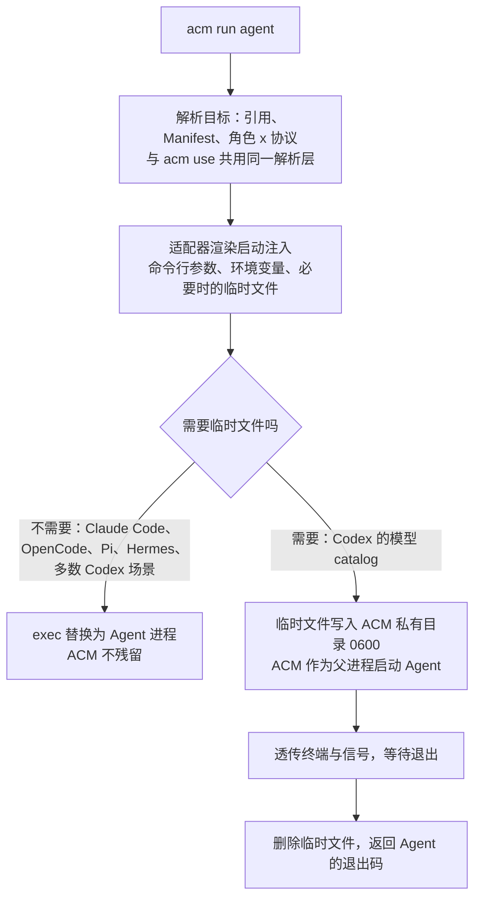

<!-- // Ver 2026-10-20 00:55, by Claude Opus 5.5 -->

# ACM 临时启动（`acm run`）：调研与设计

> **意图复述**：在不修改 Agent 默认配置文件的前提下，临时以某个模型、某套配置启动一个 Agent。例如 `acm run opencode -m vmr.coding`；或者只设置了 VMR 地址与 key 的环境变量，`acm opencode` 就自动拉取 Manifest、为 OpenCode 配好模型并启动。本文核实 CC Switch 与 Magpie 是否有此能力、如何实现，并给出 ACM 的方案。
>
> **范围**：In —— 竞品实现核实；价值判断；命令设计、执行机制、安全约束；与现有原则的冲突及修订。Out —— 各 Agent 的具体注入规则：这部分**统一维护在 `docs/ACM_Agent_Support_Matrix_opus-5.5.md` 的各规格卡"临时启动"段落与 §7**，本文不再重复，避免分散。
>
> **状态**：2026-10-20 确认纳入本批次（0.4.0），含 §4.5 的原则修订。
>
> **rev.2（2026-10-20）**：各 Agent 注入规则迁入支持矩阵，并在迁移中逐条核查。核查推翻了 rev.1 的三处判断：① Claude Code 不能靠子进程环境变量注入 key（settings.json 的 `env` 会覆盖 shell 导出值），改为内联 `--settings` + `apiKeyHelper`，从而零临时文件；② Hermes 有 `--base-url`，由"有限支持"改为"支持"；③ OpenClaw 的 `agent exec` 支持一次性任务，由"不适用"改为"仅一次性任务支持"。

---

## 0. 结论摘要

**值得做，已确认纳入 0.4.0。**

1. **它是最不具破坏性的投影**：不写任何 Agent 文件，"改坏配置"在这条路径上不存在。
2. **它是团队试用的最短路径**：新成员设好 VMR 地址和 key 两个环境变量，`uvx agent-config-manager run claude` 即可用，无需 `init`，也不留下任何持久配置。
3. **它是差异点**：CC Switch 只对 Claude Code 提供，且把 key 明文写进系统临时目录；Magpie 没有找到这个能力。

**可行性**：T1 的 6 个 Agent 都有官方的"只对本次启动生效"手段，其中 5 个能做到零临时文件、key 不出现在命令行参数里；OpenClaw 只支持一次性任务形态。逐项规则与核查记录见支持矩阵 §7。

---

## 1. 竞品核实

### 1.1 CC Switch（源码 `farion1231/cc-switch` @ `734c483`，2026-10-19）

功能名为"供应商终端"（Provider Terminal）：在供应商卡片菜单中打开一个新终端窗口，窗口里的 Claude Code 使用该供应商配置。实现（`src-tauri/src/commands/misc.rs` `open_provider_terminal`）：

1. 从供应商存储的配置中取出 `env` 字段（含 `ANTHROPIC_BASE_URL`、key 等）；
2. 在**系统临时目录**写 `claude_<供应商id>_<pid>.json`，内容为 `{"env": {...}}`；
3. 生成临时 shell 脚本，在新终端窗口中执行 `claude --settings <该文件>`，脚本用 `trap ... EXIT` 在退出时删除临时文件与脚本；
4. 适配 Terminal.app、Ghostty、Otty、Windows 等终端。

限制与问题：

- **只对 Claude Code 开放**：前端 `src/App.tsx:1254` 为 `onOpenTerminal: activeApp === "claude" ? setTerminalProvider : undefined`，启动命令固定为 `claude --settings`；
- **key 明文写入系统临时目录**：`std::fs::write` 使用默认权限，多用户机器上可能被他人读取；进程被强杀时 `trap` 不执行，文件残留；
- 依赖 GUI 弹出新窗口，不能在当前终端直接使用。

### 1.2 Magpie（源码 `33dbdcc`）

未发现对应能力：`internal/cli` 中没有 run / exec / launch 类命令，`docs/reference.md` 中也无相关描述（结论是"未发现"）。原因在架构：Magpie 让 Agent 永久指向本机网关，"临时换模型"靠 Agent 自己的 `/model` 在网关目录里选。这条路依赖常驻网关，ACM 不走。

---

## 2. 价值判断

| 场景 | 没有 `acm run` | 有 `acm run` |
|---|---|---|
| 新成员试用团队 VMR | `init` → `use`，配置被永久改写 | 设两个环境变量，`acm run claude`，什么都不改 |
| 对比两个模型 | 来回 `use`，每次改写全部 Agent | 两个终端分别 `-m vmr.coding`、`-m vmr.agent` 并行 |
| 只想这一次用某个模型 | 改了再改回 | 一条命令，退出即无痕 |
| 担心 ACM 改坏配置 | 依赖历史恢复 | 根本不写文件 |
| CI / 脚本中跑 Agent | 需在 CI 机器上 `use` | `acm run codex -- exec "..."`；OpenClaw 的 `agent exec` 本身就是一次性任务 |

成本（基于经验判断）：运行器约 1 天；每个 T1 适配器的启动注入约 0.25–0.5 天；合计约 2.5–3 天。它复用全部解析层，且绕开了写入引擎这一最高风险部分。

---

## 3. 设计

### 3.1 命令

```
acm run <agent> [-m <引用>] [--profile <名称>] [--manifest <url|file>] [-- <透传给 Agent 的参数>]
acm <agent> [...]          # 简写，等价于 acm run <agent>（agent 名不与任何子命令冲突时可用）
```

```bash
acm run opencode                         # 激活 profile 的 default 角色
acm run opencode -m vmr.coding           # 指定模型（限定 id）
acm run claude -m vmr@reasoning          # 指定角色
acm claude -- --resume                   # 简写 + 透传参数
VMR_URL=https://vmr.team.lan VMR_KEY=sk-... uvx agent-config-manager run codex   # 零配置
```

你设想的 `acm -model vmr:coding opencode`，按 ACM 统一的引用语法写作 `acm run opencode -m vmr.coding`（`.` 表示限定 id，`@` 表示角色），与 `config.yaml`、`acm use` 共用一套语法。

### 3.2 目标来源优先级

1. 命令行显式指定（`-m`、`--profile`、`--manifest`）；
2. 环境变量：`ACM_MANIFEST`（URL 或文件），或 `VMR_URL` + `VMR_KEY`——此时不需要 `config.yaml`；
3. `config.yaml` 中的激活 profile。

三者都没有时报错并提示用法。零配置模式下 provider 名取 Manifest 的 `gateway.name`（缺省为 `vmr`），角色解析与 `acm use` 完全一致。

### 3.3 执行方式



要点：

- **不写任何 Agent 目录下的文件**，不改 `config.yaml`，不写历史记录；
- 临时文件只放在 `~/.acm/state/run/<pid>/`（目录 0700、文件 0600），正常退出即删；被强杀留下的残留在下次任何 ACM 命令运行时清理；
- 能 `exec` 的场景直接替换进程；需要清理临时文件时，ACM 作为父进程等待 Agent 退出，透传终端、信号与退出码——只活到 Agent 退出为止，不是守护进程；
- **密钥不进命令行参数**（`ps` 可见）：一律经 Agent 原生的环境变量引用或凭据命令传入（各 Agent 的具体方式见支持矩阵 §7.1）。

### 3.4 与适配器的关系

适配器的纯函数增加第二种输出：

- `plan_files(target) -> FileChangeset`：用于 `use` / `apply`；
- `plan_launch(target) -> LaunchSpec`：用于 `run`（参数、环境变量、临时文件内容）。

两者在同一模块中由同一份映射表驱动，避免知识分叉。T2 成员在实际变量名经真机确认前，`plan_launch` 返回"不支持"并给出明确提示，不做猜测性注入。

### 3.5 原则修订（已确认）

PRINCIPLE v3 中把"Agent 启动包装"从 Out of Scope 移出，改为带约束的 In Scope：

1. 不写任何 Agent 配置文件；
2. 不安装任何持久化的东西（shell 别名、PATH 垫片、包装脚本）；
3. ACM 进程最长只活到 Agent 退出；
4. 注入的值必须来自与 `use` 相同的解析路径（引用、Manifest、角色），不允许旁路；
5. 临时文件只在 ACM 私有目录、0600、用后即删；密钥不进命令行参数。

原来排除"启动包装"的初衷是防止 ACM 变成常驻或劫持式的包装器，以上约束保留了这一初衷。

---

## 4. 支持范围与待确认项

支持范围、逐项依据与事实核查记录：支持矩阵 §7。概括：

| Agent | `acm run` |
|---|---|
| Claude Code、Codex、OpenCode、Pi、Hermes | 支持 |
| OpenClaw | 仅一次性任务（`agent exec`） |
| MiMo Code、DevEco Code、OmO、Prime Agent | 真机确认实际变量名 / 参数前默认关闭 |

尚待真机确认的 4 项（均记录在支持矩阵对应规格卡中）：Claude Code 置空 `ANTHROPIC_AUTH_TOKEN` 后是否回落到 `apiKeyHelper`；`apiKeyHelper` 子进程是否继承调用方环境变量；OpenClaw `--config-override` 中 `${VAR}` 是否替换；Hermes 只给 `--base-url` 时是否读取 `OPENAI_API_KEY`。
