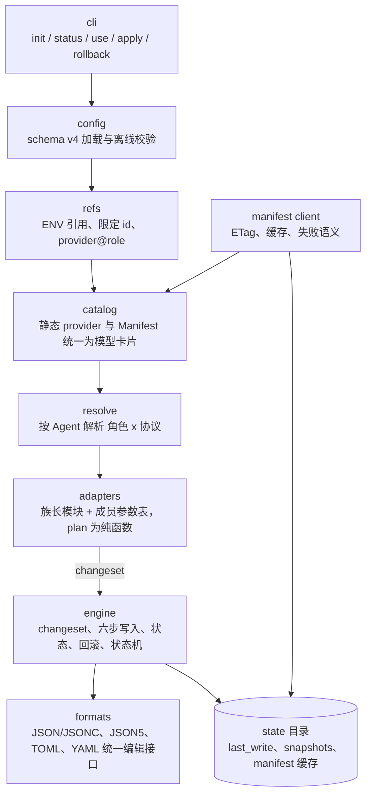

<!-- // Ver 2026-10-20 00:50, by Claude Opus 5.5 -->

# ACM 重建 Action Plan

> **意图复述**：ACM 现有代码是早期方案下的残缺实现。按"Manifest 方案"与"支持矩阵 rev.2"的新设计，从零评估现有代码，决定重建还是改造；给出可执行、可验收、分阶段的行动计划。**本文仅为待审方案，审核确认前不执行任何代码或仓库变更。**
>
> **范围**：In —— 现有代码评估与去留；目标架构；支持范围；分阶段任务、交付物、验收标准、检查点；需要你确认的决策。Out —— VMR 仓库内的实现细节（只列为并行轨道与接口约定）。
>
> **依据文档**：`docs/ACM_VMR_Manifest_Analysis_and_Design_opus-5.5.md`（Manifest 方案，D1–D4 已确认）；`docs/ACM_Agent_Support_Matrix_opus-5.5.md`（支持矩阵 rev.2）；`docs/ACM_Config_Safety_and_History_Design_opus-5.5.md`（写入安全与版本历史，下称"历史方案"）。
>
> **状态（2026-10-20）**：R1–R8 已确认；临时启动（含原则修订）已确认纳入本批次。待确认：历史方案 rev.2 §5 的 H1–H7。确认后从 P0 开始执行。

---

## 0. 摘要

| 问题 | 结论 |
|---|---|
| 重建还是改造？ | **重建 + 选择性移植**：按新架构从零搭建；现有代码中经审阅确认质量合格的 6 个小模块（锁、掩码、`${ENV}` 引用解析、快照、退出码映射、测试隔离与故障注入模式）按新接口改写后移植，其余全部归档 |
| 怎么归档？ | git 标签 `legacy-v0.3.0`（**不能用 `v` 开头**，否则会触发 PyPI 发布流程）+ 分支 `legacy/v0.3`；main 分支删除旧 `src/` 与 `tests/`，不在仓库内保留旧代码副本；旧治理文档移入 `docs/archive/` |
| 语言？ | **保持 Python 3.12**。ACM 的核心难点是"保留注释与格式的配置文件编辑"，Python 有该领域最成熟的两个库（tomlkit、ruamel.yaml）；分发走 `uvx` |
| 首个版本 | **0.4.0**，config schema v4，不兼容读取 v3（修正此前 D2，理由见 §9） |
| 支持范围 | T1（6 个，真机实测）：Claude Code、Codex、OpenCode、Pi、OpenClaw、Hermes；T2（4 个家族成员，仅金样）：MiMo Code、DevEco Code、OmO、Prime Agent |
| 工期 | 约 18–23 个工作日（AI 辅助编码，基于经验判断；含历史方案约 0.5 天、临时启动约 2.5–3 天的增量），分 9 个阶段、4 个需要你确认的检查点 |
| Codex 协议映射缺陷 | 不单独修复；旧适配器整体归档，该缺陷转为新 Codex 适配器的金样用例 |

---

## 1. 从零评估现有代码

### 1.1 现状

- 规模：源码约 2.7k 行（16 个模块 + 3 个适配器 + 3 个写入器），测试约 4.4k 行。
- 健康度：`uv run pytest` 共 **183 个测试全部通过**（2026-10-19 本地执行，5.5 秒）。代码不是坏的，而是**按旧设计做对了**。
- 版本：`pyproject.toml` 为 0.3.0；git 标签最新为 `v0.1.2`，即 PyPI 上只发布到 0.1.2，0.2.x/0.3.0 从未发布。外部用户实际为零，重建没有兼容负担。

### 1.2 与新设计的结构性不匹配

这些不是 bug，而是旧架构的地基与新需求不对齐，改造的成本接近重写：

| # | 旧设计 | 新设计要求 | 改造难度 |
|---|---|---|---|
| S1 | JSON 写入器"解析 → 改字典 → 整体重新 `json.dumps`" | JSONC（OpenCode）、JSON5（OpenClaw）必须保留注释与原始排版 → 需要"定位字节范围、原位替换"的编辑器 | 重写 |
| S2 | 字段路径用 `"a.b.c"` 字符串、按 `.` 切分 | 键本身含点（Claude Code 的 `modelSettings.claude-opus-4.6`、Pi/OpenCode 的模型 id）→ 路径必须是元组 | 贯穿所有模块的接口变更 |
| S3 | Safety Engine 内按文件后缀 `if .json / elif .toml` 分派 | 6 种格式（JSON、JSONC、JSON5、TOML、YAML，及未来 env）→ 需要统一的文档编辑接口 | 重写 |
| S4 | 适配器一 Agent 一模块、无家族概念 | 族长 + 成员参数表（T2 的前提） | 重写 |
| S5 | config schema v3：provider 单协议、无引用式目录、无角色 | schema v4：Manifest 型 provider、`provider@role` 引用、`roles` 轴、按"角色 × 协议"解析 | 重写 |
| S6 | VMR 探测读 `/v1/models`，拷贝进 YAML | Manifest 客户端（ETag、缓存、失败语义），引用不拷贝 | 重写 |
| S7 | 回滚 = 整文件快照恢复 | 公理 3 要求字段级回滚；快照只做 `--hard` 兜底 | 新增 |
| S8 | 只允许"编辑与 Agent 共享的文件" | Codex 需要 ACM 生成并独占的 catalog 文件（"自有文件"概念） | 新增 |

S1、S2、S3 三项触及几乎每个模块的接口；在旧代码上逐步改，会长期同时存在两套路径表示和两套写入方式。从零搭建反而更快、更干净。

### 1.3 逐模块去留

| 模块 | 行数 | 去留 | 理由 |
|---|---|---|---|
| `lock.py` | 75 | **移植** | 非阻塞 `flock`，逻辑简单正确 |
| `masking.py` | 54 | **移植** | 敏感键识别与掩码，独立无耦合 |
| `resolve.py` 中 `${VAR}` / `${VAR:-default}` 解析部分 | ~60 | **移植** | 语法规则已定型，与 OpenClaw 原生语法一致 |
| `state.py` 中快照创建 | ~50 | **移植并扩展** | 追加式快照逻辑可复用；`last_write` 结构需改（记录前值） |
| `main.py` 退出码映射、`errors.py` | ~130 | **移植** | 退出码规范不变 |
| 测试：`conftest` 隔离（假 HOME、清 PATH、VMR 探测指向死端口）、`ACM_TEST_FAULT_*` 故障注入钩子、SIGKILL / 锁竞争测试设计 | — | **移植模式，重写用例** | 测试思想是现有资产里最有价值的部分 |
| `writers/json_editor.py` | 129 | 归档 | S1、S2 |
| `writers/toml_editor.py`、`tree_diff.py` | 197 | 归档（思路参考） | tomlkit 的用法与"AST 非破坏断言"的思路保留，代码按新接口重写 |
| `safety.py` | 272 | 归档（六步流程保留为规格） | S3、S8；六步流程本身是正确的设计 |
| `config.py`、`resolve.py`（其余）、`vmr.py` | ~680 | 归档 | S5、S6 |
| `status.py` | 236 | 归档（状态机保留为规格） | 依赖旧 state 与旧路径表示 |
| `adapters/*` | ~810 | 归档 | S4；其中的字段知识已沉淀进支持矩阵 |
| `cli.py`、`output.py` | ~690 | 归档 | 命令面变化较大，重写更清晰 |

---

## 2. 决策：重建 + 选择性移植

**选择重建的理由**：S1–S3 是地基级接口变更；183 个测试几乎都绑定旧接口（字符串路径、旧 schema），改造期间它们会大面积失效，失去保护作用；外部用户为零，没有兼容负担。

**为什么不是"纯重写"**：§1.3 中标为"移植"的部分是独立、已验证、与新架构无冲突的小模块，重写它们没有收益。移植方式是"审阅后按新接口改写进新位置"，不是复制粘贴。

**归档方式**：

1. 在当前 main HEAD 打标签 `legacy-v0.3.0`，并建分支 `legacy/v0.3`——旧代码完整可追溯、可检出运行。
2. main 上一次提交删除旧 `src/acm/` 与 `tests/`。**不在仓库内保留旧代码目录**：留着会被 pytest、ruff、mypy 扫到，也会误导后来的 Agent 把它当成现行代码。
3. 旧治理文档（PRINCIPLE v2.2、SPEC v2.2、design v1.1、USER_GUIDE）移入 `docs/archive/`，更新 `docs/archive/README.md` 的对照表。
4. 标签命名避开 `v*`：`.github/workflows/release.yml` 由 `v*` 标签触发 PyPI 发布。

**语言**：保持 Python 3.12。ACM 的核心技术难点是格式保真编辑：TOML 用 tomlkit、YAML 用 ruamel.yaml 都是各自领域最好的 round-trip 库；JSONC/JSON5 两种语言都得自己写定位替换编辑器（Magpie 在 Go 里也是自己写的）。改用 Go 的唯一收益是单二进制分发，而目标用户是已经装了 Coding Agent 的开发者，`uvx` 的门槛很低；若将来分发真成瓶颈，可用 PyApp 打包，不必换语言（基于经验判断）。

---

## 3. 继承与变化

### 3.1 原样继承（原则层）

- 三公理：SSOT、非破坏、精确可逆（公理 1 按 D1 澄清为"意图 SSOT + 目录外部引用"）。
- 范围测试："换了 Provider/模型之后理应保持不变的东西，一律不碰"。
- 铁律：不碰 MCP / 插件 / skills / prompts / hooks / permissions / 运行时状态 / 私有数据库；写入只落在白名单；漂移默认阻断；投影损失显式告警；`${ENV}` 未解析在写盘前硬失败；不存秘密；无 DSL、无动态加载；未知上游 schema 置 ERROR 阻断。
- 六步安全写入流程、六状态机、退出码规范、批处理独立性、零守护进程。

### 3.2 新增或改变

| 项 | 内容 | 来源 |
|---|---|---|
| Manifest 型 provider 与 `provider@role` 引用 | 引用不拷贝；ETag 缓存；离线回落 | Manifest 方案 §5.5 |
| 角色轴 `roles` | `default / reasoning / fast / subagent / review` 映射到各 Agent 原生槽位 | Manifest 方案 §5.3.4；支持矩阵 §6.4 |
| 字段路径为元组 | 消除含点键的歧义 | §1.2 S2 |
| 格式层统一接口 | JSON/JSONC、JSON5、TOML、YAML | 支持矩阵 §6.1 |
| 家族适配器 | 族长代码 + 成员参数表 | 支持矩阵 rev.2 |
| 自有文件 | ACM 新建且独占的文件（如 Codex catalog），可整文件生成，路径在白名单内，回滚即删除 | 支持矩阵 §4.2 |
| 版本历史与恢复 | 内容寻址版本库 + 只追加时间线；任意版本可查看、比较、恢复；默认字段恢复，`--file` 整文件恢复；接管前原始版本永久保留 | 历史方案（取代旧设计的 Journal / last_write / 按事务快照） |
| 密钥写法 | Agent 原生支持引用的一律写引用（OpenCode `{env:}`、OpenClaw/Hermes `${}`、Pi `$NAME`、Codex `env_key`） | 支持矩阵 §6.3 |
| 不做 Marketplace | 只保留"本地纯数据描述文件"的触发项 | 支持矩阵 §2.6 |
| 临时启动 `acm run` | 不写任何文件，把同一套解析结果渲染为 Agent 的单次启动注入；允许"一次性启动注入"，禁止持久化包装 | 临时启动方案（修订 PRINCIPLE v2.2 §2.3"启动包装不做"） |

### 3.3 0.4.0 的命令面

`init`（含 `--vmr <url>`、本机 VMR 探测、无 VMR 时的模板）、`status`、`use`、`apply`、`history`、`restore`（默认字段恢复，`--file` 整文件，`--baseline` 回到接管前）、`rollback`（= 恢复到最近一次操作之前）、`run <agent>`（临时启动，不写任何文件；`acm <agent>` 为简写）；全局 `--dry-run --force --yes --verbose --show-secrets --no-color`。

不在 0.4.0：`doctor`、`bind`、`--json`、TUI（仍按触发表）。`release` 并入 `restore --baseline`。

---

## 4. 目标架构

### 4.1 分层与数据流



### 4.2 包结构

```
src/acm/
├── cli/            # typer 命令；只做参数解析、调用、输出
├── core/           # errors（退出码）、paths、lock、masking  ← 移植
├── config/         # schema.py（pydantic v4, extra=forbid）、load.py、refs.py
├── catalog/        # model.py（ModelCard）、manifest.py（客户端）、resolve.py（角色 × 协议）
├── formats/        # base.py（Document 接口）、jsonc.py、json5.py、toml.py、yaml.py
├── adapters/       # base.py（契约）、registry.py（显式列表）
│                   # claude_code.py、codex.py（+ catalog 文件）、opencode.py（族）、
│                   # pi.py（族）、openclaw.py、hermes.py
└── engine/         # changeset.py、write.py（写入流程）、history.py（版本库 + 时间线）、
                    # restore.py（字段 / 整文件恢复）、status.py（漂移与状态机，均由历史推导）
```

### 4.3 三个核心接口（草图，实现时可调整）

**格式层**——所有格式实现同一接口，路径为元组：

```python
KeyPath = tuple[str | int, ...]          # ("modelSettings", "claude-opus-4.6", "effortLevel")

class Document(Protocol):
    def get(self, path: KeyPath) -> Any | Missing: ...
    def set(self, path: KeyPath, value: Any) -> None: ...      # 原位修改，保留注释与排版
    def delete(self, path: KeyPath) -> None: ...
    def render(self) -> str: ...                               # 未修改部分逐字节不变
    def semantic_tree(self) -> Any: ...                        # 供"非破坏断言"比较
```

**适配器层**——族长写映射逻辑，成员只是参数：

```python
@dataclass(frozen=True)
class Member:
    id: str                       # "mimocode"
    name: str                     # "MiMo Code"
    bins: tuple[str, ...]         # 探测用
    dir_env: tuple[str, ...]      # 目录覆盖环境变量，按优先级
    default_dir: str              # "~/.config/mimocode"
    files: Mapping[str, str]      # 逻辑名 → 文件名
    extra_slots: Mapping[Role, KeyPath] = field(default_factory=dict)
    tier: Literal["T1", "T2"] = "T2"

class Family(Protocol):
    members: tuple[Member, ...]
    protocols: tuple[Protocol, ...]                          # 协议偏好序
    def plan(self, m: Member, t: ResolvedTarget) -> Plan: ...  # 纯函数：ops + 告警
```

**解析层**——适配器拿到的不是 profile，而是已按角色和协议解析好的目标：

```python
@dataclass(frozen=True)
class ResolvedTarget:
    provider_id: str
    endpoints: Mapping[Protocol, str]
    credential_ref: CredentialRef            # 只有引用；明文仅在 Agent 不支持引用时由引擎按需取值
    roles: Mapping[Role, ResolvedModel]      # 每个角色解析后的模型名、协议、卡片
    warnings: tuple[ProjectionWarning, ...]
```

---

## 5. 支持范围（0.4.0）

| 梯队 | Agent | 实现形态 | 验收 |
|---|---|---|---|
| T1 | Claude Code | 独立模块 | 金样 + 故障注入 + 真机 |
| T1 | Codex | 独立模块 + 自有 catalog 文件 | 同上 |
| T1 | OpenCode（族长） | `opencode.py` 族模块 | 同上 |
| T1 | Pi（族长） | `pi.py` 族模块 | 同上 |
| T1 | OpenClaw | 独立模块 | 同上 |
| T1 | Hermes Agent | 独立模块 | 同上 |
| T2 | MiMo Code、DevEco Code | `opencode.py` 成员表 | 金样（每成员一份） |
| T2 | OmO、Prime Agent | `pi.py` 成员表 | 金样（每成员一份） |

T3 候选与不支持清单见支持矩阵 §3.2。

---

## 6. 阶段计划

每个阶段结束时执行统一门禁：`uv run pytest`、`uv run ruff check .`、`uv run mypy src`（strict）全绿，并在阶段报告中列出实际命令与结果。工期为基于经验判断的估计。

### P0 归档与基线（0.5 天）

| 任务 | 交付物 |
|---|---|
| P0.1 当前 main HEAD 打标签 `legacy-v0.3.0`，建分支 `legacy/v0.3` | 标签与分支（仅本地；推送到远端前单独征询你） |
| P0.2 main 删除 `src/acm/`、`tests/`；保留 `pyproject.toml`、`uv.lock`、CI 配置 | 一次独立提交 |
| P0.3 PRINCIPLE v2.2、SPEC v2.2、design v1.1、USER_GUIDE 两份移入 `docs/archive/`（`git mv`），更新其 README 对照表 | 一次独立提交 |
| P0.4 `pyproject.toml` 版本改为 `0.4.0.dev0` | 同上 |

**验收**：`git checkout legacy-v0.3.0 && uv run pytest` 仍为 183 通过；main 上只剩空包骨架与文档。

### P1 规格先行（1 天）→ **检查点 CP1**

| 任务 | 交付物 |
|---|---|
| P1.1 `docs/ACM_PRINCIPLE_v3.md`：合并 D1–D4、梯队规则、不做 Marketplace、自有文件、字段级回滚、角色轴；删除已过时条款 | 新治理规格 |
| P1.2 `docs/ACM_SPEC_v3.md`：schema v4 完整定义（含示例）、引用语法、Manifest 客户端语义（请求、缓存、失败矩阵、退出码）、Document 与 Family 契约、六步写入在新接口下的定义、状态机、6 个 T1 + 4 个 T2 的受管键清单、验收用例清单 | 新实现规格 |
| P1.3 更新 `CLAUDE.md` 使其指向 v3 文档 | |

**CP1**：你审阅 PRINCIPLE v3 与 SPEC v3。原则层文本由你拍板后才进入编码。

### P2 骨架与基础设施（1 天）

| 任务 | 交付物 |
|---|---|
| P2.1 包结构；`core/` 移植（errors、paths、lock、masking） | |
| P2.2 `config/`：schema v4、离线校验、`refs.py`（`${VAR}`、`${VAR:-default}`、`p.id`、`p@role`） | 单测 |
| P2.3 CLI 骨架（命令注册、全局选项、退出码映射） | |
| P2.4 测试基础设施：隔离 HOME、清 PATH、故障注入钩子、假 Manifest 服务器 fixture、真实配置样本目录约定 | `tests/conftest.py` |

**验收**：`acm --help` 可运行；config 校验的正反例单测通过。

### P3 格式层（2.5–3 天）——关键路径

| 任务 | 交付物 |
|---|---|
| P3.1 `Document` 接口 + 通用 round-trip 测试套件（任何实现都必须通过同一组用例） | |
| P3.2 JSON / JSONC 编辑器：扫描器定位键的字节范围，原位替换 / 插入 / 删除，保留注释、尾逗号、缩进、换行风格 | |
| P3.3 JSON5 编辑器：在 JSONC 基础上支持无引号键、单引号字符串、十六进制、`+`/`-` 数值等 | |
| P3.4 TOML（tomlkit）、YAML（ruamel round-trip）适配到同一接口 | |
| P3.5 语料：收集 6 个 T1 Agent 的真实配置样本（脱敏，含注释与非受管内容）作为 fixture；加入属性测试（hypothesis，新增 dev 依赖） | `tests/fixtures/<agent>/` |

**验收**：每种格式对全部语料执行"读 → 改一个受管键 → 写"后，未改动部分逐字节相同，语义树只在目标路径不同；含点键（如 `claude-opus-4.6`）可正确定位。

### P4 引擎与版本历史（约 2 天）→ **检查点 CP2**

| 任务 | 交付物 |
|---|---|
| P4.1 changeset：按文件聚合 ops；白名单校验（共享文件按"文件 + 键路径前缀"，自有文件按"整文件"） | |
| P4.2 版本库与历史记录：内容寻址对象存储；每次写入一行记录（写前、写后、`op`、`external_before`、`baseline`）；"文件不存在"的表示；一致性顺序（先对象后记录） | 历史方案 §4.1 |
| P4.3 写入流程：读取 → 与上次写后版本比较（漂移处理见历史方案 §4.3，含交互三选一）→ 预检 → 首次接管确认 → 内存原位编辑与三重校验 → 哈希复核 → 存写前写后版本、原子替换（链接与权限保真）→ 追加记录 → 可选写后校验与自动退回 | 历史方案 §3.2 |
| P4.4 由历史推导：漂移检测、状态机、幂等判定 | 历史方案 §4.2 |
| P4.5 `history`（含 `--full`）/ `restore`（字段 / 整文件 / baseline）/ `rollback` / `history prune`；"不再管理该 Agent"状态 | 历史方案 §4.4–4.5 |
| P4.6 故障注入：白名单越界、多文件中途失败、提交间隙 SIGKILL、外部并发篡改、锁竞争、ENV 缺失、对象已写记录未追加、历史末行截断、对象缺失或损坏 | |

**CP2**：给你演示一个用测试替身 Agent 的完整周期（use → 外部修改受管字段 → 漂移阻断并列出改动 → 覆盖 → `history` 查看 → `restore` 到任意一次 → `restore --baseline` → 再恢复回来）。

### P5 目录与解析（1.5 天）

| 任务 | 交付物 |
|---|---|
| P5.1 静态 provider → ModelCard | |
| P5.2 Manifest 客户端：`file://` 与 HTTP(S)；`If-None-Match`；缓存写入 state；失败矩阵（200 / 304 / 401·403 / 网络失败有缓存 / 无缓存 / 未知主版本 / 结构非法）及对应退出码 | |
| P5.3 角色 × 协议解析器：唯一性校验、default 缺失即错误、非 default 角色交由槽位策略 | |
| P5.4 `init --vmr <url>`：探测 `/manifest`，404 时回落 `/v1/models` 生成静态提案 | |

**验收**：Manifest 方案 §5.5.2 流程图中的每条分支都有测试；离线模式下 `status` 不误报。

### P6 适配器（4.5–5.5 天）→ **检查点 CP3**

按依赖与风险排序，每个适配器的交付标准相同：受管键清单与 SPEC v3 一致、金样三步断言（正确写入 / 非受管无损 / 回滚后 Agent 期间写入存活）、投影损失告警用例。

| 顺序 | 任务 | 要点 | 估计 |
|---|---|---|---|
| P6.1 | Claude Code | 4 个别名槽位 + subagent + 窗口；`modelSettings.<model>.effortLevel`；验证 U4（`apiKeyHelper` 环境继承）后定密钥写法 | 1 天 |
| P6.2 | Codex + catalog 自有文件 | 仅 Responses；非 Responses 协议 provider 投影即 ERROR（旧缺陷转为用例）；catalog 结构以 `openai_models.rs` 为准（U3） | 1 天 |
| P6.3 | Pi 族：Pi + OmO + Prime Agent | `contextWindow`/`maxTokens`/`reasoning`/`input` 来自卡片；`$NAME` 引用；Prime Agent 的 `subagentDefaultModel` 作为成员槽位 | 0.75 天 |
| P6.4 | OpenCode 族：OpenCode + MiMo Code + DevEco Code | JSONC；`{env:VAR}`；`model`/`small_model`；`limit.context/output` | 0.75 天 |
| P6.5 | Hermes | YAML；`providers.<id>` + `model.*`；`auxiliary` 四个任务；`delegation`；确认 U2 | 0.75 天 |
| P6.6 | OpenClaw | JSON5；`models.providers` + `agents.defaults.model.primary` / `utilityModel`；`$include` 检测置 ERROR；确认 U6 | 1 天 |
| P6.7 | T2 成员核实 | 对照 MiMo Code、DevEco Code、OmO、Prime Agent 的官方文档核对"族长写法成立"；不成立则降为 T3 候选 | 0.25 天 |

### P6b 临时启动 `acm run`（2.5–3 天）

| 任务 | 要点 |
|---|---|
| P6b.1 运行器：目标来源优先级（参数 > `ACM_MANIFEST` / `VMR_URL`+`VMR_KEY` > 激活 profile）；`exec` 与父进程两种模式；终端、信号、退出码透传；私有临时目录与残留清理 | 临时启动方案 §4.2–4.3 |
| P6b.2 适配器 `plan_launch()`：按支持矩阵 §7 的已核实规则实现——Claude Code（内联 `--settings` + `apiKeyHelper`）、Codex（`-c`，必要时临时 catalog）、OpenCode（`OPENCODE_CONFIG_CONTENT`）、Pi（随包固定扩展 + `--model`）、OpenClaw（`agent exec` 一次性任务）、Hermes（`--provider custom --base-url`）；逐项完成矩阵中"待真机确认"的条目；T2 成员在确认实际变量名前默认关闭 | 与 `plan_files()` 共用同一映射表 |
| P6b.3 测试：每个适配器的 LaunchSpec 金样；密钥不出现在 argv 的断言；临时文件权限与清理的故障注入 | |

**CP3**：适配器与临时启动全部完成后的阶段报告，含每个适配器的受管键、启动注入方式与告警清单。

### P7 VMR Manifest（并行轨道，1–2 天，VMR 仓库）

Manifest 方案 §5.6 的 V1–V5（`GET /manifest`、`meta` 与 `public_base_url`、`vmr check` 校验、`/v1/models` 增强、文档卫生）。可在 P1 之后任何时间开始；ACM 的 P5 先用静态 manifest 文件开发，不阻塞。**此轨道修改另一个仓库，启动前单独征询你。**

### P8 真机验证、文档与发布（1.5–2 天）→ **检查点 CP4**

| 任务 | 交付物 |
|---|---|
| P8.1 按支持矩阵 §8 规程对 6 个 T1 做真机实测（本机 VMR），记录 Agent / ACM / VMR 版本与结果；另加"配置被其他工具改坏 → `status` 报漂移 → `restore` 恢复"与"`acm run` 零配置启动、退出后无任何文件残留"两个场景 | 实测记录 |
| P8.2 `README.md` / `README.zh.md`、`docs/USER_GUIDE(.zh).md` 重写：安装、加入团队 VMR、配置参考、支持矩阵、故障排查 | |
| P8.3 发布 0.4.0：改版本号、打 `v0.4.0` 标签触发 PyPI | **CP4：发布是对外动作，打标签前单独征询你** |

### P9 团队试点（发布后）

在第二台机器、第二个人身上完整走一遍"加入团队 VMR"，记录命令数、出错点与耗时——这是 Manifest 方案 §3.4 存在条件的唯一可信证据。

### 6.1 工期汇总

| 阶段 | 估计（工作日） | 依赖 |
|---|---|---|
| P0 | 0.5 | — |
| P1 | 1 | P0 |
| P2 | 1 | CP1 |
| P3 | 2.5–3 | P2 |
| P4 | 2 | P3 |
| P5 | 1.5 | P2（可与 P3/P4 部分并行） |
| P6 | 4.5–5.5 | P3、P4、P5 |
| P6b | 2.5–3 | P5、P6 各适配器（可逐个跟进） |
| P7 | 1–2 | P1（并行） |
| P8 | 1.5–2 | P6（P7 完成后真机实测才完整） |
| **合计** | **约 18–23** | |

---

## 7. 测试策略

| 层 | 内容 | 来源 |
|---|---|---|
| 格式层 | 通用 round-trip 套件 + 真实语料 + 属性测试 | P3 |
| 引擎 | 六步写入各步的负向用例；故障注入；锁竞争；SIGKILL | P4（移植旧测试的设计） |
| 解析层 | 失败矩阵全分支；角色唯一性；离线回落 | P5 |
| 适配器 | 金样三步断言；投影损失告警；未知上游结构置 ERROR | P6 |
| 真机 | T1 每次发版；T2 不做 | P8 |

所有测试在隔离 HOME 中运行，绝不读写真实用户文件（沿用现有原则）。真机实测在独立的测试用户目录中进行，事后回滚，不影响你日常使用的 Agent 配置——具体做法在 P8 开始前向你说明。

---

## 8. 风险

| 风险 | 影响 | 缓解 |
|---|---|---|
| JSONC / JSON5 原位编辑器的正确性 | 写坏用户配置，违反公理 2 | 写入后整体重解析 + 语义树比较作为硬门禁；真实语料 + 属性测试；任何失败均中止写入 |
| 上游 Agent 配置格式在开发期间变化 | 规格卡过时 | P6 每个适配器开工前复核一次官方文档；金样即哨兵 |
| OpenClaw 运行时改写自身配置 | 频繁漂移告警 | 漂移比较值而非字节；P8 真机观察后再定是否需要特别处理 |
| Codex catalog 结构未核实（U3） | P6.2 延期 | P6.2 开工首个任务就是读源码确认 |
| 工期估计偏差 | — | 每个检查点重新评估剩余工期 |
| 重建期间无可用版本 | 你自己的 Agent 配置管理暂时不可用 | 旧版可从 `legacy-v0.3.0` 检出使用；现有 Agent 配置不受影响（ACM 非侵入） |

---

## 9. 需要你确认的决策

| # | 决策 | 推荐 | 说明 |
|---|---|---|---|
| R1 | 重建还是改造 | **重建 + 选择性移植** | §1–§2 |
| R2 | 归档方式 | **标签 `legacy-v0.3.0` + 分支 `legacy/v0.3`；main 删除旧代码，不留仓库内副本** | 标签只在本地创建，推送远端另行征询 |
| R3 | 语言 | **Python 3.12** | §2 |
| R4 | 版本与兼容 | **0.4.0；schema v4；不兼容读取 v3** | **这是对此前 D2（"v4 兼容读取 v3"）的修正**：当时的前提是在旧代码上演进；重建后兼容 v3 需要专门写一套旧格式读取器，而 v3 配置的唯一使用者是你本人，`acm init` 可直接重新生成。若你仍希望兼容，P2 增加约 0.5 天 |
| R5 | 支持范围 | **T1 六个 + T2 四个**（§5） | 支持矩阵 rev.2 |
| R6 | 回滚语义 | 已确认；**后由历史方案 H1–H3 细化取代**：版本库 + 时间线，任意版本恢复，默认字段恢复 | 见历史方案 |
| R7 | Claude Code 密钥写法 | **P6.1 中验证 `apiKeyHelper` 后再定**；验证不通过则维持"写明文 + 输出掩码" | 支持矩阵 §6.3 |
| R8 | 执行节奏 | **按 4 个检查点推进**：CP1（规格）、CP2（引擎演示）、CP3（适配器完成）、CP4（发布前）；检查点之间连续执行，每阶段结束给出门禁结果 | 仓库推送、VMR 仓库改动、PyPI 发布三类对外动作，均在执行前单独征询 |

R1–R8 与临时启动已确认。历史方案 rev.2（H1–H7）确认后，从 P0 开始执行，到 CP1 停下等你审阅规格。
