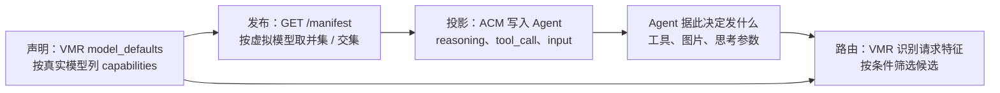

<!-- // Ver 2026-10-20 19:35, by Opus 5.5 -->

# 能力路由分析：thinking、tools、image 与 audio / video / 文档

> **意图复述**：用户的决定是，ACM 把模型能力（`reasoning`、`tool_call`、输入模态）按虚拟模型的**并集**写进 Agent，也就是"任一候选支持即可"，前提是 VMR 会把请求路由到支持该能力的候选上。本文在 ACM 与 VMR 的统一框架下，核对这个前提对每一种能力是否成立，并给出方案。
>
> **范围**：In —— VMR 的能力声明、请求特征识别、路由过滤、Manifest 发布；ACM 的投影；各 Agent 实际发出的请求。Out —— 跨协议翻译（VMR 设计上不做）；按任务内容选模型（属于 Agent）。
>
> **依据类型**：**[运行]** 已运行验证，**[代码]** 读代码得出，**[经验]** 基于经验判断。VMR 代码以 `/Users/stanford/code/vmr` 的 `main` @ `21b829e4` 为准。

## 1. 结论

- **tools 与 image：前提成立。** VMR 对这两项做硬过滤：带工具或图片的请求，只会发给声明了该能力的候选，或没有声明任何能力、因而不受约束的候选。按并集投影是正确的。
- **thinking：原先前提不成立，现已补齐**（VMR `e51d815c`）。VMR 现在识别请求顶层的思考开关，并像 tools、image 一样做**硬过滤**：只发给能思考的候选，一个都没有就拒绝，不去掉参数、不降级（用户决定）。"声称支持思考却没有能思考的候选"按配置错误处理：
  - `vmr check` 提前告警；
  - 拒绝原因同时出现在客户端收到的 503 和 VMR 运行日志里；
  - ACM 在投影 Claude Code 时，如果从 Manifest 能判断出槽位模型不能思考，也会告警。
- **audio / video**：只是"可声明、未生效"的词，没有任何 Agent 会发这类输入，维持现状。
- **文档（PDF）**：VMR 词表里没有这一项，目前只参与 token 估算。这是一个低优先级缺口，等有实际需求再加。
- **Manifest 缺省 `tool_call` 时 OpenCode 的行为**：已实测，缺省时照常发送工具，无需处理。

## 2. 统一框架：能力信息的三层

并集投影成立的**不变量**：

> 对 ACM 投影出去的每一种能力 X，只要 Agent 发出需要 X 的请求，VMR 都必须做到二者之一：
> - (a) 把请求交给能处理 X 的候选；
> - (b) 在没有这样的候选时，以可预期的方式降级。
>
> 不能把请求盲目交给一个会因 X 而失败的候选。

做到 (a) 可以靠硬过滤，也可以靠软偏好；(b) 可以是返回 503，也可以是去掉相关参数后照常转发。哪种合适，取决于这项能力能不能"去掉而不丢内容"。

| 能力 | 能否去掉而不丢内容 | 合适的方式 |
|---|---|---|
| tools | 不能：去掉工具，Agent 就没法干活 | 硬过滤，筛空返回 503 |
| image | 不能：去掉图片就丢了用户内容 | 硬过滤，筛空返回 503 |
| thinking | 能，但去掉等于替用户改变 Agent 的行为 | **硬过滤，筛空返回 503**（用户决定；去掉参数的方案见 §5.1，未采用） |
| context | 只是估算，不确定 | 软偏好，筛空回退（已实现） |

## 3. 现状核对

### 3.1 VMR 侧

| 能力 | 请求识别 | 路由 | Manifest 发布 | 出处 |
|---|---|---|---|---|
| tools | 顶层 `tools` 为非空数组，三种协议通用 | **硬过滤** `tools` | 并集里有 `tools` 时发布 `tool_call: true` | `internal/adapter/fingerprint.go:263`、`internal/strategy/conditions.go:41`、`internal/server/manifest.go:222` [代码] |
| image | 按协议解析内容块：completions `image_url`、messages `image`（包括 `tool_result` 里的图片）、responses `input_image` | **硬过滤** `image` | `modalities.input` 含 `image` | `internal/imgprep/imgprep.go:276`、`internal/server/facts.go:84`、`conditions.go:37` [代码] |
| thinking | 顶层开关（见 §5.1），与 tools 在同一次扫描中识别（`TopLevelProbe`） | **硬过滤** `thinking`（`e51d815c` 起；此前词表接受但没有对应条件） | 并集里有 `thinking` 时发布 `reasoning: true` | `internal/adapter/fingerprint.go`、`internal/strategy/conditions.go`、`manifest.go:226` [代码] |
| audio / video | 无 | 无，处理同 thinking | 声明了就进 `modalities.input` | `internal/config/config_validate.go:82` [代码] |
| 文档 / PDF | 只用于 token 估算 | 无，也不在词表里 | 无 | `facts.go` 中的 `documentMarkers` [代码] |
| context | 估算 token 数 | **软**：筛空时回退 | `limit.context` / `context_floor` | `internal/router/candidates.go:56` [代码] |

几条语义要点 [代码]：

- **没有声明 = 不受约束。** 一个端点只要没列任何 capabilities，就被视为什么都支持（`internal/core/core.go:242`）；一旦列了，就是完整清单，没列的等于不支持。
- **过滤顺序**：健康筛选 → 硬条件 → 上下文估算（软）→ pin → 排序 → 额度重排 → sticky（`candidates.go:32`）。硬条件把候选筛空时返回 503 `vmr_no_candidates`，这是设计如此。
- **Manifest 的并集只统计声明了能力的候选**（`manifest.go:178`）。未声明的候选在路由里什么都接受，但在 Manifest 里不贡献任何能力。所以 Manifest 只会少报、不会多报，方向是安全的。
- **上游返回 400 一般归为 `ErrClient`，不会切换候选**（`internal/adapter/classify.go:191`），只有命中特定提示才会归为别的类别。所以"不支持某参数"导致的 400 会直接回到用户那里，不会自动换一个候选重试。

### 3.2 Agent 实际发出的请求

数据来自第三轮联调时 VMR 的审计日志（2026-10-20，四个真实 Agent，经 VMR `main`）[运行]：

| Agent | 协议 | 模型（角色） | 思考参数 | 工具数 |
|---|---|---|---|---|
| Claude Code 2.1.304 | anthropic-messages | `main`（default） | `thinking: {type: adaptive}`，`output_config.effort: high` | 12 |
| Claude Code 2.1.304 | anthropic-messages | `quick`（fast，背后模型声明为 `[text, tools]`） | **同上，照样带思考** | 12 |
| Codex 0.148.0 | openai-responses | `main` | `reasoning: {effort: medium, summary: auto}` | 10 |
| Pi 1.2.0 | openai-completions | `main` | `reasoning_effort: medium` | 4 |
| OpenCode 1.3.13 | openai-completions | `main` | 无 | 10 |
| OpenCode 1.3.13 | openai-completions | `quick`（标题生成） | 无 | 0 |

由此得出：

1. **Claude Code 发不发思考参数，与 ACM 写入的内容无关**：对网关别名，它每个请求都带 `thinking`（ACM 写入 Claude Code 的字段里本来就没有 reasoning）。所以 thinking 一旦做成硬过滤，凡是 fast 模型不支持思考的配置，Claude Code 的后台请求会全部 503。
2. **Codex 和 Pi 发不发思考参数，取决于 ACM 的投影**：Codex 的 catalog 有 `supported_reasoning_levels`（`src/acm/adapters/codex.py:46`），Pi 的 `models.json` 有 `reasoning: true`。并集投影让它们对"部分候选支持思考"的虚拟模型也发思考参数。
3. **编码 Agent 在主循环里总是带工具**，所以 tools 的硬过滤实际上意味着：不支持工具的候选对 Agent 主循环永远不可用。这符合预期。

## 4. 问题清单（按严重度）

| 编号 | 问题 | 后果 | 依据 |
|---|---|---|---|
| C1（已解决） | thinking 不参与路由 | 虚拟模型下混有支持与不支持思考的候选时，Pi 的 `reasoning_effort`、Codex 的 `reasoning`、Claude Code 的 `thinking` 都可能落到不支持思考的候选上。有些上游会直接 400 拒绝这类参数（例如 OpenAI 的非推理模型拒绝 `reasoning_effort`），而 400 不会触发切换，错误直接回到用户 | [代码] 3.1；拒绝行为 [经验] |
| C2（按决定接受） | thinking 做成硬过滤 | Claude Code 对 fast 槽位也带思考，fast 模型不支持思考时，后台请求全部 503。按用户原则这属于配置错误；`vmr check`、503 消息、VMR 日志、ACM 投影告警四处都会指出 | [运行] 3.2、§5.1 验收 |
| C3（已解决） | Manifest 分不清"已知不支持"和"未知" | `tool_call` / `reasoning` 只有 `true` 或缺省两种状态。"候选都声明了能力、但都没有 tools"和"没人声明"在 Manifest 里看起来一样。ACM 因此对 OpenCode 不写 `tool_call`，而 OpenCode 缺省时怎么处理，当时没有核实。现已实测：缺省时照常发工具；ACM 用 `guarantee` 推断出"已知不支持" | [代码] `manifest.go:222`；[运行] OpenCode 1.3.13 |
| C4（已解决） | 虚拟模型没有任何支持工具的候选时，没人提醒 | Agent 的每个请求都 503；`vmr check` 不报 | [代码] |
| C5 | 文档（PDF）不在能力词表里 | Claude Code 等会发 document 块；上游不支持就 400，且不切换候选 | [代码]；Agent 行为 [经验] |
| C6 | audio / video 只声明、不生效 | 目前没有编码 Agent 会发这类输入，没有实际影响 | [代码]；Agent 行为 [经验] |

## 5. 方案与实施

### 5.1 VMR：thinking 的识别与硬过滤（已实施，`e51d815c`）

**识别**：`RequestFacts.WantsThinking` 与 `HasTools` 在同一次顶层扫描中得出（`adapter.TopLevelProbe`，现在返回一个 `Probe` 结构体）。只看**顶层显式开关**，不看对话历史：

| 协议 | 判定为开启思考 | 依据 |
|---|---|---|
| anthropic-messages | `thinking.type` 为 `enabled` 或 `adaptive` | [运行] Claude Code 实际发送 |
| openai-responses | `reasoning.effort` 存在且不为 `none` | [运行] Codex 实际发送 |
| openai-completions | `reasoning_effort` 存在且不为 `none` | [运行] Pi 实际发送 |
| 厂商变体 | `reasoning.enabled: true`（OpenRouter）、`thinking.type: enabled`（DeepSeek / GLM）、`enable_thinking: true`（Qwen） | [经验] |

形状不对的值（比如 `thinking: "yes"`）不算。原因是这个字段驱动硬过滤，误判会把候选全部筛掉。

**路由**：在 `strategy` 的固定条件集里加 `thinking`，与 image、tools 同为硬条件：只保留声明了 `thinking` 或不受约束的候选；筛空就返回 503 `vmr_no_candidates`，消息里写 `rejected by condition(s): thinking`。VMR 运行日志的 `ALL_FAILED` 行现在也带上拒绝原因（此前只有 `ALL_FAILED(0s, 0x)`）。

**未采用的方案**：软偏好 + 发往不支持的端点时去掉思考参数。用户否决的理由有两条：
- 删参数会悄悄改变 Agent 的行为，这个决定不该由网关替用户做；
- 它增加了复杂度。

"声称支持思考的虚拟模型却没有能思考的候选"本身就是配置错误，应当直接报错。这一取舍已登记在 VMR `docs/KNOWN_ISSUES`。

**配置检查**：`vmr check` 在两种情况下告警：
- 某个虚拟模型在某协议上的候选都声明了能力，但没有一个含 `tools`；
- 在 `anthropic-messages` 上没有一个含 `thinking`（Claude Code 对每个请求都打开思考）。

能力解析逻辑由 config 提供（`Config.ResolveModelCapabilities`），路由快照和检查共用同一份。

**验收**：

| 场景 | 结果 |
|---|---|
| 单元测试：识别（17 种形态，含重复键、历史思考块、嵌套字段）；配置检查告警（含禁用的 provider、不受约束的候选）；路由测试（绕开不支持的候选、筛空返回 503 并点名 thinking、不受约束的候选照常服务） | 通过 [运行] |
| VMR 门禁：`gofmt -l`、`go vet`、`go test -race ./...`（含 archtest） | 通过 [运行] |
| 联调：Claude Code 默认模型（能思考） | 返回 OK [运行] |
| 联调：Claude Code 的 fast 槽位（`quick`，只声明 `[text, tools]`） | 被拒绝，请求没有到达上游，VMR 日志写明 `rejected by condition(s): thinking` [运行] |
| 联调：Pi、Codex 访问混合候选的 `mix`（不支持思考的候选优先级更高） | 都落到 `think-model` [运行] |
| 联调：OpenCode 访问 `mix`（不带思考参数） | 按优先级落到 `nothink-model` [运行] |
| 联调：热重载给 `small-model` 补上 `thinking` 后，Claude Code 的 fast 槽位 | 返回 OK [运行] |
| 联调：审计 `facts` | 带有 `wants_thinking` [运行] |

### 5.2 VMR：tools（已实施，`e51d815c`）

保持硬过滤。新增的 `vmr check` 告警见 §5.1：某个虚拟模型的候选**都声明了**能力、但没有一个含 `tools` 时，编码 Agent 的每个请求都会 503。

### 5.3 Manifest 契约：不加字段，只写清语义（已实施）

- ACM SPEC §4.2 写明：`tool_call` / `reasoning` / `modalities.input` 表示"VMR 能把需要这项能力的请求路由到支持它的候选上"（并集）；`guarantee` 表示"所有候选都支持"（交集）。
- `guarantee` 只在所有候选都声明了能力时才出现，因此 ACM 用它推断"已知不支持"：`guarantee` 存在而并集里没有某项能力时，卡片记为 `False`，而不是 `None`（未知）。契约本身不变。
- OpenCode 在 `tool_call` 缺省时照常发工具（1.3.13 实测），ACM 不需要替它补字段。

### 5.4 ACM（已实施，本地提交）

- 维持并集投影（用户决定）；VMR 补上 thinking 过滤后，并集对三项能力都成立。
- 新增两条投影告警，让"会被网关拒绝"在 `acm use` / `acm run` 时就能看到：
  - 模型已知不支持工具（任何 Agent）；
  - Claude Code 槽位上的模型已知不能思考。
- ACM 不为网关做补偿，比如对 fast 角色不写 `reasoning`：这会把路由问题搬进配置，换一个 Agent 就又失效。

### 5.5 audio / video / 文档（C5、C6）

- **audio / video**：维持"可声明、未生效"。ACM 的适配器只消费 `image`，不会让 Agent 发音视频。等真有 Agent 发这类输入时，再按 image 的方式做硬过滤（不能去掉而不丢内容）。
- **文档 / PDF**：暂不做。需要时，在 VMR 词表里新增 `document`，识别方式复用现有的 `documentMarkers`，做硬过滤；Manifest 在 `modalities.input` 里发布 `pdf`（OpenCode 的 schema 已有这个值）。在此之前，文档请求遇到不支持的上游会得到 400，与现在一样。

## 6. 决定

| 编号 | 问题 | 决定 |
|---|---|---|
| Q1 | thinking 的路由方式 | **硬过滤**，与 tools、image 一致；不做软偏好回退，不去掉参数（用户，2026-10-20） |
| Q2 | 去掉参数的范围 | 不适用（不去掉参数） |
| Q3 | 由谁实施 | ACM 侧直接在 VMR 仓库实施（用户已允许） |
| Q4 | 文档 / PDF 能力 | 以后再做 |

## 7. 未验证的假设、风险与下一步

- **未验证**：各厂商对"不支持的思考参数"是拒绝还是忽略。改为硬过滤之后，这一点只影响"未声明能力的候选"（它们照常接收思考参数）[经验]。
- **风险**：
  - **对现有部署的影响**：凡是虚拟模型的候选都声明了能力、但没有一个含 `thinking` 的，此前带思考参数的请求能通过，现在会被拒绝。典型情况是 Claude Code 的 haiku 槽位指向一个只声明了 `[text, tools]` 的模型。升级 VMR 后先跑 `vmr check`，看 `no candidate declares "thinking"` 告警。
  - 识别只覆盖已知的几种开关写法；漏识别的写法等同于不要求思考，行为与改动前一样。
- **下一步**：
  1. 推送 VMR `e51d815c`（等用户同意）；
  2. 用真实上游验证 Claude Code 的 fast 槽位（需要该槽位的真实模型能思考，或在 `model_defaults` 中如实声明）；
  3. 文档 / PDF 能力与 audio / video 等到有实际客户端需求再做。
