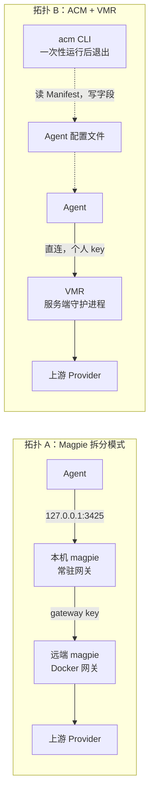
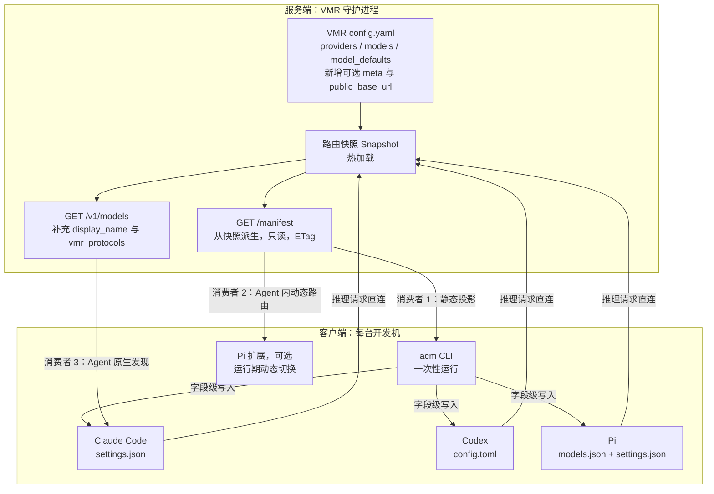
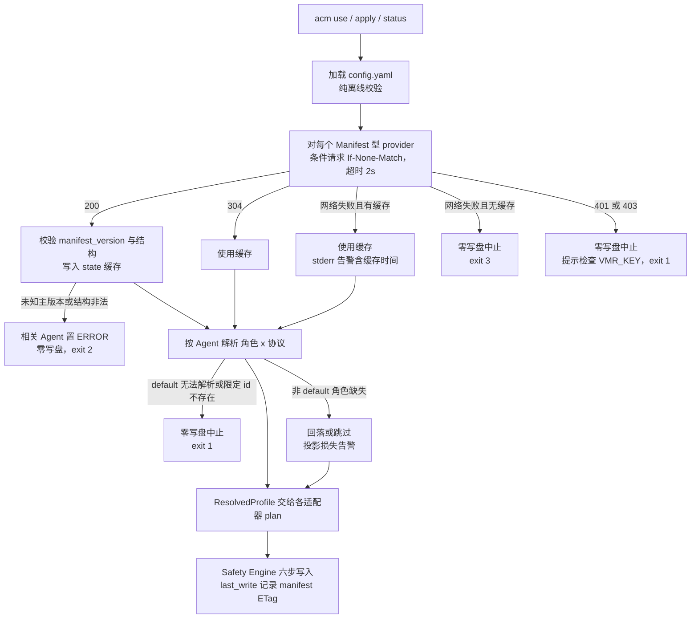

<!-- // Ver 2026-10-20 17:45, by Opus 5.5 -->

# ACM × VMR：配置面与路由面分离 —— 存在性再评估、协议设计与落地方案

> **意图复述**：在 Magpie 已大幅演进的 2026-10 时点，以第一性原理重新回答三个问题——① ACM（客户端配置管理）在 VMR（服务端路由）之外独立存在是否值得；② "配置面与路由面拆分 + 模型描述文件驱动配置"这条路线是否合理、是否已落后于 Magpie、是否存在更优解；③ 若成立，具体怎么做（模型描述协议、ACM 改造、VMR 改造、团队场景落地）。
>
> **范围**：In —— ACM 定位与架构、VMR 侧的自描述协议（Manifest）、ACM 对 Manifest 的消费与投影、团队共享 VMR 场景、Pi 动态路由插件的定位。Out —— VMR 路由算法本身、Agent 内部认知路由的实现细节、GUI。
>
> **对既有材料的态度**：`docs/archive/agent_config_manager_design_v1.1.md`、`docs/archive/ACM_PROJECT_PRINCIPLE_v2.2.md`、`docs/archive/ACM_PROJECT_SPEC_v2.2.md`、VMR 的 `vmr-agent-dynamic-routing-protocol_agent.md` 与 `vmr_vs_magpie_v1.0.md` 均作为输入素材引用，**不作为既定结论**；本文对其中若干判断做了核查与修正（见 §1.3）。

---

## 0. 执行摘要（三问三答）

| 问题 | 结论 | 一句话理由 |
|---|---|---|
| **Q1 值不值得做？** | **值得，但只值得做"窄"的那一版**：ACM = 读取路由器自描述（Manifest）、把它投影到本机各 Agent 原生配置字段的一次性 CLI。不值得做通用配置切换器。 | "配置面与路由面拆分"这个**拓扑**本身 Magpie 已经做到了（Docker 网关 + Remote magpie）；ACM 剩下的结构性差异是**请求路径上没有客户端常驻进程**（Agent → VMR 单跳直达），以及**团队成员入网 = 一条命令、零常驻、零托管密钥**。这两点对 VMR 用户（尤其团队共享 VMR）是真实价值，对其他人不是。 |
| **Q2 路线合理吗？落后了吗？有更优解吗？** | **路线合理；在"功能面/覆盖面"上全面落后 Magpie，但在 ACM 选定的赛道上不存在可替代品**。比较了 6 种方案（§4），推荐"VMR 发布 Manifest + ACM 静态投影 + Agent 原生能力承接动态切换"的组合，否决"把配置管理并入 VMR"和"直接改用 Magpie 当客户端"。 | Magpie 的客户端永远把 Agent 指向**本机** `127.0.0.1:3425`（其文档原话："Local agent configs still use the local gateway address"），所以"Magpie 客户端 + VMR 服务端"必然是双网关串联，抵消 VMR 的字节保真、缓存亲和与审计价值。 |
| **Q3 具体怎么做？** | VMR 增加一个由现有配置**派生**（不另设事实源）的 `GET /manifest`；ACM 引入"Manifest 型 Provider"（作为外部引用实时解析，像 `${ENV}` 一样只引用不拷贝）与"角色 × 协议"解析（`team@fast` 这类引用），把角色映射到各 Agent 的原生槽位（Claude Code 的 opus/sonnet/haiku/subagent 槽位、Codex 的 review/subagent 槽位、Pi 的注册表）。动态的 plan→act 切换交给 Agent 自身（Claude Code `opusplan`、Pi 扩展），ACM 不做。 | 这是唯一同时满足"Agent 无需改造""客户端零常驻""服务端单一事实源""ACM 三公理不降级"的组合。 |

**最重要的三个新发现**（均为 2026-10-19 当日实测/核对，详见 §1.2）：

1. **Magpie 已具备服务端/客户端拆分**（Docker 网关模式 + Remote magpie），"拆分"不再是我们的差异点；差异点收敛为"客户端是否常驻、请求是否经过客户端网关"。
2. **Agent 厂商正在原生化"网关模型发现"**：Claude Code 支持 `CLAUDE_CODE_ENABLE_GATEWAY_MODEL_DISCOVERY=1` 读取网关 `/v1/models`；Codex 支持 `model_providers.<id>.model_catalog_url`。但 Claude Code 的发现**只保留 id 含 `claude`/`anthropic` 的条目**，且不发现角色槽位与上下文窗口——VMR 的 `coding`/`cheap` 这类虚拟名会被过滤掉。这意味着 ACM 的"目录同步"职能会被逐步吞掉，而"角色槽位 + 上下文 + 入网引导"职能短期内不会。
3. **当前 ACM 投影 Claude Code 到 VMR 时存在一个疑似正确性缺口**：ACM 只写 `model`，不写 `ANTHROPIC_DEFAULT_{OPUS,SONNET,HAIKU}_MODEL` / `CLAUDE_CODE_SUBAGENT_MODEL`。Claude Code 的后台轻量任务、子代理、`/model` 别名会以 Anthropic 官方 model id 发往 VMR，而 VMR 不认识这些名字。（基于经验判断，需用 VMR audit 日志验证，见 §8。）这一条让"角色槽位投影"从"锦上添花"变成"正确性要求"。

---

## 1. 输入素材与事实基线

### 1.1 素材清单与本文对其的使用方式

| 素材 | 日期 | 本文如何使用 |
|---|---|---|
| `vmr_vs_magpie_v1.0.md`（deep-researcher，局域网文档） | 2026-10-07 | 引用其对 Magpie 架构（IR 翻译、JS 中间件、Routing Group）的拆解；**修正**其"Prompt Cache 亲和完全缺失""100% 置信度"两处判断（§1.3） |
| `~/code/vmr/docs/vmr-agent-dynamic-routing-protocol_agent.md`（Manifest v1.0 草案） | 2026-10-16 | 采纳其"网关暴露能力、Agent 掌控认知决策"的职责划分；**重设计**其 Schema（§5.4 逐项裁定） |
| `docs/archive/agent_config_manager_design_v1.1.md` rev.2 | 2026-10-08 | 采纳字段所有权、零守护进程、受管面纪律、"ACM = VMR 配置面"的定位；**更新**其死亡条件与 Phase 3 团队 overlay 规划 |
| `docs/archive/ACM_PROJECT_PRINCIPLE_v2.2.md` / `ACM_PROJECT_SPEC_v2.2.md` | 2026-08-27 起 | 作为不可违反的约束；指出需要修订的条款（§7） |
| ACM 源码 `src/acm/vmr.py`、`adapters/*.py` | HEAD `7bb5ae0` | 核实现状：VMR 探测只用 `/v1/models` 的 `id` + `vmr_protocol`；Claude Code 适配器受管命名空间仅 `model`、`env.ANTHROPIC_BASE_URL`、`env.ANTHROPIC_AUTH_TOKEN`、`env.ANTHROPIC_API_KEY`、`effortLevel` |
| VMR 源码 `~/code/vmr` | HEAD `d91f647c`（2026-10-13） | 核实：无 Manifest 端点；`/v1/models` 字段；`model_defaults` 能力声明；路由资格过滤（image/tools/上下文） |
| Magpie README / docs/remote / docs/docker / docs/reference.md | 2026-10-19 抓取 | 核实 Magpie 当前能力，特别是远程/服务端模式与 Agent 接线方式 |
| Claude Code 官方文档 model-config / llm-gateway-protocol | 2026-10-19 抓取 | 核实角色槽位环境变量、网关模型发现协议 |
| Codex 官方 config-reference | 2026-10-19 抓取 | 核实 `review_model`、`agents.default_subagent_model`、`model_context_window`、`model_catalog_url` |
| models.dev `api.json` / OpenRouter `/api/v1/models` | 2026-10-19 抓取 | 作为模型描述字段的事实标准参照（models.dev 当日 232 个 provider） |

### 1.2 2026-10-19 核实的关键事实

**Magpie（yetone/magpie）**

- 形态：菜单栏 / 窗口 / TUI / Web UI / CLI，另有 Docker 镜像（`ghcr.io/yetone/magpie`，当日标签示例 `0.1.1150`）与 Termux。支持的 Agent 列表 60+ 项（README 计数，含同产品变体）。
- **服务端模式**：Docker 中运行 `magpie serve`（仅网关）或 `magpie web`（网关 + 浏览器管理页，"gateway mode"，无 Agents 页）。外部调用必须持 gateway key；可设 `MAGPIE_PUBLIC_URL`、`MAGPIE_TLS_*`、`MAGPIE_ALLOW_IPS`。每个 gateway key 可设日/周/月/N 小时额度与模型白名单。
- **Remote magpie（客户端模式）**：其他电脑的 magpie 把共享 magpie 添加为一个 provider（`magpie provider add remote-magpie sk-magpie-key-… url=… id=office`），获得其模型、路由组（`office/group/…`）、System One 决策模型（`/v1/systemone`）、额度卡片。文档原文："**The computer you sit at still runs magpie: it wires that computer's agents**"；reference.md："**Local agent configs still use the local gateway address.**"
  - 推论：Magpie 的拆分拓扑是 `Agent → 本机 magpie 网关(常驻) → 远端 magpie 网关 → 上游`。客户端常驻进程在请求路径上。
- **缓存亲和**：README 原文 "A conversation stays with the account that answered it while the vendor's prompt cache is worth keeping"——Magpie 已有会话粘性。
- **协议翻译**：网关在 OpenAI Chat / Responses / Anthropic Messages / Gemini 之间互译（Remote 模式下"只在一台机器上翻译一次"）。
- 其他：订阅共享（驱动本机 `claude` 二进制并经 MCP 桥接工具）、Intent routing、JS 网关中间件（Bun）、Library（写 MCP/skills/instructions）、每日一次匿名使用上报（可关）、仓库不接受外部 PR。

**Claude Code（官方文档）**

- 角色槽位：`ANTHROPIC_DEFAULT_OPUS_MODEL`、`ANTHROPIC_DEFAULT_SONNET_MODEL`、`ANTHROPIC_DEFAULT_HAIKU_MODEL`、`ANTHROPIC_DEFAULT_FABLE_MODEL`（及 `_NAME`/`_DESCRIPTION`/`_SUPPORTED_CAPABILITIES` 后缀；后者在 `ANTHROPIC_BASE_URL` 网关后无效）、`CLAUDE_CODE_SUBAGENT_MODEL`、`ANTHROPIC_DEFAULT_MODEL`（v2.1.236+）、`opusplan`（plan 模式用 opus 槽，执行用 sonnet 槽）。
- 网关后的未识别 model id（如 `coding`）：Claude Code 默认按 200K 窗口处理，且只发送保守的请求字段（固定 budget thinking，无 effort/context management）；真实窗口需用 `CLAUDE_CODE_MAX_CONTEXT_TOKENS` 声明。
- 网关模型发现：`CLAUDE_CODE_ENABLE_GATEWAY_MODEL_DISCOVERY=1` → 启动时 `GET /v1/models?limit=1000`（3s 超时，拒绝重定向），读取 `id`/`display_name`/`description`，**只保留 id 含 `claude` 或 `anthropic` 的条目**，缓存于 `~/.claude/cache/gateway-models.json`。

**Codex（官方 config-reference）**

- 模型相关槽位：`model`、`model_provider`、`model_providers.<id>.*`（含 `wire_api`、`model_catalog_url` = "Full URL for a Codex-native model catalog"）、`model_catalog_json`、`model_context_window`、`model_auto_compact_token_limit`、`model_reasoning_effort`、`plan_mode_reasoning_effort`、`review_model`、`agents.default_subagent_model`、`agents.default_subagent_reasoning_effort`。

**VMR（源码 HEAD `d91f647c`）**

- 无 Manifest 端点（`internal/server` 中无相关路由）。
- `GET /v1/models`（`internal/server/server.go:477-521`）返回 `id/object/type/owned_by/vmr_protocol`；**同名虚拟模型注册在多个协议下时只报告排序第一的协议**——对客户端而言是有损的。
- 能力与窗口只在 `model_defaults` 按**真实上游模型**声明（`capabilities: [text, tools, image, audio, video, thinking]`、`max_context_tokens`），"未声明 = 不受约束"是架构不变量；虚拟模型自身没有能力旋钮。
- 路由资格过滤：带图请求只走声明 `image` 的端点、带工具请求只走声明 `tools` 的端点（`internal/strategy/conditions.go`），并按估算 token 数过滤上下文不足的端点（`strategy.go:76-82`，有"不得清空候选集"的兜底）。
- `/status` 已按虚拟模型聚合"能力并集 + 最大窗口"（`internal/server/admin.go:172-198`）——Manifest 的派生逻辑有现成雏形。
- 虚拟模型是**有序候选列表**（priority + `fallback_endpoints` 追加尾部），不是"对位等价组"。示例配置中 `coding` 仅在 `openai-completions` 上、`claude` 仅在 `anthropic-messages` 上——**虚拟名是按协议存在的**。
- `api_keys` 以 key 尾部作为调用方标签进入审计，天然支持"团队每人一把 key"。

### 1.3 对既有材料的修正

| 原判断 | 出处 | 修正 |
|---|---|---|
| "Magpie 的 Routing Group 完全缺乏 Session-Sticky 亲和锁定" | vmr_vs_magpie §2.3-2 | **已过时**。Magpie README 明确会话会停留在应答账号上直到缓存不再值得保留。VMR 在缓存亲和上的差异只剩"实现深度"（并发排队缓冲等），不再是"有 vs 无"。 |
| "置信度 100%（源码与官网实测双重检验）" | vmr_vs_magpie §5 | 竞品分析不应声明 100%；且报告未覆盖 Remote magpie / Docker 网关模式，这恰是与我们拓扑设想重叠最大的部分。 |
| "magpie 是重型常驻枢纽，配置在应用内部" → 我们的护城河之一是"拆分" | design v1.1 §2.3 / 用户设想 | 拆分拓扑 Magpie 已有。护城河应表述为"**客户端零常驻 + 请求路径单跳**"，而不是"拆分"。 |
| "VMR 侧零改动：只需暴露标准的模型列表查询端点" | SPEC §9 | 不再成立。标准 `/v1/models` 无法表达协议多重性、角色、窗口、能力；VMR 需要一个小而确定的 Manifest 端点（§5.6）。 |
| `import vmr` = 把 VMR 模型拉进 config.yaml 增量合并 | PRINCIPLE §4.2 / SPEC §10 | 在团队场景下"拷贝进 YAML"必然产生拷贝漂移。改为**引用而不拷贝**（§5.5.2）。 |
| Phase 3：团队 Base SSOT（git 共享 YAML）+ 本地 overlay | PRINCIPLE §2.2 | Manifest 本身就是"团队 Base"，由运行中的 VMR 权威发布；本地 config.yaml 自然成为个人 overlay。Phase 3 的 overlay 机制可直接废止。 |
| Manifest 草案：服务端 FastAPI 实现、独立的 `config/vmr_groups.yaml` | 动态路由协议 §四.2 | VMR 是 Go 单二进制；另设 groups 文件等于在 VMR 内部制造第二事实源。Manifest 必须从 VMR 现有 config **派生**。 |
| 草案代码与示例中出现明文 VMR API key 字面量 | 动态路由协议 §四.2、§五.2、§六 | **安全卫生问题**：建议立即轮换该 key，并把文档示例改为 `${VMR_KEY}`。本文不复述该字面量。 |

---

## 2. 第一性原理：问题到底是什么

### 2.1 三个平面

把"让 N 台机器上的 M 个 Agent 用上一组模型"拆到不可再分，有三件事，它们的**物理位置、生命周期、信任边界**完全不同：

| 平面 | 内容 | 物理位置 | 生命周期 | 真相在哪 |
|---|---|---|---|---|
| **数据平面** | 每个请求的转发、failover、缓存粘性、审计 | 任意一台机器（单人=本机；团队=服务器） | 常驻，毫秒级 | 路由器内存 |
| **目录平面** | "有哪些可用模型名、各自走什么协议、什么能力、多大窗口、推荐什么用途" | 路由器知道 | 分钟~天级变化 | 路由器配置 |
| **配置平面** | 每个 Agent 本地文件里的 base_url / key 引用 / model / 角色槽位 / 窗口 | **必然在每台客户端机器**（Agent 只读本地文件） | 只在目录变化或用户换方案时变 | Agent 配置文件（被 ACM 管理的字段） |

由此可以直接推出三个不依赖任何竞品的结论：

1. **配置平面的执行点必然在客户端，且每台机器至少执行一次。** 无论谁来做（ACM、Magpie、Agent 插件、手工），这一步都躲不掉。问题只在于：谁来做、做完是否需要常驻。
2. **目录平面的真相在路由器。** 任何把目录"拷贝"到客户端静态配置的方案，都会在路由器变化时产生拷贝漂移；正确做法是客户端**引用**路由器发布的目录，并在需要时刷新。
3. **配置平面的变化频率极低，不需要常驻进程。** 它的触发事件是"目录变了"或"用户换方案"，都是人类时间尺度的事件，按需运行即可。

### 2.2 类比：`get-credentials` 而不是"本地代理"

最贴切的现成范式不是 Magpie，而是 `gcloud container clusters get-credentials` / `tailscale up` 这类工具：

- 服务端（K8s API server / tailnet 控制面）**发布**一份自描述（endpoint、CA、可用上下文）；
- 客户端 CLI **一次性**拉取它，**字段级**写入本地 kubeconfig（不重写整个文件、保留用户其他 context），然后退出；
- 之后 `kubectl` **直连** API server，中间没有任何本地常驻代理。

ACM 之于 VMR，就是 `get-credentials` 之于 K8s：**VMR 发布 Manifest，ACM 把它投影成各 Agent 的本地字段，Agent 直连 VMR。** 而 Magpie 的 Remote 模式更像"在每台笔记本上再跑一个本地 API 代理，kubectl 连本地代理"——功能更多，但多一跳、多一个常驻进程。

### 2.3 什么情况下"多一跳"是可以接受的、什么情况下不行

反例思考：对于只想"Claude Code 用上 Kimi"的个人开发者，多一跳毫无代价，Magpie 的体验全面占优，ACM 没有任何理由存在。只有当用户**特意选择了 VMR**——即在乎字节保真、缓存亲和策略可推理、审计记录到的是真实客户端行为——多一跳才成为问题：

- VMR 的审计记录到的是 Magpie 网关的转发流量，客户端标签变成 Magpie 的 key，`vmr analyze` 的客户端维度分析失真；
- 两层 failover / 两层会话粘性叠加，故障路径不可推理；
- Magpie 网关的协议翻译与中间件（`onRequest` 可改写请求）发生在 VMR 之前，VMR 的"字节保真"承诺失去意义。

所以 ACM 的存在条件是一个**条件式**：它只对"已经选择 VMR（或任何希望被直连的网关）的人"有价值。这与 design v1.1 §4.2 的"ACM ≡ VMR"判断一致，本文在 §3.4 给出更精确的版本。



---

## 3. Q1：这件事值不值得做

### 3.1 按场景逐一比较

| 场景 | Magpie 的解法 | ACM + VMR 的解法 | 谁更好 |
|---|---|---|---|
| **S1 单人单机，只想给多个 Agent 换模型** | 装 app，点选即可；订阅共享、额度卡片、60+ Agent | 需要先装 VMR、写 VMR 配置，再 `acm init/use` | **Magpie 明显更好**。ACM 不应在此场景竞争。 |
| **S2 单人单机，已在用 VMR（为了审计/保真/缓存策略）** | 把 VMR 加成 Magpie 的 custom provider → 双网关串联 | `acm init && acm use` → Agent 直连本机 VMR | **ACM 更好**（且是唯一不破坏 VMR 价值的自动化方案） |
| **S3 单人多机（台式机跑 VMR，笔记本用）** | Remote magpie：每台笔记本仍需跑本地 magpie | 笔记本上一次性 `acm init --vmr <url>`，之后无常驻 | ACM 更轻；Magpie 体验更顺（GUI），但多一跳 |
| **S4 小团队共享一台 VMR（每人一把 key）** | 每个成员安装并常驻 Magpie，添加 Remote magpie；或手工配每个 Agent | 管理员维护 VMR；成员 `export VMR_KEY=…` + 一条 `acm init --vmr` + `acm use`；目录变化时 `acm apply` | **ACM 结构性更好**：零常驻、零托管密钥、VMR 审计按成员 key 精确归因、目录由服务端权威发布 |
| **S5 团队想统一"后台任务用便宜模型、规划用强模型"** | 每台机器在 Magpie 里分别设置，或用 Intent routing（网关内的模型判断请求类型） | 管理员在 VMR Manifest 里给模型打角色提示（`fast`/`reasoning`），成员的 ACM 自动映射到各 Agent 原生槽位 | ACM 更好：策略中心化发布、执行在 Agent 原生机制内、网关不做"认知路由" |

### 3.2 价值账本（基于经验判断，非量化测量）

**收益侧**

- S4/S5 的成员入网成本：从"每人手工改 3 个 Agent × 每个 3-8 个字段 × 每次 VMR 改动重做一遍"降到"一条命令 + 偶尔 `acm apply`"。对 3-10 人团队，这是每次 VMR 目录变更省下的**人数 × Agent 数**次手工操作，且消除了"某人某个 Agent 配错了没发现"的静默失败。
- 修复 §0 发现 3 所述的 Claude Code 槽位缺口：没有 ACM，团队成员几乎不会知道要设 `ANTHROPIC_DEFAULT_HAIKU_MODEL`。
- VMR 价值的完整兑现：审计里的 client_key 标签与真实成员一一对应，`vmr analyze` 的按调用方分析才有意义。

**成本侧**

- 已沉没：MVP（Safety Engine + 三适配器 + 金样门禁）已交付，本方案复用 100% 的写入机制。
- 增量：VMR 侧一个只读派生端点；ACM 侧一个 Manifest 客户端、schema v4、三个适配器各增加若干受管字段与金样。量级估计见 §6（基于经验判断）。
- 长期维护：Agent 配置 schema 的上游漂移（Claude Code 的环境变量集合在频繁扩展，如 `ANTHROPIC_DEFAULT_MODEL` 于 v2.1.236 引入）。这是本方案最大的持续成本，由金样哨兵 + ERROR 态阻断兜底。

### 3.3 关键反证：如果 Agent 原生发现足够好，ACM 还剩什么？

这是本次调研中对 ACM 最有威胁的趋势，必须正面回答。

| 配置平面要做的事 | Claude Code 原生 | Codex 原生 | Pi 原生 | 是否仍需 ACM |
|---|---|---|---|---|
| 指向网关（base_url + key 引用） | 否（需写 `env.ANTHROPIC_BASE_URL`） | 否（需写 `model_providers.<id>`） | 否（需写 `models.json`） | **需要**（入网引导） |
| 模型列表进入选择器 | 是，但**只保留 id 含 claude/anthropic 的条目** | 是，若网关提供 Codex 格式的 `model_catalog_url` | 是（通过扩展 API） | 部分需要；会随厂商演进缩小 |
| 角色槽位（后台/子代理/规划/评审各用哪个） | 否（只能写 env 槽位） | 否（只能写 `review_model` 等） | 否（静态）；动态需扩展 | **需要** |
| 上下文窗口（网关别名） | 否（未识别 id 默认 200K） | 否（需写 `model_context_window`） | 否（需写 `contextWindow`） | **需要** |
| 换方案后精确撤销 | 否 | 否 | 否 | **需要**（ACM 的回滚与漂移阻断） |

结论：即便原生发现继续演进，ACM 会退化为"入网引导 + 角色槽位 + 窗口 + 安全回滚"这一薄层——**这恰好是它应有的形态**。薄是优点：受管字段越少，Safety Engine 的重量越有理由由"团队规模"而非"字段数量"来供血（呼应 design v1.1 §3.6 的受管面纪律）。

### 3.4 结论与存在条件（取代 design v1.1 §4.2 的版本）

**结论：值得做，按"窄版"推进。** 定位一句话：

> **ACM 是网关自描述（Manifest）的客户端投影器：一次性运行、字段级写入、可精确撤销，让 Agent 直连你选定的网关。**

**存在条件**（全部满足才继续投入）：

1. 至少有一个"需要直连网关"的部署在真实使用：自用 VMR（已满足）或团队共享 VMR（本方案要验证的）。
2. Agent 原生机制仍不覆盖"角色槽位 + 窗口 + 入网引导"（2026-10-19 已核实满足）。

**死亡条件**（任一满足即归档，沉没成本≈0）：

1. Magpie（或其他工具）提供"把本机 Agent **直接**接到远端网关、请求路径上无本机常驻进程"的模式。2026-10-19 核实：未提供（Local agent configs still use the local gateway address）。**建议每季度复核一次 Magpie reference.md。**
2. 主流 Agent 原生支持从网关发现角色槽位与窗口（例如 Claude Code 允许网关在 `/v1/models` 声明 haiku/opus 槽位映射与 context）。届时 ACM 只剩入网引导，可降级为一页文档 + 一个脚本。
3. 本人停用 VMR，且团队场景在启动后 3 个月内未出现第二个真实用户。

---

## 4. Q2：方案合理性与替代方案比较

### 4.1 候选方案

| # | 方案 | 描述 | 裁定 | 理由 |
|---|---|---|---|---|
| A | ACM 做通用配置切换器 | 与 Magpie/CC Switch 正面竞争，扩适配器数量、做 GUI | **否决** | design v1.1 已论证：80% 诉求 Magpie 解决得更好；适配器数量不是 KPI |
| B | 把配置管理并入 VMR（`vmr hook claude` 等） | vmr_vs_magpie §4 的建议：VMR 二进制自带客户端配置注入 | **否决** | ① VMR 在服务端，配置写入在客户端——团队成员为了改配置要在每台机器装一个路由器二进制，"守护进程"与"客户端 CLI"两种生命周期混在一个产物里；② Agent 配置 schema 每周都在变，会把 VMR 的发版节奏绑到 Agent 上游的变化上；③ VMR 的 archtest 行数预算与"头脑清晰的单一职责"会被持续侵蚀。**单人单机时这条路看似省事，团队场景下必然拆开——不如一开始就拆。** |
| C | 只做 Agent 插件（Pi 扩展式），每个 Agent 自己读 Manifest | 动态路由协议草案的主路径 | **作为补充保留，不作为主路径** | 只有提供扩展 API 的 Agent（Pi）能做；Claude Code/Codex 无法以插件方式改写自身 base_url 与槽位。且插件本身需要被安装与配置——这一步又回到配置平面。 |
| D | 只依赖 Agent 原生网关发现 | 让 VMR 的 `/v1/models` 更丰富，等 Agent 自己读 | **作为补充保留** | §3.3 表格：原生发现不覆盖入网引导、角色、窗口；Claude Code 会过滤掉非 claude 名的虚拟模型。但 VMR 让 `/v1/models` 带上 `display_name`/`description` 几乎零成本，原生发现能用的部分就让它用。 |
| E | 改用 Magpie 作为客户端配置工具，VMR 作为其上游 | 放弃 ACM | **否决（当前）** | 双网关串联（§2.3）。若死亡条件 1 发生，本方案即刻转为推荐。 |
| **F** | **VMR 发布 Manifest + ACM 静态投影 + Agent 原生机制承接动态切换 + Pi 扩展可选** | 本文推荐 | **采纳** | 同时满足：Agent 无需改造；客户端零常驻；目录单一事实源在服务端；ACM 三公理不降级；Manifest 一份、三类消费者共用 |

### 4.2 ACM 是否"已经落后于 Magpie"

分两个维度回答，避免选择性叙述：

- **在功能面与覆盖面上，ACM 全面且大幅落后**：Agent 覆盖 3 vs 60+；无 GUI/TUI；无订阅共享、额度、用量、插件；Magpie 发版节奏极快（Docker 标签 `0.1.1150`、issue 编号已到 #2227 量级），且已覆盖服务端/客户端拆分。这些差距**不打算追**，追就是方案 A。
- **在 ACM 选定的赛道（直连网关的客户端投影器）上，没有竞争者**，Magpie 也结构性地不会进来：它的商业与产品价值锚定在本地网关（订阅共享、路由组、中间件、用量统计都依赖请求经过它），放弃本地网关等于放弃自身。

所以准确的说法是：**ACM 不是落后的 Magpie，而是 Magpie 不会去做的那一块。** 但这块的市场很小（VMR 用户），这一点必须诚实承认——ACM 的成功标准是"自己和团队用得省心"，而不是用户数。

### 4.3 "拆分"理念本身的合理性复核

用户的原始论断有三点，逐一核对：

| 论断 | 复核 | 结果 |
|---|---|---|
| 路由服务起在服务器，配置管理起在多个客户端，典型模式应分开 | §2.1 三平面分析的直接推论 | **成立** |
| 配置管理本质上应是桌面应用或 CLI | 配置平面变化频率低（§2.1），CLI 足够；GUI 的价值在于降低非技术成员门槛，但团队成员是开发者 | **成立，CLI 优先**；`--json` → TUI 的触发式路线不变 |
| VMR 本质上应是常驻后台服务，不应有界面 | VMR 已有 `/status.html`、`/config.html` 等 Web 管理页（opt-in） | **基本成立，需细化**：VMR 有"运维观测界面"是合理的（运维对象在服务端）；它不该有的是"客户端配置界面"。Manifest 正好让这条边界可执行：VMR 只**发布**，从不**写入**客户端。 |

---

## 5. Q3：方案设计

### 5.1 总体架构：一份 Manifest，三类消费者



### 5.2 职责边界

| 角色 | 做什么 | 绝不做什么 |
|---|---|---|
| **VMR** | 路由、failover、缓存粘性、审计；**发布**自身目录（Manifest），内容完全由现有配置派生 + 少量纯描述性 `meta` | 不写任何客户端文件；不判断请求属于"规划"还是"编码"（不做认知路由）；不为 Manifest 维护第二份事实源 |
| **ACM** | 拉取 Manifest（条件请求 + 本地缓存）；把"角色 × 协议"解析成具体模型名；字段级写入各 Agent 原生槽位；漂移阻断、投影损失告警、回滚 | 不常驻；不转发任何推理流量；不安装/修改插件与扩展；不存密钥；不做运行期动态切换 |
| **Agent 原生机制** | 运行期使用槽位（Claude Code 的 `opusplan` 在 plan 模式用 opus 槽、执行用 sonnet 槽；子代理用 subagent 槽；后台任务用 haiku 槽） | — |
| **Pi 扩展（可选）** | 读同一 Manifest，在 Pi 内做按回合的认知路由（plan→act、后台任务降级），并守住会话粘性 | 不重复注册 ACM 已写入的 provider；不在源码里写死 key |

关键洞察：**动态路由协议草案想要的"规划用强模型、落地用工程模型、后台用便宜模型"，对 Claude Code 而言不需要任何插件**——只要 ACM 把 `reasoning` 角色写进 opus 槽、`default` 写进 sonnet 槽，用户选 `opusplan` 即得到 plan→act 切换，且由 Claude Code 自己保证切换时机（只在模式切换时切，不会在工具调用延续中切）。ACM 只做静态映射，动态行为由 Agent 原生承担。

### 5.3 Manifest 协议规范（Agent Gateway Manifest v1）

#### 5.3.1 设计原则

| # | 原则 | 含义 | 反例（草案或常见做法） |
|---|---|---|---|
| M1 | **派生而非声明** | Manifest 的每个字段要么从 VMR 现有路由配置计算得出，要么来自显式的纯描述性 `meta`；没有任何字段需要运维在两处维护 | 草案的独立 `vmr_groups.yaml` 手写 `contextWindow: 512000` |
| M2 | **未知即缺省** | 不知道的值不出现，绝不写 `0`/`false` 冒充"无"（与 VMR "nil 表示未知、不表示免费"的定价哲学一致） | 把未声明能力的模型写成 `reasoning: false` |
| M3 | **可路由 vs 有保证** | 能力与窗口区分"VMR 能把这类请求路由到某个候选"与"任意 failover 后仍成立"两层 | 草案的单一 `capabilities`/`contextWindow` |
| M4 | **协议显式** | 每个模型名列出它应答的全部入口协议；端点 URL 按协议给出 | 草案的单一 `gateway.api` |
| M5 | **角色是提示，不是命令** | 服务端只说"推荐把我当 fast 用"，客户端（用户 profile）可覆盖；网关永远不根据角色改变路由 | 网关按请求内容猜阶段（认知路由） |
| M6 | **不含秘密、默认不泄露上游** | 无 key、无上游 provider 名与真实模型名 | 草案的 `peers` 默认暴露上游模型 |
| M7 | **网关中立命名、对齐事实标准** | 字段名对齐 models.dev（`limit.context`、`modalities`、`tool_call`、`reasoning`），文档类型名不含 "vmr"；任何网关甚至一个静态 JSON 文件都能提供 | 自创一套分类学字段（`tier: engineering`） |

#### 5.3.2 传输

- **端点**：`GET /manifest`（与 `/status`、`/health` 同为根路径的管理端点；不放进 `/v1/` 以免与 OpenAI 兼容命名空间混淆）。
- **鉴权**：与 `/status` 相同——配置了 `api_keys` 时要求 `Authorization: Bearer <key>` 或 `x-api-key`，未配置时开放（单运维者局域网立场）。
- **缓存**：响应带 `ETag`（规范化 JSON 的 SHA-256）；客户端发 `If-None-Match`，未变化返回 `304`；`Cache-Control: no-cache`。VMR 热加载配置后 ETag 自然变化。
- **静态托管**：同一文档可以作为文件放在任意 HTTPS 地址或本地路径（`file://`），用于非 VMR 网关或离线团队。ACM 只认文档，不认服务端实现。

#### 5.3.3 Schema（TypeScript 表述）

```typescript
/** Agent Gateway Manifest, major version 1. */
export interface GatewayManifest {
  manifest_version: 1;                 // 整数主版本；仅在破坏性变更时递增
  gateway: {
    kind: string;                      // "vmr"
    version?: string;                  // 网关自身版本，如 "0.7.3"
    name?: string;                     // 运维可读名称
  };
  /** 面向客户端的 base URL，按入口协议给出。只列出至少有一个模型应答的协议。 */
  endpoints: Partial<Record<Protocol, string>>;
  auth: { required: boolean };         // 是否需要调用方 key（key 本身永不出现）
  models: ManifestModel[];
}

export type Protocol = "openai-completions" | "anthropic-messages" | "openai-responses";

/** 封闭的角色词表。扩展只能通过协议小版本说明新增；客户端忽略不认识的角色。 */
export type Role = "default" | "reasoning" | "fast" | "subagent" | "review";

export interface ManifestModel {
  id: string;                          // 客户端在请求体 model 字段里发送的名字
  display_name?: string;
  description?: string;
  protocols: Protocol[];               // 该名字应答的全部入口协议（非空）
  roles?: Role[];                      // 角色提示；约束见 5.3.4
  /** 可路由层：VMR 能把此类请求路由到至少一个声明了该能力的候选 */
  limit?: {
    context?: number;                  // 候选中已声明窗口的最大值
    context_floor?: number;            // 所有候选窗口的最小值；仅当每个候选都声明了窗口时出现
    output?: number;                   // VMR 当前无此配置，故缺省
  };
  modalities?: { input: Modality[] };  // 恒含 "text"
  tool_call?: boolean;
  reasoning?: boolean;
  /** 保证层：每个候选都声明了的能力；任一候选未声明能力时整个对象缺省 */
  guarantee?: {
    input: Modality[];
    tool_call: boolean;
    reasoning: boolean;
  };
}

export type Modality = "text" | "image" | "audio" | "video";
```

客户端兼容规则：未知字段忽略；未知角色忽略；`manifest_version` 不是自己支持的主版本 → 视为"未知上游 schema"，置 ERROR 并阻断（ACM 铁律）。

#### 5.3.4 角色语义与"角色 × 协议"约束

角色词表刻意只有 5 个，因为它们**一一对应到真实 Agent 已有的配置槽位**（§5.5.4），而不是一套抽象分类学：

| 角色 | 语义 | 主要落点 |
|---|---|---|
| `default` | 主循环模型 | 所有 Agent 的默认模型 |
| `reasoning` | 规划、疑难诊断、架构设计 | Claude Code opus/fable 槽（配合 `opusplan`） |
| `fast` | 后台轻量任务（标题、摘要、分类） | Claude Code haiku 槽 |
| `subagent` | 派生子代理的默认模型 | Claude Code `CLAUDE_CODE_SUBAGENT_MODEL`、Codex `agents.default_subagent_model` |
| `review` | 代码评审 | Codex `review_model` |

**唯一性约束**：对任一协议 `p` 与角色 `r`，`protocols ∋ p` 且 `roles ∋ r` 的模型**至多一个**（由 `vmr check` 在加载期校验）。这条约束让"同一个角色在不同协议上由不同虚拟名承担"成为一等公民——正好对应 VMR 示例配置中 `coding` 只在 `openai-completions`、`claude` 只在 `anthropic-messages` 上的现实：两者都可标 `default`，Claude Code 解析到 `claude`，Codex/Pi 解析到 `coding`。

草案中的六维分类学（System 1 分类器、长上下文吞吐、专职模态等）**不进入协议**：它们要么没有对应的 Agent 槽位（ACM 无处可写），要么不是 chat 模型（VMR 当前不提供）。需要时写进 `description` 即可；真有 Agent 槽位出现时再按小版本新增角色。

#### 5.3.5 从 VMR 配置派生的规则

| Manifest 字段 | VMR 来源与计算 |
|---|---|
| `models[].id` | `models.<name>`（不含 direct_routing 的 `provider:model` 名——那是绕过 try-order 的调试通道，不应成为团队目录的一部分） |
| `protocols` | `models.<name>.endpoints` 的协议键（`fallback_endpoints` 只附着在已有协议上，不新增协议） |
| `display_name` / `description` / `roles` | 新增的可选 `models.<name>.meta`（纯描述性，**永不影响路由**） |
| 候选集合 | 该名字在各协议下展开后的全部 endpoint，含 fallback 追加的尾部 |
| `limit.context` | 候选中 `max_context_tokens > 0` 的最大值（与 `/status` 现有聚合一致）；无任何声明则缺省 |
| `limit.context_floor` | 若所有候选都有 `max_context_tokens > 0`，取最小值；否则缺省 |
| `modalities.input` / `tool_call` / `reasoning` | 已声明能力的并集：`image`/`audio`/`video` → `modalities.input`，`tools` → `tool_call`，`thinking` → `reasoning`；未声明能力的候选不贡献 |
| `guarantee` | 若每个候选都声明了能力（显式或经 `"*"` 通配），取交集；否则整个对象缺省 |
| `endpoints` | 新增顶层 `public_base_url`（可选）拼接协议路径：`openai-completions`/`openai-responses` → `<base>/v1`，`anthropic-messages` → `<base>`；未配置时用请求自身的 scheme + Host |
| `auth.required` | `len(api_keys) > 0` |
| `gateway.version` | `internal/buildinfo` |

为什么 `limit.context` 用最大值却仍然安全：VMR 的 `WithinContext` 会把超出小窗口的请求过滤到大窗口候选上，所以"最大值"是真实可路由的上限；代价是超过 `context_floor` 之后 failover 深度变浅、会话可能被迫迁移（缓存断裂）。这正是需要同时发布两个值、由客户端按策略选择的原因（ACM 默认取保守值，见 §5.5.4）。

#### 5.3.6 完整示例

以下示例的模型名与协议分布取自 VMR `config.example.yaml` 中的四个虚拟模型；`meta`、`public_base_url` 以及 `model_defaults` 的能力/窗口声明均为**假设值，仅作示意**（示例配置里实际只为 MiniMax-M3 声明了能力与窗口）：

```json
{
  "manifest_version": 1,
  "gateway": { "kind": "vmr", "version": "0.7.3", "name": "team-vmr" },
  "endpoints": {
    "openai-completions": "https://vmr.team.lan/v1",
    "anthropic-messages": "https://vmr.team.lan",
    "openai-responses": "https://vmr.team.lan/v1"
  },
  "auth": { "required": true },
  "models": [
    {
      "id": "coding",
      "display_name": "Coding workhorse",
      "description": "Main-loop coding model; GLM first, DeepSeek as failover.",
      "protocols": ["openai-completions"],
      "roles": ["default", "subagent"],
      "limit": { "context": 1000000, "context_floor": 200000 },
      "modalities": { "input": ["text"] },
      "tool_call": true,
      "reasoning": true,
      "guarantee": { "input": ["text"], "tool_call": true, "reasoning": false }
    },
    {
      "id": "claude",
      "display_name": "Claude-protocol main",
      "protocols": ["anthropic-messages"],
      "roles": ["default", "subagent"],
      "limit": { "context": 512000 },
      "modalities": { "input": ["text", "image"] },
      "tool_call": true
    },
    {
      "id": "agent",
      "display_name": "Deep reasoning",
      "protocols": ["anthropic-messages", "openai-completions", "openai-responses"],
      "roles": ["reasoning", "review"],
      "limit": { "context": 512000 },
      "tool_call": true,
      "reasoning": true
    },
    {
      "id": "cheap",
      "display_name": "Cheap and fast",
      "protocols": ["openai-completions"],
      "roles": ["fast"],
      "limit": { "context": 512000 },
      "modalities": { "input": ["text", "image"] },
      "tool_call": true
    }
  ]
}
```

注意示例里的现实问题：`anthropic-messages` 上没有标 `fast` 的模型，所以 Claude Code 的 haiku 槽会回落到 `claude`（`default`）并产生一条投影损失告警——这是协议如实暴露的配置缺口，运维看到后可以给某个 anthropic 协议模型补上 `fast` 角色。

#### 5.3.7 明确不进入协议的内容

| 内容 | 理由 |
|---|---|
| 上游 provider 名、真实模型名（草案的 `peers`） | 团队场景下是信息泄露；且会诱导客户端绑定到 VMR 内部拓扑。调试需要时看 `/status` |
| 价格 | VMR 定价只服务离线分析；客户端写 cost 没有消费者（Pi 显示 $0 不影响功能） |
| 健康状态、额度余量 | 运行期瞬时状态，属于 `/status`；放进 Manifest 会让 ETag 频繁变化，破坏缓存 |
| 认知路由规则（plan/act 判定） | 网关不做认知决策（草案自己的原则） |
| 分类器/图像/语音端点 | VMR 当前不提供；出现时按小版本新增 `kind` 字段 |

### 5.4 对 Manifest v1.0 草案的逐项裁定

| 草案元素 | 裁定 | 说明 |
|---|---|---|
| 职责边界（网关暴露能力、Agent 掌控认知） | **保留** | 本文的 5.2 直接继承 |
| `GET /v1/manifest` | **修改** → `GET /manifest` | 管理端点放根路径，与 VMR 现有约定一致 |
| ETag / 304 | **保留** | |
| `gateway.baseUrl` + `gateway.api`（单协议） | **修改** → `endpoints` 按协议 | VMR 是多入口协议网关；单协议字段会让 Claude Code 永远拿不到正确入口 |
| `groups` 作为"对位等价组" | **修改** → `models`，不承诺等价 | VMR 虚拟模型是有序候选列表（主备 + fallback），可以是强弱混合；承诺等价是不诚实的。改用"可路由/有保证"两层能力如实表达 |
| `tier` 五值分类 | **删除** → `roles` 五值 | `tier` 描述"是什么"，没有消费者；`roles` 描述"该放进哪个槽位"，每个值都有落点 |
| `capabilities` 数组 + `reasoning` + `input` | **修改** → 对齐 models.dev 字段 + `guarantee` | 与 OpenCode/Magpie 等使用的事实标准互通 |
| `contextWindow` / `maxTokens` 手写 | **修改** → 派生；`output` 缺省 | 原则 M1、M2 |
| `peers` | **删除** | 原则 M6 |
| `type: classifier` / `tier: decision` | **删除（推迟）** | VMR 不提供；YAGNI |
| FastAPI 实现 + 独立 `vmr_groups.yaml` | **删除** | VMR 是 Go；第二事实源违反 M1 |
| 代码中的明文 key | **删除并轮换** | 安全卫生 |
| Pi 扩展的认知状态机（plan→act、sticky、direct→cheap） | **保留思路，改为按角色而非硬编码组名** | 见 §5.7 |
| Manifest 离线快照 | **保留** | ACM 同样采用（state 目录缓存） |

---

### 5.5 ACM 侧设计

#### 5.5.1 Config schema v4

在 v3 基础上做两处**增量**，静态 provider 与现有 profile 写法完全不变：

```yaml
version: 4

providers:
  # 新：Manifest 型 provider。protocol / base_url / models 由 Manifest 解析得出，
  # 在此处声明它们是配置错误（互斥，extra=forbid 风格）。
  team:
    manifest: "https://vmr.team.lan/manifest"   # 也可 "${VMR_MANIFEST_URL}" 或 file:///path/manifest.json
    api_key: "${VMR_KEY}"                        # 每个成员自己的 key，只存引用
    # headers / proxy 仍可声明（L1 连接要素）

  # 不变：静态 provider（直连厂商、无 Manifest 的网关）
  deepseek-direct:
    protocol: openai
    base_url: https://api.deepseek.com/v1
    api_key: "${DEEPSEEK_API_KEY}"
    models:
      deepseek-v4-pro: { context_window: 1000000 }

profiles:
  team:
    default: team@default        # 新：角色引用 <provider>@<role>
    roles:                       # 新：第三条正交轴（仅非 default 角色；封闭词表）
      reasoning: team@reasoning
      fast: team@fast
      subagent: team@subagent
      review: team@review
    models:                      # 不变：额外注册（Pi）；Manifest 模型用限定引用
      deep: team.agent

  solo-direct:                   # 不变：v3 写法照常有效
    default: deepseek-v4-pro
```

设计取舍：

- **为什么 `roles` 不包含 `default`**：`default` 已是 v3 的独立轴，且语义就是 default 角色；在 `roles` 里再放一份只会制造"两处声明哪个优先"的歧义。
- **为什么是 `team@fast` 而不是自动套用 Manifest 提示**：显式优于隐式。`acm init` 生成的提案会把 Manifest 中出现的角色全部写成 `team@<role>`，于是"跟随服务端"是一个**看得见、删得掉**的声明；用户想固定某个角色，就改成 `team.cheap` 这样的限定 id 引用。
- **Manifest 模型必须限定引用**：裸 id（如 `coding`）的全局唯一性在加载期无法判定（需要网络），所以对 Manifest 型 provider 只接受 `team.<id>` 与 `team@<role>`，保持 config 加载期校验确定、离线、无副作用。
- **版本号升到 4**：v3 文件仍按"不支持的旧版本"处理还是兼容读取，见 §8 待决项；推荐 v4 读取器兼容 v3（v4 是纯超集），只在写出提案时用 v4。

#### 5.5.2 Manifest 作为"外部引用"：不拷贝、可缓存、显式暴露

这是本方案对 SSOT 公理最重要的一次澄清，需要回写 PRINCIPLE（§7）：

> **config.yaml 是"意图"的唯一事实源**（用哪些来源、哪个角色指向哪里、投影到哪些 Agent）；**目录（Manifest）是外部引用，在投影时实时解析**——与 `${ENV}` 完全同构：只存引用、不存值、解析失败在任何写盘之前中止。

为什么不沿用 SPEC 中"`import vmr` 把模型拷贝进 YAML"的设计：拷贝在单人场景只是麻烦，在团队场景是必然的错误源——管理员改了 VMR 的 `fast` 指向，每个成员的 YAML 都静默过期，且没有任何信号。引用 + ETag 让"目录变了"成为一个可观测事件。

解析流水线（位于 `resolve.py` 阶段，适配器 `plan()` 保持纯函数）：



状态布局（全部在 `~/.acm/state/`，永不写回 config.yaml）：

```
~/.acm/state/
├── manifests/
│   └── <provider>.json        # {url, etag, fetched_at, body}；0600
└── <agent>/
    └── last_write.json        # 新增：resolved_roles {role: "model@protocol"}、manifest_etag
```

#### 5.5.3 "角色 × 协议"解析算法

每个适配器声明自己的**协议偏好序**（模块常量，金样覆盖）：Claude Code = `[anthropic-messages]`；Codex = `[openai-responses]`（2026-10-19 核实：`wire_api` 唯一合法值为 `responses`，见 `docs/ACM_Agent_Support_Matrix_opus-5.5.md` §4.2）；Pi = `[openai-completions, anthropic-messages, openai-responses]`（Pi 三者皆支持，偏好序只决定生成哪个 provider 条目）。

对 Agent A 解析引用：

1. `P.<id>`：在 Manifest(P) 中找 `id`；不存在 → 硬错误。存在则按 A 的偏好序取第一个 `p ∈ model.protocols`；无交集 → 若该引用是 A 的 `default` 则 A 置 ERROR（批处理独立，其他 Agent 照常），否则投影损失告警。
2. `P@r`：按 A 的偏好序遍历协议 `p`，取唯一满足 `r ∈ roles ∧ p ∈ protocols` 的模型（唯一性由服务端保证；若客户端发现多于一个，视为 Manifest 非法 → ERROR）。
3. 找不到时：`r = default` → A 置 ERROR；其他角色交给适配器的**槽位策略**（下一节）：回落到 default，或不写。
4. 结果的 base_url 取 `Manifest.endpoints[p]`；api_key 取 provider 的引用。

#### 5.5.4 角色 → Agent 槽位映射矩阵

> 2026-10-19 补充：覆盖全部第一梯队 Agent（含 OpenCode、OpenClaw、Hermes）的完整矩阵见 `docs/ACM_Agent_Support_Matrix_opus-5.5.md` §6.4；下表为最初三个适配器的版本。

| 角色 | Claude Code（`settings.json`，除注明外均为 `env.*`） | Codex（`config.toml`） | Pi（`models.json` / `settings.json`） |
|---|---|---|---|
| `default` | `model`；`env.ANTHROPIC_DEFAULT_SONNET_MODEL` | `model`、`model_provider`、`model_providers.<id>` | `defaultProvider`/`defaultModel` + 注册 |
| `reasoning` | `env.ANTHROPIC_DEFAULT_OPUS_MODEL`、`env.ANTHROPIC_DEFAULT_FABLE_MODEL` | 无模型槽位 → 投影损失告警 | 注册（可被 `/model` 与扩展使用） |
| `fast` | `env.ANTHROPIC_DEFAULT_HAIKU_MODEL` | 无 → 告警 | 注册 |
| `subagent` | `env.CLAUDE_CODE_SUBAGENT_MODEL` | `agents.default_subagent_model` | 无 → 告警 |
| `review` | 无 → 告警 | `review_model` | 无 → 告警 |
| 窗口 | `env.CLAUDE_CODE_MAX_CONTEXT_TOKENS`（取 default 模型的有效窗口） | `model_context_window` | 每个注册模型的 `contextWindow`；`input`/`reasoning` 取自能力 |

**槽位策略**（角色缺失时）：

| 槽位类别 | 策略 | 理由 |
|---|---|---|
| Claude Code 的 opus/sonnet/haiku/fable 别名槽 | **必须写，缺失则回落 default** + 告警 `role.fallback` | 这些槽不写，Claude Code 会把别名解析成 Anthropic 官方 id 发给 VMR，VMR 不认识 → 请求失败。这是正确性，不是偏好。 |
| subagent / review 槽 | **缺失则不写** | 两个 Agent 原生都继承主模型；不写 = 少一个受管字段 = 少一个漂移面 |
| 窗口 | 有值才写；默认取 `context_floor`，无则取 `context`，都无则不写 | 保守值让自动压缩更早触发，换来 failover 后会话不超窗、缓存更稳——与 VMR 的核心价值同向。取"最大值"的覆盖开关按触发式引入 |

**不做的事**：不自动把 Claude Code 的 `model` 设为 `opusplan`（这是用户偏好，`/model opusplan` 一次即可，ACM 只负责让 opus 槽有正确的值）；不写 `modelOverrides`（把 VMR 别名映射到某个 Anthropic id 以"骗取"能力识别，对异构候选是不诚实的，见 §8 风险 4）。

**新增受管命名空间**（白名单，须同步金样与故障注入用例）：

- Claude Code：`env.ANTHROPIC_DEFAULT_OPUS_MODEL`、`env.ANTHROPIC_DEFAULT_SONNET_MODEL`、`env.ANTHROPIC_DEFAULT_HAIKU_MODEL`、`env.ANTHROPIC_DEFAULT_FABLE_MODEL`、`env.CLAUDE_CODE_SUBAGENT_MODEL`、`env.CLAUDE_CODE_MAX_CONTEXT_TOKENS`
- Codex：`review_model`、`agents.default_subagent_model`、`model_context_window`
- Pi：无新增（`providers.*` 已覆盖）

#### 5.5.5 命令面变化

| 命令 | 变化 | 依据 |
|---|---|---|
| `acm init --vmr <url>` | 新参数。探测顺序：`<url>/manifest`（携 `VMR_KEY`）→ 200 生成 v4 提案（Manifest 型 provider + `team` profile，角色全部写成 `@` 引用）；404 → 回落现有 `/v1/models` 静态提案（兼容旧 VMR）；401/403 → `auth_required` 明确提示。无参数时保持现有本机探测行为。 | 成功路径硬标准："≤ 3 条命令、零手工编辑"在团队场景同样成立 |
| `acm status` | 对 Manifest 型 provider 做一次条件请求；ETag 变化 → 受影响 Agent 显示 `OUT_OF_SYNC`（原因 `catalog_changed`），并列出解析结果差异（如 `fast: cheap → mini`）；离线 → 标注"目录新鲜度未知"，状态只按本地证据判定 | 显式暴露；**不是** DRIFTED（漂移只指本地文件被外部改动） |
| `acm apply [<agent>]` | **触发条件已满足，启动实现**：不切换激活 profile，仅重新解析并收敛 | PRINCIPLE §7 触发表："手改 config.yaml 成为常规动作"——服务端目录变化是同类事件，且在团队场景下是常规事件 |
| `acm use` | 行为不变；解析阶段包含 Manifest | |
| `acm import vmr` | **废止**（被引用式 Manifest provider 取代） | §5.5.2 |

#### 5.5.6 与 ACM 原则的逐条核对

| 原则 / 铁律 | 本方案 | 结论 |
|---|---|---|
| 范围测试："换了 Provider/模型之后理应保持不变的东西不碰" | 新增字段全部是"换模型就要跟着变"的字段：角色槽位、窗口、Manifest URL | 通过 |
| 不碰 MCP/插件/扩展/hooks | Pi 扩展由用户自行安装，ACM 不安装、不写其文件 | 通过 |
| 不存秘密 | Manifest 无 key；provider 只存 `${VMR_KEY}` 引用；缓存 0600 | 通过 |
| 显式暴露 | 目录变化 → OUT_OF_SYNC，绝不自动应用；角色回落 → 告警；离线 → 告警含缓存时间 | 通过 |
| 未知上游 schema → ERROR 阻断 | `manifest_version` 未知 / 结构非法 → ERROR | 通过 |
| 适配器纯函数、Safety Engine 唯一写路径 | 网络 I/O 只在 resolve 阶段；`plan()` 输入仍是 `ResolvedProfile` | 通过 |
| 无 DSL、无动态加载 | Manifest 是数据，不是代码；映射逻辑在适配器源码里 | 通过 |
| SSOT 公理 | 需要**措辞澄清**：config.yaml = 意图 SSOT；目录 = 外部引用 | **需回写 PRINCIPLE**（§7），属于原则层变更，应由你确认 |
| 受管面纪律（design v1.1 §3.6）："能力位/temperature 永不获得专属机制" | 能力位只经由已有的 Pi 注册通道落地，无新机制；窗口从"schema-only"升级为写入 Claude Code/Codex——理由是网关别名下 Claude Code 默认按 200K 处理，属正确性 | 通过，但窗口的升级需在 v1.1 §3.6 表中更新裁定 |

### 5.6 VMR 侧改动（最小集）

| # | 改动 | 说明 |
|---|---|---|
| V1 | `GET /manifest` | 新文件（如 `internal/server/manifest.go`）。把 `admin.go` 中 `statusModels` 的能力/窗口聚合抽成纯函数供两处复用（避免两套聚合逻辑分叉）；鉴权与 `/status` 相同；规范化 JSON + SHA-256 ETag + 304。遵守 archtest 行数预算。 |
| V2 | 配置：顶层 `public_base_url`（可选）；`models.<name>.meta: {display_name, description, roles}`（可选） | `meta` 的包文档写明"纯描述性，永不影响路由"，并登记到 KNOWN_ISSUES / 设计文档的决策表，防止日后有人把它接到 strategy 上 |
| V3 | `vmr check` 校验 | 角色词表；(角色, 协议) 唯一性；某协议上有模型但无 `default` 角色时告警（该协议的客户端无法自动解析主模型） |
| V4 | `/v1/models` 增强 | 增加 `vmr_protocols`（数组，修复多协议有损报告），保留 `vmr_protocol` 兼容旧 ACM；增加 `display_name`/`description`（来自 `meta`）供 Claude Code 原生发现展示 |
| V5 | 文档卫生 | 轮换动态路由协议草案中出现的 key，示例改为 `${VMR_KEY}`；草案标注"已由 ACM 侧设计文档取代"或按本文重写 |
| — | 不做 | per-key 模型白名单与额度（Magpie 有）：属于 VMR 路线图的独立议题，与 ACM 无关；Codex 原生 catalog 端点：格式未核实，触发式 |

### 5.7 Pi 扩展（动态路由）的重新定位

草案第五章的 Pi 扩展思路是对的——**按回合的认知路由只能发生在 Agent 内部**——但需要四处修改：

1. **按角色而非硬编码组名**：plan 阶段用 `reasoning` 角色、act 阶段用 `default`、`direct`（后台调用）用 `fast`。服务端改名或换模型，扩展无需修改。
2. **与 ACM 共存规则**：若 `models.json` 中已有 ACM 写入的 provider（扩展可通过 `modelRegistry` 查到 Manifest 中的模型 id），扩展**只注册虚拟路由模型**，不再 `registerProvider`；仅在无 ACM 的独立模式下才自行注册 provider，且使用不同的 provider id，避免与 ACM 的受管命名空间 `providers.<name>` 冲突。
3. **凭据**：从环境变量读取，绝不写死在源码里。
4. **分发**：放在 VMR 仓库的 `examples/` 或独立仓库，由用户自行安装。ACM 依铁律不安装、不管理扩展。

保留草案的两条铁律：工具调用延续期间不切换模型（守住 Prompt Cache）；Manifest 离线快照兜底。注：草案引用的 Pi API（`registerVirtualModel`、`ModelRouteRequest` 等）本文未核实，实现前需对照 Pi 当期文档。

### 5.8 团队场景完整走查

**管理员（服务器，一次性）**

```yaml
# VMR config.yaml 片段
listen: 0.0.0.0:8800
public_base_url: https://vmr.team.lan          # 新：经 Caddy/Tailscale 暴露的地址
api_keys:
  - ${VMR_KEY_ALICE}                            # key 尾部 -alice 成为审计中的调用方标签
  - ${VMR_KEY_BOB}
models:
  claude:
    meta: { display_name: "Main (Anthropic)", roles: [default, subagent] }
    endpoints: { anthropic-messages: [ ... ] }
  coding:
    meta: { display_name: "Main (OpenAI)", roles: [default, subagent] }
    endpoints: { openai-completions: [ ... ] }
  agent:
    meta: { display_name: "Deep reasoning", roles: [reasoning, review] }
    endpoints: { anthropic-messages: [ ... ], openai-completions: [ ... ], openai-responses: [ ... ] }
  cheap:
    meta: { roles: [fast] }
    endpoints: { openai-completions: [ ... ], anthropic-messages: [ ... ] }
```

`vmr check` 通过后热加载生效。给每位成员发：地址 + 个人 key。

**成员（每台机器，一次性）**

```bash
export VMR_KEY=sk-...-alice                     # 写进 shell profile 或用密钥管理工具注入
uvx --from agent-config-manager acm init --vmr https://vmr.team.lan
#   → 展示提案：providers.team(manifest) + profiles.team(default/roles 全部 team@...)
#   → 确认后写入 ~/.acm/config.yaml
acm use team
#   claude_code: model=claude, OPUS/FABLE=agent, SONNET=claude, HAIKU=cheap,
#                SUBAGENT=claude, MAX_CONTEXT_TOKENS=<floor>
#   codex:       按 Codex 的协议偏好序解析 team@default；Responses 上无 default 角色时见下文
#                （review_model=agent；subagent 角色在其协议上有解时写 agents.default_subagent_model）
#   pi:          注册 claude/coding/agent/cheap，default=coding
acm status
```

走查中暴露的一个真实配置问题：示例里 `openai-responses` 协议上只有 `agent`，且它没有 `default` 角色——Codex 若只走 Responses，`team@default` 无法解析，Codex 置 ERROR 并在 stderr 说明原因，其他 Agent 照常成功（批处理独立）。`vmr check` 的 V3 告警会在服务端提前暴露这个问题。**这正是协议显式化（原则 M4）的价值：问题在配置期被看见，而不是在运行期变成 404。**

**管理员之后把 `fast` 从 `cheap` 改到新模型 `mini`**

```bash
acm status        # claude_code / pi: OUT_OF_SYNC (catalog_changed: fast cheap → mini)
acm apply         # 收敛；漂移规则不变（若成员手改过受管字段，仍默认阻断）
```

---

## 6. 落地路线与验收标准

> 2026-10-19 补充：ACM 侧（M2、M3）的执行计划已由 `docs/archive/ACM_Rebuild_Action_Plan_opus-5.5.md` 取代（ACM 按新架构重建）；M0（验证 Claude Code 后台请求）、M1（VMR Manifest，对应 Action Plan P7）、M4（Pi 扩展）仍以本节为准。

原则：沿用 PRINCIPLE §7 的"里程碑分级兑现"——公理级语义在每个里程碑都成立，只分片交付机制。工作量为**基于经验判断的量级估计**（含测试，AI 辅助编码），不是排期承诺。

| 里程碑 | 内容 | 量级估计 | 验收标准（可执行） |
|---|---|---|---|
| **M0 验证缺口**（先做，半天） | 用现有 ACM 把 Claude Code 投影到本机 VMR，跑一个会触发后台任务与子代理的会话，查 VMR audit | ~0.5 天 | 回答一个问题：VMR 日志里是否出现 Claude Code 以 `claude-haiku-*` / `claude-opus-*` 等官方 id 发来的请求、且被拒绝？**是** → 角色槽位为正确性需求，按本文推进；**否** → 角色槽位降为体验优化，M2 中 Claude Code 部分可后置 |
| **M1 VMR Manifest** | V1–V4（§5.6）+ V5 文档卫生 | Go 约 400–700 行（含测试） | `curl -H "Authorization: Bearer $VMR_KEY" <vmr>/manifest` 返回符合 §5.3.3 的文档；改 `meta` 热加载后 ETag 变化、未改时 304；`vmr check` 能拒绝重复的 (角色, 协议) |
| **M2 ACM 解析层 + 适配器槽位** | schema v4；Manifest 客户端（条件请求、缓存、失败语义）；`@` 引用与"角色 × 协议"解析；三个适配器新增受管命名空间与金样；`init --vmr` | Python 约 1500–2500 行（含金样与故障注入） | ① 新成员 3 条命令（`export`、`init --vmr`、`use`）完成 3 个 Agent，零手工编辑；② 金样三步断言（正确写入 / 非受管字段无损 / 回滚后 Agent 期间写入存活）覆盖新槽位；③ 故障注入：Manifest 401、超时无缓存、超时有缓存、未知 `manifest_version`、重复角色——全部符合 §5.5.2 的退出码与零写盘承诺；④ mypy strict、ruff 全绿 |
| **M3 `apply` + 目录变更可观测** | `status` 的 `catalog_changed`；`apply` 命令 | Python 约 300–600 行 | 管理员改 `fast` 指向后，成员 `acm status` 显示 OUT_OF_SYNC 与解析差异；`acm apply` 收敛；离线时 `status` 不误报 |
| **M4 Pi 扩展（可选，独立产物）** | 按 §5.7 重写，放 VMR 仓库 `examples/` | TS 约 200–300 行 | 与 ACM 共存时不出现重复 provider；工具调用延续期间不切换模型（以 VMR audit 中同会话 model 字段连续性验证） |
| **不在本轮** | TUI、新增适配器（OpenCode 是下一个最自然的候选：其配置本就用 models.dev 字段，与 Manifest 卡片同构）、per-key ACL、Codex 原生 catalog | — | 按触发表 |

团队场景的**最终验收**（M1–M3 完成后）：在第二台机器、第二个人身上完整走一遍 §5.8，记录实际命令数、出错点与耗时。这是 §3.4 存在条件 1 的唯一可信证据。

## 7. 需要回写的文档

| 文档 | 回写内容 |
|---|---|
| `ACM_PROJECT_PRINCIPLE_v2.2.md` | §1 公理 1 措辞澄清（意图 SSOT + 目录外部引用）；§2.2 新增"角色"作为 L2 模型选择的正交轴；§4.2 命令表：`init --vmr`、`apply` 移出触发表、废止 `import vmr`；§7 触发表同步；§2.2 Phase 3 团队 overlay 改为"由 Manifest 承担" |
| `ACM_PROJECT_SPEC_v2.2.md` | §7.3 投影类型 III（语义角色型）由"P1 待定"改为本文 §5.5.4 矩阵；§9 VMR 协同整章重写（Manifest、`init --vmr`、失败语义）；§10 命令规格；§12 交付分片加入 M1–M3 |
| `agent_config_manager_design_v1.1.md` | §4.2 存在理由与死亡条件替换为本文 §3.4；§3.6 受管面纪律中"窗口"的裁定更新；§2.3 补充 Magpie Remote/Docker 模式事实 |
| `USER_GUIDE(.zh).md` | 新增"加入团队 VMR"章节；§7 投影映射表加入角色槽位 |
| VMR `docs/vmr-agent-dynamic-routing-protocol_agent.md` | 轮换并移除 key；标注 Manifest 部分以本文 §5.3 为准，或按本文重写 |
| VMR 设计文档 / `KNOWN_ISSUES` | 登记"`meta` 永不影响路由"的决策；`/v1/models` 多协议报告修复 |
| `vmr_vs_magpie_v1.0.md`（deep-researcher） | 更正"Magpie 无缓存亲和"；补充 Remote magpie / Docker 网关模式；去掉"100% 置信度" |

## 8. 未验证假设、风险与下一步

### 8.1 未验证假设

| # | 假设 | 如何验证 | 若不成立 |
|---|---|---|---|
| A1 | Claude Code 经 `ANTHROPIC_BASE_URL` 指向 VMR 时，后台任务/子代理/`/model` 别名会以 Anthropic 官方 id 发请求，而 VMR 不识别（§0 发现 3） | M0：查 VMR audit | 角色槽位从"正确性"降为"体验"，Claude Code 部分后置 |
| A2 | 团队成员愿意在 shell 环境中管理个人 `VMR_KEY` | 第二位真实成员的走查 | 需考虑 Claude Code 的 `apiKeyHelper` 一类机制（仍是引用，不是存储） |
| A3 | ~~Codex 对 chat wire_api 的支持状况~~ **已关闭（2026-10-19）**：Codex 仅支持 `responses` | — | VMR 必须在 `openai-responses` 上为 Codex 提供 `default` 角色模型；另见支持矩阵 §6.2 关于 ACM 现有 Codex 适配器协议映射的缺陷 |
| A4 | ~~Pi 扩展 API 名称~~ **部分关闭（2026-10-19）**：Pi 官方 extensions 文档已列出 `pi.registerProvider()` 与 `pi.registerVirtualModel()`；具体签名在 M4 实现时核对 | 对照 Pi 当期文档 | M4 设计调整，不影响 M1–M3 |
| A5 | 5 个角色足以覆盖未来 6–12 个月的 Agent 槽位 | 每次新增适配器时检查 | 按协议小版本新增角色（客户端忽略未知角色，向前兼容） |
| A6 | `CLAUDE_CODE_MAX_CONTEXT_TOKENS` 在 settings.json 的 `env` 块中设置即对网关别名生效 | M2 金样之外的一次真机验证 | 改由其他官方机制声明窗口，或降为告警 |

### 8.2 风险

1. **市场极小**：ACM 的用户上限 ≈ VMR 的用户。这是有意的选择，不是失误；衡量标准是自用与团队的摩擦，不是增长。若追求用户数，结论会完全不同（方案 A），而 A 已被否决。
2. **Magpie 演进速度**：其发版与功能扩张极快，死亡条件 1 随时可能触发。对冲方式不是竞争，而是保持 ACM 足够薄、沉没成本足够低，并每季度复核一次。
3. **上游 Agent schema 漂移**：Claude Code 的环境变量集合在持续扩展（例如 `ANTHROPIC_DEFAULT_MODEL` 在 v2.1.236 才出现）。新增 9 个受管命名空间意味着更多的哨兵与金样维护。缓解：金样即哨兵；未知结构 → ERROR，绝不盲写。
4. **网关别名削弱 Claude Code 的能力识别**：未识别的 model id 会让 Claude Code 关闭 effort / adaptive thinking 等字段（官方文档明示）。用 `modelOverrides` 把 `claude` 映射到某个 Anthropic id 可以"恢复"能力，但 VMR 虚拟名背后是异构候选，这种映射在 failover 到非 Anthropic 模型时会发送对方不接受的字段（400）。本文选择**不自动做**，并在 USER_GUIDE 中说明取舍；若 VMR 的某个虚拟名候选全是 Anthropic 模型，可由用户自行决定。
5. **SSOT 措辞变更的滑坡风险**：一旦接受"外部引用"，后续可能有人想引用更多远端内容（远端 profile、远端角色映射）。防线：外部引用只允许"目录"（有哪些模型、什么能力、推荐角色），**意图（用哪个、投到哪）永远只在本地 config.yaml**。
6. **团队安全**：Manifest 本身不含秘密，但 VMR 端口暴露到团队网络后，key 泄露即可调用。建议沿用 Magpie 文档中同样成立的做法：VPN（Tailscale/WireGuard）优先、反向代理 + TLS、不直接暴露公网。

### 8.3 决策事项（2026-10-19 已确认：D1–D4 全部按推荐方案执行）

| 决策 | 选项 | 推荐 / 已决 |
|---|---|---|
| D1 是否接受 SSOT 公理的措辞澄清（意图 SSOT + 目录外部引用） | 接受 / 坚持拷贝式 `import vmr` | **接受**。拷贝式在团队场景必然产生静默过期 |
| D2 schema v4 是否兼容读取 v3 | 兼容 / 像 v2→v3 一样拒绝旧版 | **兼容**（v4 是纯超集，拒绝没有收益） |
| D3 Claude Code 窗口默认取保守值（`context_floor`）还是最大值 | 保守 / 最大 | **保守**，与 VMR failover 与缓存稳定性同向 |
| D4 Manifest 文档类型命名是否网关中立 | 中立（Agent Gateway Manifest）/ VMR 专有 | **中立**。零成本换来"任何网关或一个静态 JSON 都能被 ACM 消费"，略微松绑 ACM 与 VMR 的生死绑定 |

### 8.4 下一步（按顺序）

1. 立即：轮换动态路由协议草案中暴露的 VMR key（与本方案是否推进无关）。2026-10-19 已将草案中的字面量替换为 `sk-vmr-...`；该文件此前未纳入 git 跟踪，无历史泄露，但 key 本身是否轮换由你决定。
2. M0：半天验证 A1，决定角色槽位的优先级。
3. ~~确认 §8.3 的 D1–D4~~（已确认）。
4. M1（VMR）与 M2（ACM）可并行；M1 的 Manifest 可先以静态 JSON 文件形式交给 M2 开发使用（§5.3.2 的 `file://` 路径），解除依赖。
5. M3 后做团队走查，作为存在性的最终证据；三个月内无第二位真实用户则按 §3.4 死亡条件 3 处理。
