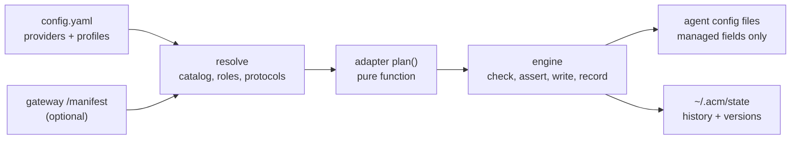

<!-- // Ver 2026-10-20 20:10, by Opus 5.5 -->

# ACM User Guide

This guide covers ACM 0.4. The authoritative design lives in [ACM_PRINCIPLE_v3.md](ACM_PRINCIPLE_v3.md) and [ACM_SPEC_v3.md](ACM_SPEC_v3.md) (both Chinese); this document is the user-facing view.

- [Quick start with a VMR gateway](#quick-start-with-a-vmr-gateway)
- [How ACM works](#how-acm-works)
- [Configuration](#configuration)
- [Commands](#commands)
- [Choosing which agents ACM manages](#choosing-which-agents-acm-manages)
- [Safety, drift and recovery](#safety-drift-and-recovery)
- [One-off launch: `acm run`](#one-off-launch-acm-run)
- [What ACM writes, per agent](#what-acm-writes-per-agent)
- [Gateway manifest](#gateway-manifest)
- [Subscription logins](#subscription-logins)
- [Environment variables](#environment-variables)
- [Troubleshooting](#troubleshooting)
- [Upgrading from 0.3](#upgrading-from-03)

## Quick start with a VMR gateway

ACM reads the gateway's model catalog (`GET /manifest`) instead of you copying model names into a file. Pick the case that matches where VMR runs.

**VMR on this machine** (the default address `http://127.0.0.1:8800`):

```bash
export VMR_KEY=sk-...        # only if the gateway has api_keys; a keyless gateway needs nothing
acm init                     # finds the gateway, shows the proposed ~/.acm/config.yaml, asks before writing
acm use daily                # pick the agents in the checklist; writes their model fields
acm status                   # every managed agent should be SYNCED
```

**VMR on another machine** (LAN address or a domain): name it once, per command or for your shell.

```bash
acm init --vmr http://192.168.0.22:8800
# or put it in ~/.zshrc / ~/.bashrc so `acm init` and `acm run` find it by themselves:
export VMR_URL=http://192.168.0.22:8800
export VMR_KEY=sk-...        # if the gateway requires a key
```

`acm init` writes the manifest URL into `config.yaml`, so `use`, `apply`, `status` and `run` work without `VMR_URL` afterwards.

**No config file, one session only:** `VMR_URL` (plus `VMR_KEY` if needed) is all `acm run` needs. It reads the manifest, starts the agent with the gateway's models and writes nothing.

```bash
VMR_URL=http://192.168.0.22:8800 acm run claude
VMR_URL=http://192.168.0.22:8800 acm run pi -m coding     # a model by name; vmr@fast for a role
```

How models are picked:

- **Roles.** The gateway tags models with roles: `default`, `reasoning`, `fast`, `subagent`, `review` (VMR: `models.<name>.meta.roles`). `acm init` proposes `vmr@default` plus every role the gateway publishes. Each agent then gets the model for its protocol and slot (see [What ACM writes](#what-acm-writes-per-agent)). When the gateway re-tags or swaps a model, `acm status` shows `OUT_OF_SYNC` and `acm apply` follows it.
- **No roles published.** `acm init` can only guess a default (the first model) and says so in a comment that lists the models. Either name models yourself:

  ```yaml
  profiles:
    daily:
      default: vmr.coding
      roles: {fast: vmr.fast, reasoning: vmr.agent}
  ```

  or ask the gateway's admin to set the roles. With roles, `vmr@default` and the others follow the gateway automatically.
- **Keys.** `config.yaml` holds the reference `${VMR_KEY}`, never the key. The agents get a reference too (Claude Code `apiKeyHelper: printenv VMR_KEY`, Codex `env_key`, OpenCode `{env:VMR_KEY}`, Pi `$VMR_KEY`), so **export `VMR_KEY` in the shell that starts the agents**, not only where you run `acm`. For a gateway whose manifest says it needs no key, `acm init` writes `${VMR_KEY:-}`, and nothing has to be exported.

## How ACM works



1. You describe providers (where models are) and profiles (which models you want) once.
2. For each installed agent, ACM computes the exact fields to set — a *plan*. Adapters never touch disk.
3. The engine writes the plan: it re-parses the result and verifies that nothing outside the planned fields changed, stores the before/after versions, then replaces the file atomically.

ACM owns **fields**. Anything it does not list in [What ACM writes](#what-acm-writes-per-agent) is never read for modification and never changed.

## Configuration

`~/.acm/config.yaml` (override the directory with `ACM_HOME`). Created by `acm init`, or write it by hand. `version: 4` is required and unknown keys are rejected.

```yaml
version: 4

providers:
  # A static provider: you describe the endpoint and its models.
  deepseek:
    protocol: openai-completions        # openai-completions | anthropic-messages | openai-responses
    base_url: https://api.deepseek.com/v1
    api_key: "${DEEPSEEK_API_KEY}"      # whole-field reference; see below
    models:
      deepseek-v4-pro:
        context_window: 1000000         # all optional; unknown is left unset, never guessed
        max_output_tokens: 65536
        input: [text, image]
        tool_call: true
        reasoning: true
        effort: high                    # low | medium | high
      deepseek-v4-flash:
        roles: [fast]                   # a role hint, so "deepseek@fast" resolves

  # A manifest provider: the gateway publishes its own catalog.
  team:
    manifest: https://vmr.team.lan/manifest   # URL, file path, file:// or "${VAR}"
    api_key: "${VMR_KEY}"

profiles:
  team:
    default: team@default               # the model the agent starts with
    roles:                              # optional slots for agents that have them
      reasoning: team@reasoning
      fast: team@fast
  direct:
    default: deepseek.deepseek-v4-pro
    models:                             # optional: register more models (used by Pi-style agents)
      flash: deepseek.deepseek-v4-flash
```

**References**

| Form | Example | Meaning |
|---|---|---|
| Credential | `${VAR}`, `${VAR:-fallback}` | Whole field only — no interpolation inside strings. An unset variable without a fallback is a hard error before anything is written. A literal key is allowed but triggers a plain-text warning when an agent cannot take a reference. |
| Qualified model | `deepseek.deepseek-v4-pro` | Split on the *first* dot; the left side must be a declared provider, so model ids may contain dots. |
| Bare model | `deepseek-v4-pro` | Valid only when unique across static providers. |
| Role | `team@fast` | Roles: `default`, `reasoning`, `fast`, `subagent`, `review`. Resolved from the provider's catalog for the protocol the agent speaks. |

**Profile rules.** A profile needs `default`, `models`, or both. `roles` requires `default`. `default` drives the agent's default-model field; `models` registers extra choices for agents that keep a model registry (Pi family). Agents with no registry (Claude Code, Codex) project only the default and warn that the other members cannot be expressed.

## Commands

Global flags where they apply: `--dry-run`, `--force`, `--yes/-y`, `--verbose`, `--show-secrets`, `--no-color`.

| Command | What it does |
|---|---|
| `acm init [--vmr URL] [--force] [-y]` | Detect installed agents and a gateway (`--vmr`, `VMR_URL`, or `http://127.0.0.1:8800`): `GET /manifest`, falling back to `/v1/models`. Shows the proposed `config.yaml` and writes it after confirmation. Refuses to overwrite an existing file unless `--force`. |
| `acm use PROFILE [AGENT...]` | Choose the agents to manage (see below), project PROFILE onto them, and make it active once at least one agent is projected. Asks before taking over an agent or when new fields appear. |
| `acm apply [AGENT...]` | Re-project the active profile onto the managed agents — picks up catalog changes from the gateway. |
| `acm status [AGENT...] [--all]` | State per agent; with `--verbose`, field-level differences. |
| `acm history [AGENT...] [--full] [--limit N]` | What ACM wrote per file, newest first, each with an operation number. |
| `acm restore [N] [AGENT...] [--baseline] [--file]` | Return to a historical version. See below. |
| `acm rollback [AGENT...]` | Undo the latest operation for each agent (managed fields only). |
| `acm prune --keep N` | Delete old history entries and unreferenced versions; keeps the newest N (N ≥ 1) per file. Baselines are always kept. |
| `acm run AGENT [-m REF] [--profile P] [--manifest M] [-- ARGS]` | One-off launch. Shorthand: `acm AGENT ...`. |

Agent names accept the id (`claude_code`), the alias (`claude`) and hyphenated spellings.

**States**

| State | Meaning |
|---|---|
| `SYNCED` | Managed fields match the plan, no drift. |
| `OUT_OF_SYNC` | The plan differs from the file (new profile, new catalog). `acm apply` fixes it. |
| `DRIFTED` | A managed field was changed outside ACM since its last write. Writes are blocked until `--force` or resolution. |
| `ERROR` | The file cannot be parsed, its structure is unexpected, the plan failed, or the catalog is unreachable. Nothing is written. |
| `UNMANAGED` | Not in the managed set: never selected, deselected, released after drift, or returned with `restore --baseline`. Also shown when there is no active profile. |
| `NOT_DETECTED` | The agent is not installed. |

**Exit codes**: `0` ok or no-op · `1` configuration error · `2` safety block (drift, lock, whitelist, confirmation needed non-interactively) · `3` I/O failure or catalog unreachable · `4` not found · `130` interrupted. Normal output goes to stdout; warnings and errors to stderr.

## Choosing which agents ACM manages

ACM only writes the agents you selected — like choosing install targets with `npx skills`.

- `acm use` / `acm apply` without agent names, in a terminal, list the agents **detected on this machine** (agents that are not installed are not listed). Managed agents are pre-checked, others are not; the first time, every detected agent is pre-checked. Toggle by number, `a` = all, `n` = none, Enter = continue, `q` = abort.
- Deselecting a managed agent stops managing it (`released`). Its files are left exactly as they are; `acm restore --baseline AGENT` reverts them.
- Agents that are not selected are skipped and listed as `skipped`, with the command that adds them.
- Without a terminal (scripts) or with `--yes`, the pre-checked set is used as is.
- Naming agents (`acm use team claude codex`) works on exactly those agents and adds them to the set. An agent that is not in the set yet — including one you released earlier — is a takeover: ACM shows the changes and asks (non-interactively: `--yes`).
- The set is kept in `~/.acm/state/managed.json`.

## Safety, drift and recovery

**Before any write**, per agent: read files → check drift → compute plan → compare with current values (equal ⇒ no-op, exit 0) → confirm first takeover → apply in memory → re-parse and assert that only planned fields changed → recheck the file hash → store versions → atomic replace → append to history. Any failure before the replace leaves the file untouched. A global lock prevents two ACM processes from interleaving.

**Drift.** For each file ACM remembers the managed fields it last wrote. If the current value of one of them differs, that is drift: ACM prints `path: what ACM wrote → what is there now` and blocks (exit 2). Values are masked like any other output. Choose `--force` to overwrite. Interactive runs offer: overwrite, stop managing this agent, or abort. Changes to *unmanaged* fields are never drift.

**History.** Every write is a line in `~/.acm/state/history.jsonl` plus the exact before/after bytes in a content-addressed store. The first write to a file also records a *baseline* — the file as it was before ACM.

**Restore.**

| Command | Target |
|---|---|
| `acm restore N` | The state after operation N (numbers from `acm history`). |
| `acm restore --baseline` | The state before ACM first touched the file. |
| `acm rollback` | The state before the latest operation. |

By default only managed fields are restored; everything else in the file stays as it is now, so changes the agent made in the meantime survive. `--file` replaces the whole file with that version and first shows which unmanaged changes it would lose. A restore is itself recorded, so it can be undone. After `restore --baseline` the agent leaves the managed set (`UNMANAGED`): later `use` / `apply` runs skip it until you select or name it again. If ACM created a file and you restore its baseline, the managed fields are removed and the file is deleted when nothing else is left in it.

**Secrets.** The version store holds exact copies of agent config files and may contain plain-text keys that were already there. It lives under `~/.acm/state` (mode 0700, files 0600). All output masks values of keys containing `key`, `token`, `auth`, `secret`, `password` or `credential` (size fields such as `CLAUDE_CODE_MAX_CONTEXT_TOKENS` or `maxTokens` stay readable); `--show-secrets` disables masking.

## One-off launch: `acm run`

`acm run AGENT` starts the agent with the configured models without writing any of its files, so nothing needs undoing. Targets are taken from, in order: command-line flags, environment (`ACM_MANIFEST`, or `VMR_URL` + `VMR_KEY` — no `config.yaml` needed), then the active profile.

```bash
acm run claude                         # active profile's default
acm run codex -m team.coding           # a specific model
acm run opencode -m team@fast          # a role
acm run pi --profile direct -- -p "hi" # arguments after -- go to the agent
VMR_URL=https://vmr.lan VMR_KEY=sk-... acm opencode      # zero-config
```

**Pi: one model that follows the thinking level.** When the profile has a `fast` or `reasoning` model that differs from `default` (and you did not pass `-m`), `acm run pi` starts Pi on the virtual model `acm/auto`. The thinking level picks the model: `low` uses fast, `medium` (the start) uses default, `high` uses reasoning. Switch the level as usual inside Pi, or start on one with `acm run pi -- --thinking high`. Follow-ups after tool calls and retries stay on the model that answered, so the prompt cache survives. Background requests such as compaction summaries use the fast model only when its context window is at least as large as the current one. Pi's footer shows the routed model, for example `auto • high → deep • high`. This exists only for `acm run`; `acm use` keeps registering the role models for `/model`.

The mechanism per agent (CLI flags, config override env vars, or a temporary directory under `~/.acm/state/run/<pid>/`) is chosen by the adapter. API keys never appear in argv: they reach the agent as an environment variable — your own `${VAR}`, or, when `config.yaml` holds a literal, one variable per provider (`ACM_RUN_KEY` for the default model's provider, `ACM_RUN_KEY_<NAME>` for others), so each key only goes to its own endpoint. Not supported yet: T2 family members (OmO, Prime Agent, MiMo Code, DevEco Code) — `acm run` says so and exits 1 rather than guessing.

## What ACM writes, per agent

Everything not listed is untouched.

| Agent | File | Managed fields |
|---|---|---|
| Claude Code | `~/.claude/settings.json` (`CLAUDE_CONFIG_DIR`) | `model`, `effortLevel`, `apiKeyHelper`; `env`: `ANTHROPIC_BASE_URL`, `ANTHROPIC_AUTH_TOKEN`, `ANTHROPIC_DEFAULT_{OPUS,SONNET,HAIKU,FABLE}_MODEL`, `CLAUDE_CODE_SUBAGENT_MODEL`, `CLAUDE_CODE_MAX_CONTEXT_TOKENS`, `ANTHROPIC_API_KEY` (removed so a real key is not sent to your gateway) |
| Codex CLI | `~/.codex/config.toml` (`CODEX_HOME`) + ACM-owned `~/.acm/owned/codex/catalog.json` | `model`, `model_provider`, `model_reasoning_effort`, `review_model`, `model_catalog_json`, `model_providers.<name>`, `agents.default_subagent_model`. Responses protocol only. |
| Pi | `~/.pi/agent/models.json`, `settings.json` (`PI_CODING_AGENT_DIR`) | `models.json`: `providers.<name>`; `settings.json`: `defaultProvider`, `defaultModel`, `defaultThinkingLevel`. Profile `models:` members are registered; the default is always registered. |
| OpenCode | `~/.config/opencode/opencode.json[c]` (`OPENCODE_CONFIG_DIR`, `XDG_CONFIG_HOME`) | `model`, `small_model` (the `fast` role), `provider.<name>`. Comments are preserved. |
| Hermes Agent | `~/.hermes/config.yaml` (`HERMES_HOME`) | `model`, `providers.acm-*`, `auxiliary.<task>`, `delegation.{provider,model}` |
| OpenClaw | `~/.openclaw/openclaw.json` (`OPENCLAW_CONFIG_PATH`) | `models.providers.<id>`, `agents.defaults.model.primary`, `agents.defaults.utilityModel`. A file using `$include` for these sections is refused rather than edited. |
| OmO, Prime Agent | like Pi, in their own directories | T2 / experimental |
| MiMo Code, DevEco Code | like OpenCode, in their own directories | T2 / experimental |

Credentials are written as references whenever the agent supports them (`apiKeyHelper: printenv VAR` for Claude Code, `env_key` for Codex, `{env:VAR}` for OpenCode, `$VAR` for Pi). A literal key from `config.yaml` is written in plain text only when the agent offers no reference form, with a warning.

**Projection-loss warnings.** When an agent cannot express something in your profile (an extra member for Claude Code, a role it has no slot for, a model whose protocol the agent cannot speak), ACM says so on stderr — one aggregated line per cause — instead of silently dropping it.

## Gateway manifest

A manifest provider points at a document served by your gateway. ACM fetches it with `Authorization: Bearer <api_key>`, caches it in `~/.acm/state/manifests/`, and uses `If-None-Match` for cheap refreshes (2-second timeout; `ACM_MANIFEST_TIMEOUT` to change). Redirects are not followed, so credentials cannot be forwarded to another host. Because the key is sent wherever the manifest's `endpoints` point, ACM warns when an endpoint is on a different origin (scheme, host or port) than the manifest URL itself, and says so explicitly when an https manifest hands out http endpoints. The usual cause is a gateway behind a reverse proxy without its public address configured (VMR: `public_base_url`); if the split is intended, point `manifest` at the same address as the endpoints.

| Situation | `use` / `apply` / `run` | `status` |
|---|---|---|
| 200 / 304 | use it | same |
| Network failure, cache exists | use the cache, warn with its age | same, marked "freshness unknown" |
| Network failure, no cache | exit 3, nothing written | dependent agents show `ERROR` |
| 401 / 403 | exit 1, check credentials | `ERROR` |
| 404 (gateway does not publish `/manifest`) | exit 1 | `ERROR` |
| Invalid or unknown `manifest_version` | exit 1 | `ERROR` |

The document format is in [SPEC §4.2](ACM_SPEC_v3.md). [VMR](https://github.com/bigfatsea/vmr) serves it at `GET /manifest` from its routing table; models are tagged with roles in its `models.<name>.meta.roles`. The gateway only publishes; ACM and you decide which model fills which slot.

## Subscription logins

Most people start with an agent's own subscription (Claude Pro/Max, ChatGPT for Codex, the provider logins of OpenCode or Pi). Those logins live in the agent's credential store, which ACM never manages:

| Agent | Where the login lives | What ACM writes instead |
|---|---|---|
| Claude Code | macOS Keychain, or `~/.claude/.credentials.json` | `settings.json`: `env.ANTHROPIC_BASE_URL`, model slots, `apiKeyHelper` |
| Codex | `~/.codex/auth.json` | `config.toml`: `model_provider`, `model`, `model_providers.<alias>`, … |
| OpenCode | `~/.local/share/opencode/auth.json` | `opencode.json`: `provider.<alias>`, `model`, `small_model` |
| Pi | `~/.pi/agent/auth.json` | `models.json` providers, `settings.json` default provider / model |

So switching to a gateway does not log you out, and switching back does not need a new login:

- **Back to the subscription**: `acm restore --baseline AGENT` (or `acm rollback AGENT` to undo just the last change). The fields ACM wrote are removed and the agent uses its stored login again. In Claude Code the documented precedence puts `ANTHROPIC_AUTH_TOKEN` / `apiKeyHelper` above the subscription login, so once they are gone the login is used.
- **Back to the gateway**: `acm use PROFILE AGENT --yes`.
- **Gateway for one session only**: `acm run AGENT` writes nothing, so the subscription stays the default.
- A key ACM removed on takeover (for example a real `ANTHROPIC_API_KEY` in Claude Code's `settings.json`, which would otherwise be sent to the gateway) is in the history and comes back with `restore --baseline` / `rollback`.
- If the stored login itself has expired, the agent asks you to log in again — that is between you and the agent's vendor.

## Environment variables

| Variable | Read by | Meaning |
|---|---|---|
| `VMR_URL` | `acm init`, `acm run` without a config | Gateway base URL. `acm init` falls back to `http://127.0.0.1:8800`; `--vmr` wins over it |
| `VMR_KEY` | `acm init` (probing), zero-config `acm run`, and wherever `config.yaml` says `${VMR_KEY}` — including the agents themselves | The gateway's key |
| `ACM_MANIFEST` | `acm run` without a config | A manifest URL or file to run against, instead of `VMR_URL` |
| `ACM_MANIFEST_TIMEOUT` | every command that reads a manifest | Seconds to wait for the gateway (default `2`) |
| `ACM_HOME` | every command | Moves `~/.acm` (config, history, versions, manifest cache) |
| Agent directory variables (`PI_CODING_AGENT_DIR`, …) | the matching agent | Where that agent keeps its files; listed in [What ACM writes](#what-acm-writes-per-agent) |

Any other `${NAME}` in `config.yaml` is your own: every reference must be set when ACM runs, unless it is written `${NAME:-default}`.

## Troubleshooting

| Symptom | Cause and fix |
|---|---|
| `unsupported config version` | Config is not schema v4. See [Upgrading](#upgrading-from-03). |
| `environment variable X is not set` | A `${X}` reference has no value and no `:-default`. Export it in the shell that runs ACM. Nothing was written. |
| Exit 2, `DRIFTED` | A managed field was edited elsewhere. Read the listed differences; `--force` overwrites, or change `config.yaml` to match what you want. |
| Exit 2, `another acm process is holding the write lock` | Another ACM process is running; retry when it finishes. |
| Exit 3 with a manifest provider | Gateway unreachable and no cache. Check the URL and VPN; run once while online to create the cache. |
| Agent `ERROR`, file cannot be parsed | The agent's own file is invalid. Fix it (ACM never rewrites a file it cannot parse), then `acm status`. |
| `OUT_OF_SYNC` after the gateway changed models | `acm apply`. |
| `warning: manifest '…' was read from A but its endpoints send requests and the key to B` | The gateway publishes endpoints on another origin than the manifest URL. Behind a reverse proxy this usually means its public address is not configured (VMR: `public_base_url`), and https may have turned into http. If the split is intended, point `manifest` at the same address as the endpoints. |
| Agent `ERROR`: `no model with role 'default' on <protocol>` | The gateway offers no `default` model on the protocol this agent speaks (Codex needs `openai-responses`, Claude Code `anthropic-messages`). Ask the gateway to serve it there, or reference a model explicitly in the profile. Other agents are unaffected. |
| Claude Code fails on one model (often the `haiku` / fast slot); the gateway says `rejected by condition(s): thinking`, and `acm use` warned `'X' has no thinking-capable model behind it` | Claude Code turns thinking on for every request to a gateway model, background ones included, and the gateway only routes such requests to a model that can think. Declare `thinking` on one of that virtual model's real models in the gateway (VMR: `model_defaults`), or point the role at a model that can think. |
| Claude Code does not use the gateway | `acm status --verbose` shows whether `env.ANTHROPIC_BASE_URL` and `apiKeyHelper` are in sync. The key variable named in `config.yaml` must be exported in the shell that starts Claude Code, because the helper is `printenv VAR`. |
| Agent `skipped` | It is not in the managed set. Select it in the checklist or name it: `acm use PROFILE AGENT`. |
| Want ACM gone | `acm restore --baseline` per agent (or `acm rollback` repeatedly), then uninstall. Files stay valid at any point; ACM keeps no hooks into the agents. |

## Upgrading from 0.3

0.4 is a rewrite with a new config schema (v4) and a new history format. The old snapshots and journal are not read. To migrate:

1. Keep a copy of your old `~/.acm/config.yaml`.
2. `acm init --force` regenerates the config from your gateway or edit by hand following [Configuration](#configuration): protocols are now `openai-completions` / `anthropic-messages` / `openai-responses`; the `capabilities` block is replaced by `input` / `tool_call` / `reasoning`; `models:` live under their provider.
3. `acm use <profile>` takes over the agents again. Fields ACM wrote under 0.3 are simply overwritten; the first 0.4 write records a fresh baseline from the file's *current* content. That baseline already contains what 0.3 wrote, so `restore --baseline` returns to the 0.3-era state, not to the file before 0.3; restore 0.3's own backups first if you need that.
