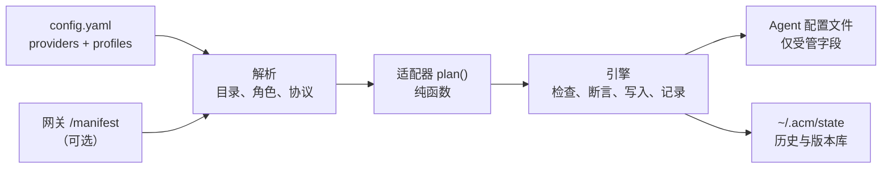

<!-- // Ver 2026-10-20 17:55, by Opus 5.5 -->

# ACM 使用指南

本指南对应 ACM 0.4。权威设计见 [ACM_PRINCIPLE_v3.md](ACM_PRINCIPLE_v3.md) 与 [ACM_SPEC_v3.md](ACM_SPEC_v3.md)；本文从使用者角度说明。

- [工作原理](#工作原理)
- [配置](#配置)
- [命令](#命令)
- [选择受管 Agent](#选择受管-agent)
- [安全、漂移与恢复](#安全漂移与恢复)
- [一次性启动：`acm run`](#一次性启动acm-run)
- [各 Agent 的写入范围](#各-agent-的写入范围)
- [网关 Manifest](#网关-manifest)
- [订阅登录](#订阅登录)
- [排障](#排障)
- [从 0.3 升级](#从-03-升级)

## 工作原理



1. 你只需描述一次 provider（模型在哪）与 profile（想用哪些模型）。
2. 对每个已安装 Agent，ACM 计算要设置的确切字段，即 *plan*；适配器从不接触磁盘。
3. 引擎执行写入：重新解析结果，并断言计划字段之外没有任何变化；保存前后版本；再原子替换文件。

ACM 只拥有**字段**。[各 Agent 的写入范围](#各-agent-的写入范围)里没有列出的内容，不会被修改。

## 配置

`~/.acm/config.yaml`（目录可用 `ACM_HOME` 改写）。由 `acm init` 生成，或手写。必须 `version: 4`，未知键一律拒绝。

```yaml
version: 4

providers:
  # 静态 provider：自己描述端点和模型
  deepseek:
    protocol: openai-completions        # openai-completions | anthropic-messages | openai-responses
    base_url: https://api.deepseek.com/v1
    api_key: "${DEEPSEEK_API_KEY}"      # 整字段引用，见下
    models:
      deepseek-v4-pro:
        context_window: 1000000         # 以下均可选；未知就不写，ACM 不猜
        max_output_tokens: 65536
        input: [text, image]
        tool_call: true
        reasoning: true
        effort: high                    # low | medium | high
      deepseek-v4-flash:
        roles: [fast]                   # 角色提示，使 "deepseek@fast" 可解析

  # Manifest 型 provider：由网关发布自己的目录
  team:
    manifest: https://vmr.team.lan/manifest   # URL、文件路径、file:// 或 "${VAR}"
    api_key: "${VMR_KEY}"

profiles:
  team:
    default: team@default               # Agent 启动时用的模型
    roles:                              # 可选：给有对应槽位的 Agent
      reasoning: team@reasoning
      fast: team@fast
  direct:
    default: deepseek.deepseek-v4-pro
    models:                             # 可选：注册更多模型（Pi 族等使用）
      flash: deepseek.deepseek-v4-flash
```

**引用语法**

| 形式 | 例 | 含义 |
|---|---|---|
| 凭据 | `${VAR}`、`${VAR:-fallback}` | 仅限整字段，不支持字符串内插值。变量未设置且无默认值 = 硬错误，写盘之前即中止。允许写明文 key，但 Agent 无法接受引用时会出明文告警。 |
| 限定模型 | `deepseek.deepseek-v4-pro` | 按**第一个点**切分，左侧必须是已声明的 provider，因此模型 id 可含点。 |
| 裸模型 | `deepseek-v4-pro` | 仅在静态 provider 中全局唯一时有效。 |
| 角色 | `team@fast` | 角色：`default`、`reasoning`、`fast`、`subagent`、`review`；按 Agent 所用协议在该 provider 目录中解析。 |

**Profile 规则**：至少声明 `default` 或 `models` 之一；`roles` 必须同时有 `default`。`default` 决定 Agent 的默认模型字段；`models` 为有模型注册表的 Agent（Pi 族）登记额外选项。没有注册表的 Agent（Claude Code、Codex）只投影 default，并告警其余成员无法表达。

## 命令

适用时可用的全局选项：`--dry-run`、`--force`、`--yes/-y`、`--verbose`、`--show-secrets`、`--no-color`。

| 命令 | 作用 |
|---|---|
| `acm init [--vmr URL] [--force] [-y]` | 探测已安装的 Agent 与网关（`--vmr`、`VMR_URL` 或 `http://127.0.0.1:8800`）：先 `GET /manifest`，回落 `/v1/models`。展示 `config.yaml` 提案，确认后写入。已存在则拒绝，除非 `--force`。 |
| `acm use PROFILE [AGENT...]` | 选择要管理的 Agent（见下），把 PROFILE 投影上去；至少一个 Agent 投影成功后才激活。接管 Agent 或出现新字段时先询问。 |
| `acm apply [AGENT...]` | 把当前 profile 重新投影到受管 Agent，用于获取网关目录变化。 |
| `acm status [AGENT...] [--all]` | 各 Agent 状态；`--verbose` 显示字段级差异。 |
| `acm history [AGENT...] [--full] [--limit N]` | 按文件列出 ACM 写过的内容（新→旧），每条带操作编号。 |
| `acm restore [N] [AGENT...] [--baseline] [--file]` | 恢复到历史版本，见下。 |
| `acm rollback [AGENT...]` | 撤销每个 Agent 最近一次操作（仅受管字段）。 |
| `acm prune --keep N` | 删除旧历史与不再被引用的版本；每个文件保留最近 N 条（N ≥ 1）；基线始终保留。 |
| `acm run AGENT [-m REF] [--profile P] [--manifest M] [-- ARGS]` | 一次性启动。简写：`acm AGENT ...`。 |

Agent 名接受 id（`claude_code`）、别名（`claude`）和连字符写法。

**状态**

| 状态 | 含义 |
|---|---|
| `SYNCED` | 受管字段与计划一致，无漂移。 |
| `OUT_OF_SYNC` | 计划与文件不同（换了 profile、目录变了）。`acm apply` 可修复。 |
| `DRIFTED` | 自 ACM 上次写入后，受管字段被外部改过；在 `--force` 或处理之前写入被阻断。 |
| `ERROR` | 文件无法解析、结构不符预期、计划失败或目录不可得；不写任何东西。 |
| `UNMANAGED` | 不在受管集合中：从未选择、被取消勾选、漂移时选择不再管理，或已 `restore --baseline`。没有激活 profile 时也显示此状态。 |
| `NOT_DETECTED` | 未安装该 Agent。 |

**退出码**：`0` 成功或无变化 · `1` 配置错误 · `2` 安全阻断（漂移、锁、白名单、非交互下需要确认）· `3` I/O 失败或目录不可达 · `4` 未找到 · `130` 中断。正常输出到 stdout，警告与错误到 stderr。

## 选择受管 Agent

ACM 只写你选中的 Agent，类似 `npx skills` 安装时选择目标 Agent。

- 在终端里运行不点名的 `acm use` / `acm apply`，会列出**本机检测到的** Agent（未安装的不列）。受管的默认勾选，其余不勾选；第一次时所有检测到的都默认勾选。输入编号切换，`a` 全选，`n` 全不选，回车继续，`q` 放弃。
- 取消勾选一个受管 Agent = 不再管理它（`released`）：文件保持原样；`acm restore --baseline AGENT` 可还原。
- 未选中的 Agent 被跳过，输出 `skipped` 及纳入它的命令。
- 非终端（脚本）或带 `--yes` 时，直接使用默认勾选的集合。
- 点名（`acm use team claude codex`）只处理这些 Agent，并把它们加入集合。不在集合中的 Agent（包括之前释放的）属于接管：ACM 展示变更并确认（非交互须 `--yes`）。
- 集合保存在 `~/.acm/state/managed.json`。

## 安全、漂移与恢复

**每次写入之前**（逐 Agent）：读文件 → 检查漂移 → 计算 plan → 与当前值比较（相同 ⇒ no-op，退出 0）→ 首次接管需确认 → 内存中应用 → 重新解析并断言只有计划字段变化 → 复核文件哈希 → 保存版本 → 原子替换 → 追加历史。替换之前的任何失败都不会改动文件。全局锁防止两个 ACM 进程交错写入。

**漂移**：ACM 为每个文件记住上次写入的受管字段值；若其中某个当前值不同，即为漂移。ACM 打印 `路径：ACM 写的值 → 现在的值` 并阻断（退出 2）。其中的值与其他输出一样掩码。可用 `--force` 覆盖；交互运行时会提供：覆盖 / 不再管理此 Agent / 放弃。*非受管*字段的变化永远不算漂移。

**历史**：每次写入在 `~/.acm/state/history.jsonl` 追加一行，并把前后字节存入内容寻址版本库。某文件的首次写入还会记录一条*基线*——ACM 接管之前的原貌。

**恢复**

| 命令 | 目标 |
|---|---|
| `acm restore N` | 第 N 号操作之后的状态（编号见 `acm history`）。 |
| `acm restore --baseline` | ACM 首次接触该文件之前的状态。 |
| `acm rollback` | 最近一次操作之前的状态。 |

默认只恢复受管字段，文件中其他内容保持现状，因此 Agent 在此期间自己写入的变化不会丢。`--file` 用该版本整体替换文件，并先展示会丢失哪些非受管变化。恢复本身也被记录，因此可再次撤销。`restore --baseline` 之后该 Agent 移出受管集合（`UNMANAGED`）：之后的 `use` / `apply` 跳过它，直到你重新勾选或点名。若文件由 ACM 新建、恢复到基线，受管字段被移除，且文件中不剩其他内容时文件被删除。

**密钥**：版本库保存 Agent 配置文件的原样副本，其中可能含原本就存在的明文 key。它位于 `~/.acm/state`（目录 0700，文件 0600）。所有输出对键名含 `key`、`token`、`auth`、`secret`、`password`、`credential` 的值掩码（`CLAUDE_CODE_MAX_CONTEXT_TOKENS`、`maxTokens` 这类大小字段照常显示）；`--show-secrets` 取消掩码。

## 一次性启动：`acm run`

`acm run AGENT` 用已配置的模型启动 Agent，不写它的任何文件，因而无需回滚。目标来源优先级：命令行选项 > 环境变量（`ACM_MANIFEST`，或 `VMR_URL` + `VMR_KEY`——此时不需要 `config.yaml`）> 当前激活的 profile。

```bash
acm run claude                         # 当前 profile 的 default
acm run codex -m team.coding           # 指定模型
acm run opencode -m team@fast          # 按角色
acm run pi --profile direct -- -p "hi" # -- 之后的参数交给 Agent
VMR_URL=https://vmr.lan VMR_KEY=sk-... acm opencode      # 零配置
```

**Pi：一个跟随思考档位的模型。** 当 profile 里有与 `default` 不同的 `fast` 或 `reasoning` 模型（且没有传 `-m`）时，`acm run pi` 会以虚拟模型 `acm/auto` 启动 Pi，由思考档位决定用哪个模型：`low` 用 fast，`medium`（启动时的档位）用 default，`high` 用 reasoning。在 Pi 里照常切换档位即可，也可以用 `acm run pi -- --thinking high` 直接从某一档开始。工具调用后的继续请求和重试会沿用刚才应答的模型，以保住 Prompt Cache；压缩摘要等后台请求只在 fast 模型的上下文窗口不小于当前模型时才用 fast。Pi 页脚会显示实际路由到的模型，例如 `auto • high → deep • high`。该功能只用于 `acm run`；`acm use` 仍然把各角色模型注册进 `/model`。

各 Agent 采用的机制（命令行参数、配置覆盖环境变量，或 `~/.acm/state/run/<pid>/` 下的临时目录）由适配器决定。API key 不会出现在 argv：以环境变量传给 Agent——你自己的 `${VAR}`；`config.yaml` 里是明文时每个 provider 一个变量（默认模型的 provider 用 `ACM_RUN_KEY`，其他用 `ACM_RUN_KEY_<NAME>`），保证每个 key 只发往它自己的端点。暂不支持 T2 家族成员（OmO、Prime Agent、MiMo Code、DevEco Code）——`acm run` 会明确说明并以 1 退出，而不是猜测。

## 各 Agent 的写入范围

未列出的内容一律不动。

| Agent | 文件 | 受管字段 |
|---|---|---|
| Claude Code | `~/.claude/settings.json`（`CLAUDE_CONFIG_DIR`） | `model`、`effortLevel`、`apiKeyHelper`；`env`：`ANTHROPIC_BASE_URL`、`ANTHROPIC_AUTH_TOKEN`、`ANTHROPIC_DEFAULT_{OPUS,SONNET,HAIKU,FABLE}_MODEL`、`CLAUDE_CODE_SUBAGENT_MODEL`、`CLAUDE_CODE_MAX_CONTEXT_TOKENS`、`ANTHROPIC_API_KEY`（会被移除，避免真实 key 被发到你的网关） |
| Codex CLI | `~/.codex/config.toml`（`CODEX_HOME`）+ ACM 独占的 `~/.acm/owned/codex/catalog.json` | `model`、`model_provider`、`model_reasoning_effort`、`review_model`、`model_catalog_json`、`model_providers.<name>`、`agents.default_subagent_model`。仅 Responses 协议。 |
| Pi | `~/.pi/agent/models.json`、`settings.json`（`PI_CODING_AGENT_DIR`） | `models.json`：`providers.<name>`；`settings.json`：`defaultProvider`、`defaultModel`、`defaultThinkingLevel`。登记 profile 的 `models:` 成员；default 总会被登记。 |
| OpenCode | `~/.config/opencode/opencode.json[c]`（`OPENCODE_CONFIG_DIR`、`XDG_CONFIG_HOME`） | `model`、`small_model`（`fast` 角色）、`provider.<name>`；注释保留。 |
| Hermes Agent | `~/.hermes/config.yaml`（`HERMES_HOME`） | `model`、`providers.acm-*`、`auxiliary.<task>`、`delegation.{provider,model}` |
| OpenClaw | `~/.openclaw/openclaw.json`（`OPENCLAW_CONFIG_PATH`） | `models.providers.<id>`、`agents.defaults.model.primary`、`agents.defaults.utilityModel`。对这些段使用 `$include` 的文件会被拒绝而不是编辑。 |
| OmO、Prime Agent | 同 Pi，目录各自独立 | T2 / 实验性 |
| MiMo Code、DevEco Code | 同 OpenCode，目录各自独立 | T2 / 实验性 |

只要 Agent 支持引用，凭据就写成引用（Claude Code 用 `apiKeyHelper: printenv VAR`，Codex 用 `env_key`，OpenCode 用 `{env:VAR}`，Pi 用 `$VAR`）。仅当 Agent 没有引用写法且 `config.yaml` 里是明文时才写明文，并告警。

**投影损失告警**：当 Agent 无法表达 profile 中的某些内容（Claude Code 的额外成员、没有对应槽位的角色、Agent 不会说的协议），ACM 在 stderr 明确说明——同一原因合并成一行——而不是静默丢弃。

## 网关 Manifest

Manifest 型 provider 指向网关发布的文档。ACM 带 `Authorization: Bearer <api_key>` 获取，缓存到 `~/.acm/state/manifests/`，用 `If-None-Match` 做廉价刷新（超时 2 秒，可用 `ACM_MANIFEST_TIMEOUT` 调整）。不跟随重定向，因此凭据不会被转发到其他主机。由于 key 会发往 Manifest 中 `endpoints` 指向的地址，当某个端点与 Manifest URL 本身不同源（scheme、主机或端口不同）时，ACM 会告警；https 的 Manifest 给出 http 端点时会明确指出明文风险。常见原因是网关部署在反向代理之后却没有配置对外地址（VMR：`public_base_url`）；如果确实有意分开，把 `manifest` 指向与端点相同的地址即可。

| 情形 | `use` / `apply` / `run` | `status` |
|---|---|---|
| 200 / 304 | 使用 | 同左 |
| 网络失败，有缓存 | 使用缓存，告警并注明缓存时间 | 同左，标注"目录新鲜度未知" |
| 网络失败，无缓存 | 退出 3，零写盘 | 依赖它的 Agent 为 `ERROR` |
| 401 / 403 | 退出 1，检查凭据 | `ERROR` |
| 404（网关未发布 `/manifest`） | 退出 1 | `ERROR` |
| `manifest_version` 非法或未知 | 退出 1 | `ERROR` |

文档格式见 [SPEC §4.2](ACM_SPEC_v3.md)。[VMR](https://github.com/bigfatsea/vmr) 在 `GET /manifest` 按其路由表派生并提供；模型的角色在其 `models.<name>.meta.roles` 中标注。网关只发布，哪个槽位用哪个模型由 ACM 与你决定。

## 订阅登录

多数人一开始用的是 Agent 自己的订阅（Claude Pro/Max、Codex 的 ChatGPT 登录、OpenCode 或 Pi 的 provider 登录）。这些登录保存在 Agent 的凭据存储里，ACM 从不管理：

| Agent | 登录保存在 | ACM 改写的是 |
|---|---|---|
| Claude Code | macOS 钥匙串，或 `~/.claude/.credentials.json` | `settings.json`：`env.ANTHROPIC_BASE_URL`、模型槽位、`apiKeyHelper` |
| Codex | `~/.codex/auth.json` | `config.toml`：`model_provider`、`model`、`model_providers.<alias>` 等 |
| OpenCode | `~/.local/share/opencode/auth.json` | `opencode.json`：`provider.<alias>`、`model`、`small_model` |
| Pi | `~/.pi/agent/auth.json` | `models.json` 的 providers，`settings.json` 的默认 provider / 模型 |

因此切到网关不会让你退出登录，切回来也不需要重新登录：

- **切回订阅**：`acm restore --baseline AGENT`（只撤销上一次改动用 `acm rollback AGENT`）。ACM 写的字段被移除，Agent 重新使用已保存的登录。Claude Code 官方的认证优先级中 `ANTHROPIC_AUTH_TOKEN` / `apiKeyHelper` 高于订阅登录，二者移除后即回到订阅。
- **切回网关**：`acm use PROFILE AGENT --yes`。
- **只在一次会话里用网关**：`acm run AGENT` 不写任何文件，订阅始终是默认。
- 接管时被 ACM 移除的 key（例如 Claude Code `settings.json` 里真实的 `ANTHROPIC_API_KEY`，否则会被发给网关）记录在历史中，`restore --baseline` / `rollback` 会把它恢复。
- 如果已保存的登录本身过期，Agent 会要求重新登录——这取决于 Agent 厂商，ACM 无法代劳。

## 排障

| 现象 | 原因与处理 |
|---|---|
| `unsupported config version` | 配置不是 schema v4，见[从 0.3 升级](#从-03-升级)。 |
| `environment variable X is not set` | `${X}` 没有值且无 `:-default`。在运行 ACM 的 shell 中导出它；此时没有写入任何东西。 |
| 退出 2，`DRIFTED` | 受管字段在别处被改过。阅读列出的差异；`--force` 覆盖，或改 `config.yaml` 使其与你想要的一致。 |
| 退出 2，`another acm process is holding the write lock` | 另一个 ACM 进程在运行；等它结束后重试。 |
| 使用 Manifest provider 时退出 3 | 网关不可达且无缓存。检查 URL 与网络；联网时运行一次以建立缓存。 |
| Agent 为 `ERROR`，文件无法解析 | Agent 自己的文件无效。先修好它（ACM 绝不重写无法解析的文件），再 `acm status`。 |
| 网关改了模型后显示 `OUT_OF_SYNC` | `acm apply`。 |
| `warning: manifest '…' was read from A but its endpoints send requests and the key to B` | 网关发布的端点与 Manifest URL 不同源。部署在反向代理后时，通常是没有配置对外地址（VMR：`public_base_url`），https 还可能变成了 http。若确实有意分开，把 `manifest` 指向与端点相同的地址。 |
| Agent 为 `ERROR`：`no model with role 'default' on <protocol>` | 网关在该 Agent 使用的协议上没有 `default` 模型（Codex 需要 `openai-responses`，Claude Code 需要 `anthropic-messages`）。请网关在该协议上提供，或在 profile 中直接引用某个模型。其他 Agent 不受影响。 |
| Claude Code 没有走网关 | `acm status --verbose` 查看 `env.ANTHROPIC_BASE_URL` 与 `apiKeyHelper` 是否同步。`config.yaml` 中指定的 key 变量必须在启动 Claude Code 的 shell 中导出，因为 helper 就是 `printenv VAR`。 |
| Agent 显示 `skipped` | 它不在受管集合中。在勾选列表里选中它，或点名：`acm use PROFILE AGENT`。 |
| 想彻底移除 ACM | 对每个 Agent 运行 `acm restore --baseline`（或多次 `acm rollback`），然后卸载。任何时刻文件都保持有效；ACM 不在 Agent 里留任何钩子。 |

## 从 0.3 升级

0.4 是重写，配置 schema 升到 v4，历史格式也不同；旧快照与日志不会被读取。迁移步骤：

1. 保留旧的 `~/.acm/config.yaml` 副本。
2. 运行 `acm init --force` 从网关重新生成，或参照[配置](#配置)手改：协议名改为 `openai-completions` / `anthropic-messages` / `openai-responses`；`capabilities` 块换成 `input` / `tool_call` / `reasoning`；`models:` 放在各自 provider 之下。
3. `acm use <profile>` 重新接管 Agent。0.3 写入的字段会被直接覆盖；0.4 的首次写入会以文件*当前*内容记录新的基线。该基线已包含 0.3 写入的内容，因此 `restore --baseline` 回到的是 0.3 时期的状态，而不是 0.3 之前；如需更早的状态，请先用 0.3 自己的备份恢复。
