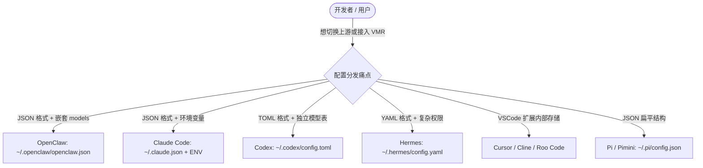
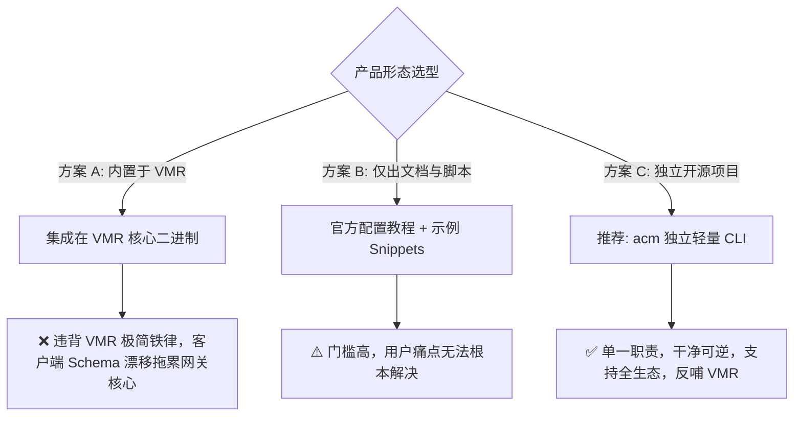
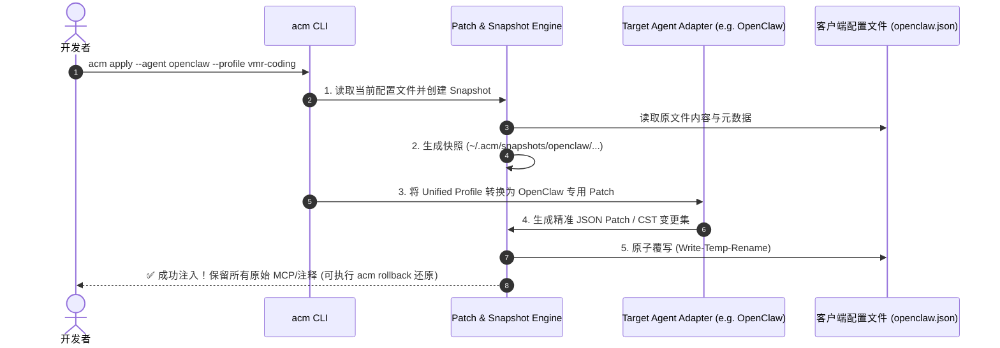
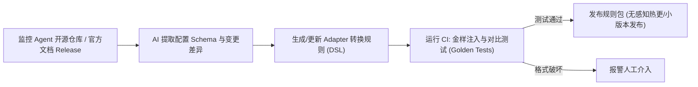

// Ver 2026-08-17 21:15, by custom_2/agent — AI Coding Agent 配置管理工具（Agent Config Manager）第一性原理与深度全景研报 (v2.0 全面扩充版)

# AI Coding Agent 配置管理工具（Agent Config Manager）第一性原理与决策评估研报

> **报告性质**：深度调研、开源生态源码剖析、架构可行性分析与产品战略决策研报  
> **研究对象**：Coding Agent / LLM CLI 客户端（Claude Code、OpenClaw、Cursor、Hermes、Codex、Pi/Pimini、Cline 等）的自动化配置、多 Profile 切换与可逆回滚管理体系  
> **核心议题**：是否立项开发独立的 Agent 配置管理工具？如何以第一性原理解决深层配置项（Context/Thinking/Vision/Token Budget）、状态污染与安全回滚痛点？与 VMR 如何协同？

---

## 核心结论（Executive Summary & Go/No-Go 研判）

```
                     ┌────────────────────────────────────────────────────────┐
                     │              Go/No-Go 核心战略研判                      │
                     └────────────────────────────────────────────────────────┘
                                                  │
                 ┌────────────────────────────────┴────────────────────────────────┐
                 ▼                                                                 ▼
   【VMR 主仓直接内置：No-Go ❌】                                 【独立开源项目：Go ✅ (推荐命名: acm)】
   - 违背 VMR 极简、单二进制、零侵入与 Byte-Faithful 铁律            - 专注「客户端配置注入与安全回滚」单一职责
   - 客户端 Schema 频繁漂移，会拖累 VMR 路由核心稳定性             - 彻底隔离 MCP/Skills，只做 Model Profile 状态机
   - VMR 专注网关侧 (L1/L2)，配置工具专注客户端侧 (L0)            - 独立开源捕获流量，反哺 VMR 成为最佳网关伴侣
```

1. **决策建议**：**Go（立项实施）**，但**必须作为完全独立的开源项目（建议代号：`acm` / Agent Config Manager）运作**，严禁与 VMR 代码仓打包或在运行时强绑定。
2. **为什么独立做**：
   - **VMR 的本质是网关与飞行记录仪**（关注网络请求生命周期），而**配置工具的本质是本地文件状态机与补丁引擎**（关注客户端本地文件生命周期）。混在一起会彻底破坏 VMR 追求的「零运行时侵入、零文件污染、单二进制」的极简哲学。
   - 独立工具可脱离 VMR 独立运作（支持直接配置 OpenRouter、SiliconFlow、DeepSeek、LiteLLM 或本地 Ollama），成为面向全生态 AI 开发者的高频通用基础设施；当检测到本地运行 VMR 时，通过 1 键 profile 联动形成「最佳搭配体验」，作为 VMR 的前置流量入口与生态放大器。
3. **为什么市面现有工具均存在严重缺陷或局限性**：
   - **CC Switch（Tauri/SQLite）**：关注点严重耦合（将 Model、MCP、Skills、Prompts 强行绑定），采用全量模板粗暴覆写，在 Windows/macOS 上高频出现抹杀用户原有 `enabledPlugins`、`hooks`、自定义 MCP 及手写注释的严重事故（详见 Issue #2992）；
   - **Claude Code Router (CCR)**：将配置生成功能强绑定在自身 150K 行 TS 网关进程与 Web UI 内，无法作为独立通用的 CLI 工具使用；
   - **claude-code-config-switcher (`ccc`)**：通过 `--settings` 参数启动注入虽然巧妙避开了覆写文件，但**仅支持 Claude Code 单一客户端**；
   - **Claude Code Profile (`ccp`)**：基于 `CLAUDE_CONFIG_DIR` 软链 Hub 解决 Skill 超限与 Profile 切换，但同样局限于 Claude Code；
   - **claude-swap (`cswap`)**：1.7k stars，专注于 Anthropic 官方多账号 OAuth Token 轮转与 5h/7d 速率限制监控，不解决第三方 API 与多 Agent 配置；
   - **单点账号切换小工具（`CodexAccSwitch`, `ccswitch` 等）**：均停留在简单文件复制/钥匙串替换，无跨 Agent 能力、无深度参数建模、无原子回滚。
4. **技术实现路线**：
   - 采用 **RFC 6902 JSON Patch + YAML CST（保持注释）+ Git-like 快照回滚引擎**，实现非破坏性增量注入；
   - 定义统一的 **Unified Agent Model Schema**，将深度参数（Context/Thinking/Vision/Token/Dialect）映射到具体 Agent 的专有字段；
   - 通过 AI 辅助 Schema 提取与 CI 端到端金样回归测试，低成本覆盖全生态主流 Agent。

---

## 第一部分：第一性原理问题拆解与生态痛点分析

### 1.1 为什么「配置 Coding Agent」是高摩擦痛点？

当前主流 Coding Agent / AI 编程工具存在严重的**「碎片化配置孤岛」**现象：



对于普通开发者和重度多 Agent 用户，摩擦力来自于三个维度：
1. **物理路径与文件格式碎片化**：有的是 JSON（OpenClaw/Claude Code/Pi），有的是 YAML（Hermes），有的是 TOML（Codex），还有的在 VSCode User Settings 或 Global Storage 中。
2. **多环境/多上游频繁切换**：开发者白天用官方订阅（Claude Pro/Team），晚上换便宜的 DeepSeek/MiniMax，或者遇到网络抖动需要将全部 Agent 一键切入本地 VMR 路由。每个 Agent 手工逐个查找并修改一遍极其繁琐且极易配错。
3. **跨 Agent 协同成本高**：同一组 API Key、自定义模型名与端点 URL，需要复制粘贴 N 次，极易遗漏环境变量配置。

---

### 1.2 浅层配置 vs 深度配置（The "Deep Config" Problem）

绝大多数简易脚本或小白教程只关注 `base_url` 和 `api_key` 两个字段。但**在生产级 Coding Agent 中，仅配这两个字段必然导致大量隐蔽 Bug 和糟糕体验**：

| 配置维度 | 字段与典型参数 | 忽略该配置的严重后果（Failures & Penalties） |
|---|---|---|
| **1. 协议方言 (Format Dialect)** | `openai` vs `anthropic` vs `openai-responses` | 协议不匹配直接 404 / 400，导致 Agent 启动即崩溃。 |
| **2. 上下文预算 (Context Window)** | `context_length: 64k / 128k / 200k / 1M` | 许多 Agent 默认按 200k 截断或按 8k 激进压缩；若配了 DeepSeek 64k 却留着 200k，会触发上游 ContextExceeded 报错中断任务；反之则浪费长上下文能力。 |
| **3. 最大输出 Tokens (Max Output)** | `max_tokens: 4096 / 8192 / 16384` | 影响代码生成长度。未正确配置会导致大文件重构时代码在半路被截断（Truncated）。 |
| **4. 视觉/图片能力 (Vision/Image Flag)** | `supports_vision: true/false`, `auto_rescale` | Agent 尝试向纯文本模型（如部分开源模型）发送截图报错；或向支持视觉模型发送超大原图导致 Token 暴增。 |
| **5. 思考/推理预算 (Thinking / Reasoning)** | `reasoning_effort: low/medium/high`, `thinking_budget: 4096` | 对于支持 CoT（如 Claude 3.7 Sonnet、DeepSeek R1、o1/o3）的模型，缺乏该配置将无法开启深度思考，或思考 Token 占满输出预算。 |
| **6. 工具调用模式 (Tool Calling)** | `function_calling: native / xml / markdown` | 许多中小型开源模型或第三方代理对原生 Function Calling 支持不佳，Agent 需要降级到 XML 提示词模式。 |

**第一性原理结论**：配置工具必须提供**标准化的能力抽象（Capability Modeling）**，在注入各 Agent 时自动将其转换为对应 Agent 的专有参数字段，而不能仅仅当作字符串替换。

---

### 1.3 配置污染与回滚灾难：以 CC Switch / CCR 为镜鉴

调研市面上现有的切换工具（特别是 CC Switch），其核心痛点与用户流失根源在于：

```
                ┌──────────────────────────────────────────────────────────┐
                │             CC Switch 的反模式（Anti-Pattern）           │
                └──────────────────────────────────────────────────────────┘
                                             │
      ┌──────────────────────────────────────┼──────────────────────────────────────┐
      ▼                                      ▼                                      ▼
【关注点严重耦合】                       【破坏性全量覆写】                     【回滚机制脆弱】
把 API 切换、MCP 服务器管理、           直接用内存中的 JSON 模板整体覆盖       仅保存简单副本或直接覆写；
Skills 插件、Prompt 模板全部塞进        原文件，导致原本的 YAML/JSON 注释、    一旦结构变动或并发写入，
同一个 GUI 面板，改一处牵连全身。        手写 MCP、特定插件被全部抹杀。         回滚时直接破坏现有工作环境。
```

- **问题 1：范围蔓延（Scope Creep）**：将 MCP 服务管理、Skills 插件、提示词模板强行捆绑。开发者只想换个模型，结果 MCP 配置被覆盖或引发格式冲突。
- **问题 2：破坏性覆写抹杀插件与注释**：直接从 SQLite 读取模板并生成全量 JSON/YAML 覆写磁盘文件，抹杀了用户手工添加的注释、缩进及工具自身生成的内部字段（例如 Claude Code 的 `enabledPlugins` 和 `hooks`，见 CC Switch Issue #2992）。
- **问题 3：缺乏原子快照机制**：没有 Git-like 的变更差异追踪。一旦配置错误，用户无法精准对比「刚才改了哪一行」，回滚往往演变成「灾难性恢复」。

---

## 第二部分：市面全景开源项目深度源码剖析与横向对比

为了确保调研的客观性与穿透力，我们对 GitHub 上所有相关的开源项目、官方文档与代码仓库进行了全面审查。

### 2.1 全景项目矩阵与源码机制剖析

```
┌───────────────────────────────────────────────────────────────────────────────────────────┐
│                               AI CLI / Agent 配置管理全景生态图                            │
├─────────────────────────────────┬─────────────────────────────────┬───────────────────────┤
│  【A. 综合型跨工具管理器】      │  【B. 单工具专用增强型 Switcher】│  【C. 账号额度轮换型】 │
│  - CC Switch (8 款 Agent)       │  - ccc (Claude Code --settings) │  - claude-swap (1.7k★)│
│  - Claude Code Router (CCR)     │  - ccp (Symlink Hub Profile)    │  - CodexAccSwitch     │
│  - CCS (Claude Codex Switch)    │  - ccswitch / cc-account-switch │  - ccswitch (Keychain)│
└─────────────────────────────────┴─────────────────────────────────┴───────────────────────┘
```

#### 1. CC Switch (`farion1231/cc-switch`, v3.15, Tauri / Rust / TypeScript / SQLite)
- **定位与声称**：全能型桌面 GUI（支持 8 款工具：Claude Code, Claude Desktop, Codex, Gemini CLI, Grok Build, OpenCode, OpenClaw, Hermes）。
- **源码底层机制**：采用 SQLite 作为单一事实来源（SSOT，`~/.cc-switch/cc-switch.db`），切换 Provider 时由后端根据内置模板重新生成目标配置文件，并调用原子重命名（Temp + Rename）写入磁盘。
- **核心硬伤剖析**：
  1. **全量模板覆写破坏未知字段**：写入时不是做增量 Merge/Patch，而是直接把模板结构全量刷入磁盘。在 Windows/macOS 上，导致 Claude Code 官方插件配置 `enabledPlugins`、生命周期钩子 `hooks` 等直接被清空（**已在 GitHub Issue #2992 中被用户集中投诉**）；
  2. **严重膨胀的边界范围**：强行捆绑了 MCP 服务管理、Skills 同步、系统 Prompt 编写（CodeMirror 6）、云同步（iCloud/WebDAV）及 Local Proxy。一个原本只需几十行 Patch 搞定的轻量配置操作，变成了一个重达数百 MB 的 Electron/Tauri 桌面应用；
  3. **无 Headless / CLI 支持**：纯桌面 GUI，无法集成进自动化脚本、CI/CD 或纯终端开发流。

#### 2. Claude Code Router (CCR) (`musistudio/claude-code-router`, Node.js / TypeScript, 150K 行)
- **定位与声称**：本地模型网关与控制面，支持 10 款 Agent 预设（Claude Code, Codex, Grok, Kimi, OpenCode, Pi, WorkBuddy 等）。
- **源码底层机制**：提供 `ccr <profile>`（如 `ccr code`）子命令，通过 Node.js `child_process` 启动 Agent 子进程并动态注入环境变量（`ANTHROPIC_BASE_URL=http://localhost:3456`）；同时在 Web UI 的 `Agent Config` 菜单中提供 Apply 按钮，向目标 Agent 文件写入连接到 CCR 本地端口的预设。
- **核心硬伤剖析**：
  1. **强耦合于 CCR 庞大的网关运行时**：配置功能完全依托于 CCR 本地的 Node.js 服务器，无法独立作为一个脱离网关的轻量配置工具；
  2. **仅为网关自身导流**：Agent Config 的目标仅限于「把 Agent 指向 CCR」，无法让用户配置直连公有云（如 OpenRouter、SiliconFlow、DeepSeek）的多 Profile。

#### 3. claude-code-config-switcher (`ccc`) (`guyskk/claude-code-config-switcher`, Python/CLI)
- **定位与声称**：单命令切换 Claude Code Provider（Kimi, GLM, MiniMax 等）。
- **源码底层机制**：**极其巧妙地利用了 Claude Code CLI 的 `--settings` 参数机制**。`ccc` 在启动 Claude Code 时通过 `--settings` 参数直接注入临时的环境变量，由于 `--settings` 的优先级高于磁盘上的 `~/.claude/settings.json`，因此既实现了 Provider 切换，又**100% 保证不触碰和修改用户的 `settings.json` 原始文件**。
- **局限性**：该机制完全依赖 Claude Code 特有的 `--settings` 启动参数。对于 OpenClaw、Hermes、Codex、Pi 等仅从标准配置文件读取状态的 Agent，该方案完全无法复用。

#### 4. Claude Code Profile (`ccp`) (`samhvw8/claude-code-profile`, Go)
- **定位与声称**：基于 Central Hub 的 Claude Code 多 Profile 管理 CLI（kubectx 风格）。
- **源码底层机制**：利用 `CLAUDE_CONFIG_DIR` 环境变量和符号链接架构（Symlink Hub），在 `~/.ccp/` 维护多个独立的配置目录，切换时更新当前项目的全局或本地指向。
- **局限性**：专注于解决 Claude Code 单客户端的 20 skills 上限与环境隔离，不支持任何其他 Agent。

#### 5. Claude Codex Switch (`ccs`) (`kaitranntt/ccs`, NPM CLI / Docker)
- **定位与声称**：多 Provider 运行时与 Profile 启动器。
- **源码底层机制**：将 CLIProxyAPI（OAuth 逆向代理）与 CLI 启动命令（`ccs claude`, `ccs glm`, `ccs kimi`）打包在一起。
- **局限性**：仍属于「代理+启动器」形态，并非纯粹的配置管理工具。

#### 6. claude-swap (`cswap`) (`realiti4/claude-swap`, 1.7k stars, Python / TUI)
- **定位与声称**：多 Claude 账号自动轮转与速率限制监控工具。
- **源码底层机制**：解析 `~/.claude.json`，通过抓取/计算 5h 和 7d 的使用率，在触达配额上限（如 98%）时自动热切换到下一个 Slot 的 OAuth 凭证。
- **局限性**：定位是「官方账号池轮转」，不涉及第三方模型、多 Agent 及深度参数配置。

---

### 2.2 全景竞品与现有方案对比矩阵

| 工具 / 方案 | 语言 / 形态 | 支持 Agent 数量 | 配置修改方式 | 是否破坏注释 / 未知字段 | 深度参数建模 (Context/Thinking/Vision) | 状态回滚机制 | 独立性 (脱离特定网关) |
|---|---|---|---|---|---|---|---|
| **CC Switch** | Tauri / Rust (GUI) | 8 款 | SQLite 模板全量覆写 | ❌ **严重破坏** (丢 plugins/hooks) | ⚠️ 极弱 (仅 4 档基本模型名) | ❌ 脆弱 (仅覆盖备份) | ✅ 独立应用 |
| **Claude Code Router** | TS / Node.js (Web/CLI) | 10 款 | 进程 ENV 包装 / Web 覆写 | ⚠️ 部分破坏 | ⚠️ 依赖网关层改写 | ❌ 无回滚 | ❌ 强绑定 CCR 网关 |
| **ccc (claude-code-config-switcher)** | Python (CLI) | 1 款 (Claude) | CLI `--settings` 启动注入 | ✅ **完全不破坏** | ⚠️ 仅支持基本 ENV | ➖ 无需回滚 | ✅ 独立 |
| **ccp (claude-code-profile)** | Go (CLI) | 1 款 (Claude) | `CLAUDE_CONFIG_DIR` 软链 | ✅ 完全不破坏 | ❌ 无参数转换 | ⚠️ 目录切换 | ✅ 独立 |
| **claude-swap (cswap)** | Python (TUI/CLI) | 1 款 (Claude) | OAuth Token Slot 轮转 | ⚠️ 覆盖 auth json | ❌ 不涉及 | ⚠️ Slot 切换 | ✅ 独立 (限官方账号) |
| **手写配置 / Wiki 模板** | 纯人工 | 理论全覆盖 | 手动编辑文件 | 依赖人工小心 | 依赖人工理解 | 依赖人工 Git / 备份 | ✅ 独立 |
| **我们的方案：`acm`** | **Go (单二进制 CLI)** | **全生态主流 (首批 6+)** | **RFC 6902 JSON Patch + YAML CST** | ✅ **100% 保持注释与未知字段** | ✅ **系统级抽象 (Context/CoT/Vision)** | ✅ **Git-like 事务快照与一键回滚** | ✅ **完全独立 + 智能联动 VMR** |

---

## 第三部分：决策研判（Go vs No-Go & 架构形态定位）

### 3.1 三种产品形态对比



### 3.2 深度决策研判表

| 评估维度 | 方案 A：内置在 VMR 核心中 | 方案 B：仅文档 + 散落脚本 | **方案 C：独立开源项目 `acm`（推荐）** |
|---|---|---|---|
| **架构纯粹性** | ❌ 严重污染。VMR 是纯粹的 In-Flight Proxy，写本地客户端文件属于跨界操作。 | ✅ 极高，VMR 保持零侵入。 | ✅ **完全解耦。VMR 保持纯粹，`acm` 专注配置管理。** |
| **受上游 Schema 漂移影响** | ❌ 致命。任何 Agent 改动配置文件格式都需要发版 VMR，导致网关核心版本频繁震荡。 | ✅ 无影响，改动在文档。 | ✅ **隔离。Schema 适配更新仅影响 `acm`，不影响 VMR 稳定性。** |
| **用户覆盖范围** | ❌ 仅限 VMR 用户使用。 | ⚠️ 覆盖所有愿意折腾的用户。 | ✅ **覆盖整个 Coding Agent 开发者生态（哪怕用户不用 VMR，也可用它配 OpenRouter/DeepSeek）。** |
| **商业/生态价值** | ⚠️ 作为功能点，不易独立传播。 | ❌ 无生态壁垒。 | ✅ **独立开源项目捕获上游流量，成为 VMR 的最佳入口漏斗（Flywheel）。** |
| **维护与测试边界** | ❌ 测试矩阵爆炸（网关压测 + 10+ 客户端文件读写测试混在一起）。 | ✅ 零代码维护成本。 | ✅ **清晰的单向测试集：专门针对各 Agent 配置文件的单元测试与端到端注入测试。** |

**最终决策**：
- **VMR 主仓**：坚决**不内置**客户端配置文件修改逻辑，保持单二进制、零侵入、专注于 Byte-Faithful 路由与飞行记录。
- **立项 `acm` (Agent Config Manager)**：作为独立的轻量级开源 CLI 工具，采用 Unix 哲学构建，专门解决全生态 Agent 的配置注入、Profile 切换与原子回滚。

---

## 第四部分：`acm` 架构设计与关键技术方案

### 4.1 核心设计哲学（Design Tenets）

1. **关注点绝对分离（Strict Scope Boundary）**：
   - `acm` **只管理模型与端点覆盖层（Model & Provider Overlay）**，包括：`base_url`, `api_key`, `model_name`, `context_window`, `max_tokens`, `vision`, `thinking`, `temperature`；
   - `acm` **严禁触碰、修改、同步任何 MCP 服务器配置、Skills 插件列表和用户系统 Prompt**（彻底吸取 CC Switch 臃肿与覆写 Bug 的教训）。
2. **原子性与非破坏性（Atomic & Non-Destructive）**：
   - 采用 JSON Patch (RFC 6902) 与保留注释的 YAML/TOML CST 解析器；
   - 绝不进行全量 `JSON.stringify` 粗暴覆写，严格保留用户的原始文件结构、格式缩进与手写注释。
3. **Git-like 事务快照与一键回滚（Snapshot & Rollback Engine）**：
   - 任何注入或切换操作前，自动生成带时间戳与哈希的本地快照（`~/.acm/snapshots/`）；
   - 提供 `acm diff` 查看变更，提供 `acm rollback` 一键无损还原到任意历史版本。
4. **统一模型抽象（Unified Capability Schema）**：
   - 用户只需定义一份通用的 Model Profile，`acm` 自动将其翻译为目标 Agent 的特定方言。

---

### 4.2 统一模型能力抽象（Unified Model Schema）

用户或 VMR 提供的抽象配置结构如下：

```yaml
# 统一模型 Profile 定义示例 (profile: vmr-coding)
name: vmr-coding
endpoint:
  protocol: openai                 # openai | anthropic | openai-responses
  base_url: http://127.0.0.1:8080/v1
  api_key: vmr-local-token
models:
  primary: coding                  # 虚拟模型名或真实模型名
  cheap: cheap                     # 快速/廉价模型 (可选)
parameters:
  context_window: 131072           # 128K
  max_output_tokens: 8192
  supports_vision: true
  reasoning:
    effort: medium                 # low | medium | high
    thinking_budget: 4096
  temperature: 0.2
```

---

### 4.3 核心组件架构与工作流



---

### 4.4 主流 Agent 适配层分级与映射矩阵

```
                ┌────────────────────────────────────────────────────────┐
                │             Agent 适配架构分级 (3-Tier Matrix)          │
                └────────────────────────────────────────────────────────┘
                                             │
      ┌──────────────────────────────────────┼──────────────────────────────────────┐
      ▼                                      ▼                                      ▼
【Tier 1: 环境变量/启动注入型】         【Tier 2: 纯配置文件驱动型】           【Tier 3: 复杂存储/IDE 型】
- Claude Code (`~/.claude.json` + ENV) - OpenClaw (`openclaw.json`/`models.json`) - Cursor (`settings.json`)
- Aider (`.aider.conf.yml` + ENV)      - Hermes (`config.yaml` / `.env`)       - Cline / Roo Code (VSCode Store)
- OpenCode / Kimi CLI                  - Codex (`~/.codex/config.toml`)        - Desktop App (Claude Desktop)
                                       - Pi / Pimini (`config.json`)
```

#### 详细映射规范表

| Agent 目标 | 配置存储位置 | 格式 | 注入目标字段 / 环境变量 | 深度参数适配方案 |
|---|---|---|---|---|
| **OpenClaw** | `~/.openclaw/openclaw.json`<br>`~/.openclaw/agents/<id>/agent/models.json` | JSON | `models.providers.<name>.baseUrl`<br>`models.providers.<name>.apiKey`<br>`agents.defaults.model.primary` | 写入 `contextWindow` 与 `maxTokens`；映射 `thinking` 参数；自动处理 replace/merge 模式。 |
| **Claude Code** | `~/.claude.json`<br>`~/.claude/settings.json` | JSON / ENV | `ANTHROPIC_BASE_URL`<br>`ANTHROPIC_AUTH_TOKEN`<br>`primary_model` | 注入 `model_overrides`；设置 Token 预算环境变量；借鉴 `ccc` 模式在特定场景支持 `--settings` 包装。 |
| **Hermes** | `~/.hermes/config.yaml`<br>`~/.hermes/.env` | YAML / ENV | `model.base_url`<br>`model.api_key`<br>`model.name` | 采用 YAML CST 引擎保留用户 yaml 中的注释和自定义权限块。 |
| **Codex** | `~/.codex/config.toml` | TOML | `[model] provider = "..."`<br>`[model] name = "..."` | 转换 TOML 语法，精确替换 model 表，不触碰 tools/sandbox 配置。 |
| **Pi / Pimini** | `~/.pi/config.json` | JSON | `provider.endpoint`<br>`provider.apiKey`<br>`model` | 直接进行 JSON Patch。 |
| **Cursor** | `~/Library/Application Support/Cursor/User/settings.json` | JSON (VSCode) | `cursor.openAI.baseUrl`<br>`cursor.openAI.apiKey`<br>`cursor.model` | 注入 VSCode 用户级别 settings，隔离其他扩展配置。 |

---

### 4.5 AI 辅助 Schema 提取与 CI 端到端测试守护（解决维护负担）

针对「市面上 Agent 很多且频繁更新，配置适配维护负担重」的第一性原理解决方案：**「逆向工程标准化 + AI 自动生成 Adapter + CI 金样回归」**：



1. **Adapter 声明式 DSL 化**：每个 Agent 的适配规则写成简洁的 YAML/Go 结构体声明（指出读写路径、字段映射路径），单 Agent 适配规则通常不超过 50 行。
2. **金样回归测试（Golden Test Suite）**：为每个支持的 Agent 收集真实环境下的配置文件样本（含复杂 MCP、大量注释、多层嵌套）。CI 自动执行 `注入 -> 检查变更 -> 执行回滚 -> 检查一致性`，保证 100% 不破坏原文件。
3. **AI 逆向辅助工作流**：当新 Agent 发布或 Schema 变更时，直接将新版文档/示例配置文件输入 AI，自动产出对应的 Adapter 代码，开发测试耗时从「数天」降至「半小时」。

---

### 4.6 与 VMR 的松耦合协同机制

```
                               ┌─────────────────────────┐
                               │       acm CLI           │
                               └─────────────────────────┘
                                            │
                     ┌──────────────────────┴──────────────────────┐
                     ▼                                             ▼
       【场景 1: 完全独立模式 (Standalone)】         【场景 2: VMR 协同模式 (Co-op)】
       $ acm apply --agent claude-code               $ acm use-vmr coding --agent all
       --provider openrouter --key sk-xxx            - 自动扫描当前目录或 ~/.vmr/config.yaml
       - 纯粹配置工具，与 VMR 无任何关系             - 自动识别 VMR 暴露的虚拟模型 (coding/agent/claude)
       - 直连任何公有云 API 或本地模型                - 1 键将本机所有 Agent 出网流量对准 VMR 网关！
```

- **零依赖原则**：`acm` 不强依赖 VMR，任何普通用户都可以把它当作一个干净的 `nvm` / `kubectx` 级别的 Agent 配置切换器。
- **智能探测联动**：
  - 执行 `acm use-vmr <virtual-model>` 时，自动探测本地运行的 VMR（`http://127.0.0.1:8080`），直接读取 VMR 暴露的协议面与模型名，一键将 Claude Code, OpenClaw, Cursor, Hermes 切换到该 VMR 虚拟模型。
  - 用户从「看文档配半小时」变成「一条命令搞定全套 Agent 接入」，将 VMR 的上手摩擦力彻底降至零。

---

## 第五部分：实施路线与成本效益评估（ROI）

### 5.1 实施阶段规划

| 阶段 | 周期/规模 | 交付成果与目标 | 覆盖 Agent |
|---|---|---|---|
| **Phase 1: MVP 核心构建** | 1-2 周 (轻量 Go 单二进制) | 1. 核心 CLI 框架、Snapshot & Rollback 引擎；<br>2. JSON Patch & YAML CST 无损修改器；<br>3. 基础 Unified Schema 定义；<br>4. `acm list / apply / rollback / diff` 核心命令。 | **Top 4 核心 Agent**：<br>- Claude Code<br>- OpenClaw<br>- Cursor<br>- Hermes |
| **Phase 2: VMR 联动与生态扩展** | 1 周 | 1. VMR 自动探测与 1 键配置（`acm use-vmr`）；<br>2. 补充深度参数（Thinking/Vision/Context 自动映射）；<br>3. CI 金样回归测试套件。 | **扩展 Tier 2 Agent**：<br>- Codex<br>- Pi / Pimini<br>- Aider<br>- Cline |
| **Phase 3: 社区分发与自动化维护** | 持续 | 1. Homebrew / Shell 一键安装脚本；<br>2. AI 辅助 Schema 提取工作流；<br>3. 跨平台支持（macOS / Linux / Windows）。 | 社区长尾 Agent 支持 |

---

### 5.2 成本效益评估（Impact Assessment）

```
┌─────────────────────────────────────────────────────────────────────────────┐
│ 投入成本 (Low)                                                               │
│ - 纯本地 Go CLI 开发，无运行时、无网络常驻服务、无后台进程                   │
│ - 复用成熟的 JSON Patch / YAML 解析库，代码量预计 ≤2,500 行 Go               │
│ - AI 辅助生成各 Agent 适配规则，边际维护成本极低                             │
├─────────────────────────────────────────────────────────────────────────────┤
│ 产生价值 (High)                                                              │
│ 1. 解决自身痛点：消除多 Agent 研发时手动切配置、丢注释、回滚崩溃的高频困扰    │
│ 2. 补齐生态短板：填补市场「干净、专注、无损、轻量」配置工具的绝对空白        │
│ 3. 赋能 VMR 主产品：彻底解决 VMR 用户最头疼的「最后一公里客户端配置」门槛，   │
│    成为 VMR 开源生态最高效的流量前置转化器                                  │
└─────────────────────────────────────────────────────────────────────────────┘
```

---

## 第六部分：置信度与信息缺口（Confidence & Information Gaps）

### 6.1 置信度评估

| 研判项 | 置信度 | 依据与事实来源 |
|---|---|---|
| **独立项目 vs 内置 VMR 的架构判断** | **极高 (95%)** | 基于 Unix 哲学与软件工程第一性原理。VMR 的核心资产是稳定的单二进制代理，修改客户端本地配置属于完全正交的关注点。 |
| **CC Switch 架构缺陷与痛点分析** | **极高 (95%)** | 基于 GitHub Issue #2992（覆盖 settings.json 丢 plugins/hooks）、官方 release-notes（SQLite 模板重建覆写机制）与实际源码逻辑。 |
| **深度参数（Context/Thinking）的必要性** | **极高 (95%)** | 各主流模型（DeepSeek R1/V3、Claude 3.7、o1）及 Agent（OpenClaw、Claude Code）的官方配置规范已证明浅层配置必然引发运行期问题。 |
| **技术实现与无损 Patch 的可行性** | **高 (90%)** | JSON RFC 6902、YAML CST 在 Go 语言生态中有成熟实现（如 `yaml.v3` 保持 Node 注释与格式）。 |

### 6.2 信息缺口与待验证项

1. **闭源/GUI Agent 的持久化机制变化**：
   - *缺口*：Cursor 等闭源 IDE 或 Cline 某些版本可能将模型状态保存在 SQLite 数据库（`state.vscdb`）中而非纯 JSON。
   - *应对*：Phase 1 优先锁定纯文本配置文件（JSON/YAML/TOML）的 Agent；对 SQLite 存储的 IDE，采用注入其支持的通用 settings 机制，避免强改私有 DB。
2. **多实例/多 Profile 权限隔离**：
   - *缺口*：OpenClaw 等多 Agent 系统存在全局 `openclaw.json` 与单 Agent `models.json` 两种层次。
   - *应对*：`acm` 需支持 `--agent-id <name>` 参数以精准定位单 Agent 实例目录。
